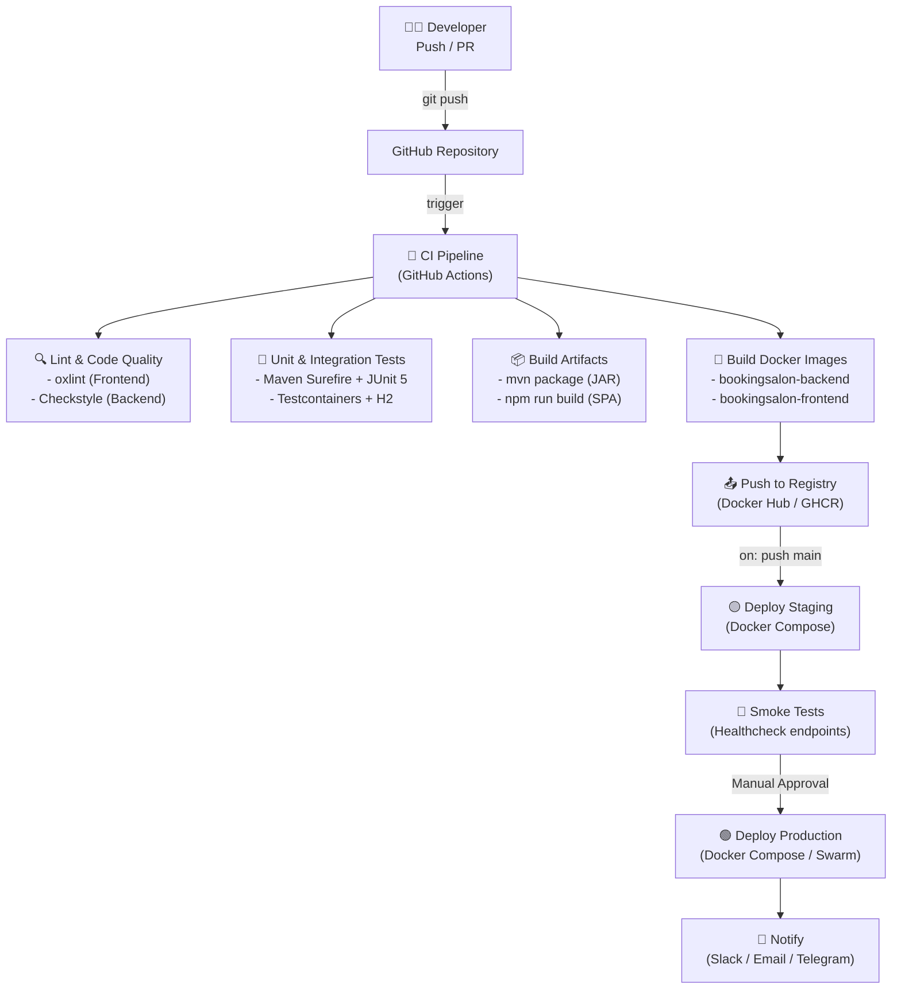
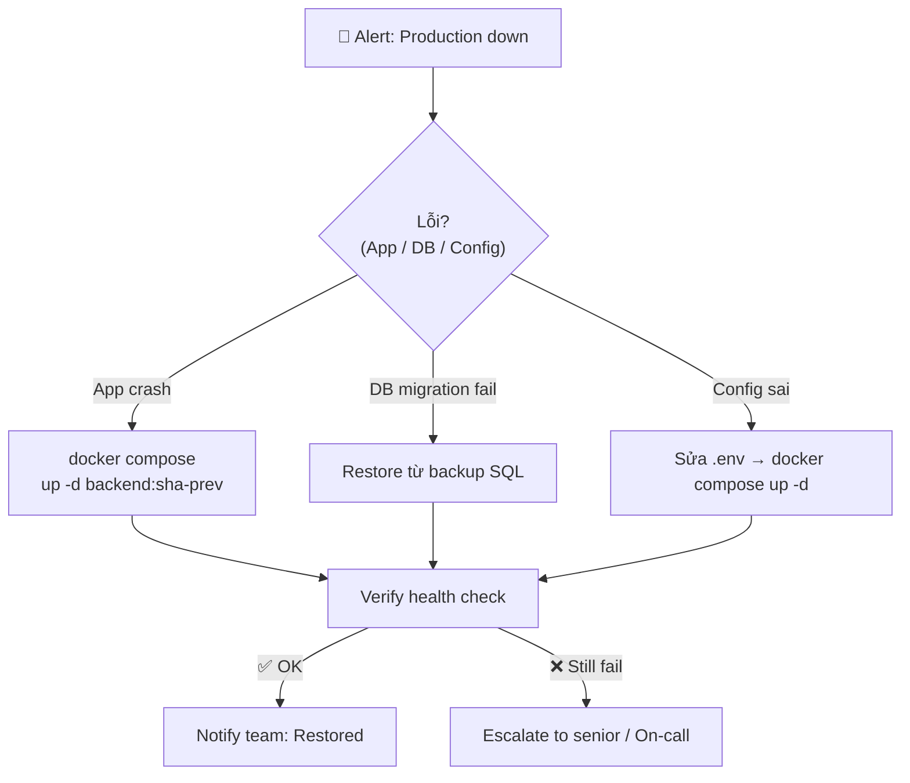

# 🚀 CI/CD Tutorial — BookingSalon

> Hướng dẫn thiết lập quy trình Tích hợp liên tục & Triển khai liên tục (CI/CD) toàn diện cho dự án **BookingSalon** sử dụng **GitHub Actions** + **Docker Hub** + **VPS/Cloud**.

---

## 📋 Mục lục

1. [Tổng quan kiến trúc CI/CD](#1-tổng-quan-kiến-trúc-cicd)
2. [Tech Stack & Môi trường](#2-tech-stack--môi-trường)
3. [Chiến lược Branch & Git Flow](#3-chiến-lược-branch--git-flow)
4. [Cấu trúc thư mục CI/CD](#4-cấu-trúc-thư-mục-cicd)
5. [Giai đoạn CI — Continuous Integration](#5-giai-đoạn-ci--continuous-integration)
6. [Giai đoạn CD — Continuous Delivery/Deployment](#6-giai-đoạn-cd--continuous-deliverydeployment)
7. [GitHub Actions Workflows chi tiết](#7-github-actions-workflows-chi-tiết)
8. [Quản lý Secrets & Environment Variables](#8-quản-lý-secrets--environment-variables)
9. [Chiến lược Docker Image & Registry](#9-chiến-lược-docker-image--registry)
10. [Database Migration trong CI/CD (Flyway)](#10-database-migration-trong-cicd-flyway)
11. [Rollback & Recovery](#11-rollback--recovery)
12. [Monitoring & Alerting sau Deploy](#12-monitoring--alerting-sau-deploy)
13. [Checklist vận hành](#13-checklist-vận-hành)

---

## 1. Tổng quan kiến trúc CI/CD



### Luồng tổng quát

| Sự kiện | Pipeline kích hoạt |
|---|---|
| PR vào `develop` | CI: Lint → Test → Build (không push image) |
| Push lên `develop` | CI đầy đủ + Deploy Staging |
| Push lên `main` | CI đầy đủ + Deploy Production (sau approval) |
| Push tag `v*.*.*` | CI + Build image tag versioned + Release notes |

---

## 2. Tech Stack & Môi trường

### Hệ thống dịch vụ

| Service | Image/Version | Port | Vai trò |
|---|---|---|---|
| **MySQL** | `mysql:8.0` | 3307 → 3306 | Cơ sở dữ liệu chính |
| **Redis** | `redis:7-alpine` | 6379 | Cache & Distributed Lock |
| **Keycloak** | `keycloak:26.7.0` | 8081 → 8080 | IAM / OAuth2 / SSO |
| **Backend** | `eclipse-temurin:21` | 8080 | Spring Boot 3.5.3 BFF API |
| **Frontend** | `nginx:alpine` | 80, 5173 | React 19 SPA |

### Backend Dependencies (Spring Boot 3.5.3 / Java 21)

- Spring Web, JPA, Security, OAuth2 Resource Server
- Keycloak Admin Client 26.0.5
- Flyway Migration (MySQL)
- Redis (Lettuce + Commons Pool2)
- WebSocket, WebFlux (WebClient)
- ShedLock (distributed scheduler)
- Cloudinary, VNPay, SePay integrations
- **Testing:** JUnit 5, Testcontainers, H2, Spring Security Test

### Frontend Dependencies (React 19 / Node 22)

- Vite 8 (build tool)
- React Router 7, Redux Toolkit
- Ant Design 6, Tailwind CSS 3
- Keycloak-JS 26
- **Linting:** oxlint

---

## 3. Chiến lược Branch & Git Flow

```
main          ──────────────────────────────────────►  Production
                ↑ (PR + Approval)
develop       ──────────────────────────────────────►  Staging
                ↑ (PR)
feature/*     ──────────────────────────────────────►  Dev local
hotfix/*      ──────────────────────────────────────►  Hotfix → main + develop
release/*     ──────────────────────────────────────►  Release candidate
```

### Quy tắc bảo vệ branch

```
main:
  - Require PR + 1 reviewer approval
  - Require all CI checks pass
  - No direct push

develop:
  - Require CI checks pass
  - Squash merge từ feature/*
```

---

## 4. Cấu trúc thư mục CI/CD

```
BookingSalon/
├── .github/
│   └── workflows/
│       ├── ci.yml                    # CI chính: Lint, Test, Build
│       ├── cd-staging.yml            # Deploy lên môi trường Staging
│       ├── cd-production.yml         # Deploy lên Production (có approval)
│       └── release.yml               # Tạo versioned release
│
├── backend/
│   ├── Dockerfile                    # Multi-stage: JDK 21 builder → JRE runtime
│   └── .dockerignore
│
├── frontend/
│   ├── Dockerfile                    # Multi-stage: Node 22 builder → Nginx
│   └── .dockerignore
│
├── docker-compose.yml                # Local & Production compose
├── docker-compose.staging.yml        # Override cho Staging
├── docker-compose.prod.yml           # Override cho Production
├── .env.example                      # Template biến môi trường
└── CI_CD_Tutorial.md                 # File này
```

---

## 5. Giai đoạn CI — Continuous Integration

### 5.1 Trigger

```yaml
on:
  pull_request:
    branches: [main, develop]
  push:
    branches: [develop, main]
```

### 5.2 Job 1: Backend CI

```
┌─────────────────────────────────────────────────────────┐
│  JOB: backend-ci   (ubuntu-latest, Java 21 + Maven)     │
├─────────────────────────────────────────────────────────┤
│  Step 1: Checkout code                                  │
│  Step 2: Setup JDK 21 (eclipse-temurin)                 │
│  Step 3: Cache Maven ~/.m2                              │
│  Step 4: mvn verify -B                                  │
│          → Compile                                      │
│          → Unit Tests (H2 in-memory)                    │
│          → Integration Tests (Testcontainers MySQL)     │
│          → Generate Surefire HTML Report               │
│  Step 5: Upload test reports (artifact)                 │
│  Step 6: Build Docker image (no push on PR)            │
└─────────────────────────────────────────────────────────┘
```

#### Các test suite hiện có

| Test Class | Loại | Mô tả |
|---|---|---|
| `BookingSalonApplicationTests` | Integration | Spring context load |
| `BookingLifecycleUnitTest` | Unit | Booking state machine |
| `CreateBookingTest` | Integration | Tạo booking end-to-end |
| `AdminShopControllerUnitTest` | Unit | Controller layer |
| `AdminShopIntegrationTest` | Integration | Shop CRUD API |
| `PaymentControllerTest` | Unit | Payment endpoints |
| `PaymentRepositoryTest` | Integration | JPA repository |
| `PaymentServiceTest` | Unit | Business logic |
| `PaymentWebhookIntegrationTest` | Integration | VNPay/SePay webhook |
| `PaymentWebhookServiceUnitTest` | Unit | Webhook handler |
| `AdminStylistAndSalonUnitTest` | Unit | Stylist & Salon |
| `CreateSalonTest` | Integration | Salon creation flow |
| `VoucherEngineUnitTest` | Unit | Voucher calculation |

### 5.3 Job 2: Frontend CI

```
┌─────────────────────────────────────────────────────────┐
│  JOB: frontend-ci  (ubuntu-latest, Node 22)             │
├─────────────────────────────────────────────────────────┤
│  Step 1: Checkout code                                  │
│  Step 2: Setup Node.js 22                               │
│  Step 3: Cache node_modules                             │
│  Step 4: npm ci (clean install)                        │
│  Step 5: npm run lint (oxlint)                         │
│  Step 6: npm run build (Vite production build)         │
│  Step 7: Upload dist/ artifact (optional)              │
└─────────────────────────────────────────────────────────┘
```

### 5.4 Job 3: Docker Build & Push

> Chỉ chạy khi push lên `develop` hoặc `main` (không chạy trên PR)

```
┌─────────────────────────────────────────────────────────┐
│  JOB: docker-build  (needs: backend-ci, frontend-ci)    │
├─────────────────────────────────────────────────────────┤
│  Step 1: Set up Docker Buildx                           │
│  Step 2: Login to Docker Hub                            │
│  Step 3: Extract metadata (tags, labels)               │
│  Step 4: Build & Push Backend image                    │
│          Tag: youruser/bookingsalon-backend:sha-xxxxx   │
│               youruser/bookingsalon-backend:develop     │
│               youruser/bookingsalon-backend:latest      │
│  Step 5: Build & Push Frontend image                   │
│          (với --build-arg VITE_* từ Secrets)           │
└─────────────────────────────────────────────────────────┘
```

---

## 6. Giai đoạn CD — Continuous Delivery/Deployment

### 6.1 Staging Deploy (tự động)

```
Trigger: push to develop
┌───────────────────────────────────────────────────────────────┐
│  JOB: deploy-staging  (self-hosted runner OR ssh to VPS)      │
├───────────────────────────────────────────────────────────────┤
│  Step 1: SSH vào staging server                               │
│  Step 2: Pull image mới nhất                                  │
│          docker pull youruser/bookingsalon-backend:develop     │
│          docker pull youruser/bookingsalon-frontend:develop    │
│  Step 3: Backup DB snapshot (mysqldump)                       │
│  Step 4: docker compose -f docker-compose.staging.yml up -d   │
│          → MySQL, Redis, Keycloak (nếu cần)                   │
│          → backend (Flyway migration tự chạy)                 │
│          → frontend                                           │
│  Step 5: Health check (curl /actuator/health)                 │
│  Step 6: Smoke test API endpoints                             │
└───────────────────────────────────────────────────────────────┘
```

### 6.2 Production Deploy (có approval)

```
Trigger: push to main
┌───────────────────────────────────────────────────────────────┐
│  JOB: deploy-production                                       │
│  environment: production (requires manual approval)           │
├───────────────────────────────────────────────────────────────┤
│  Step 1: Manual approval từ maintainer                        │
│  Step 2: SSH vào production server                            │
│  Step 3: Backup database đầy đủ (mysqldump → S3/GCS)         │
│  Step 4: Blue-Green / Rolling update                          │
│          → Pull image :main tag                               │
│          → docker compose up -d --no-deps backend             │
│          → Wait health check pass                             │
│          → docker compose up -d --no-deps frontend            │
│  Step 5: Verify deployment                                    │
│  Step 6: Notify team (Slack / Telegram)                       │
└───────────────────────────────────────────────────────────────┘
```

---

## 7. GitHub Actions Workflows chi tiết

### 7.1 `.github/workflows/ci.yml`

```yaml
name: CI — Lint, Test & Build

on:
  push:
    branches: [develop, main]
  pull_request:
    branches: [develop, main]

jobs:
  backend-ci:
    name: Backend CI (Java 21 / Spring Boot)
    runs-on: ubuntu-latest

    steps:
      - name: Checkout source
        uses: actions/checkout@v4

      - name: Set up JDK 21 (Eclipse Temurin)
        uses: actions/setup-java@v4
        with:
          java-version: '21'
          distribution: 'temurin'
          cache: 'maven'

      - name: Cache Maven packages
        uses: actions/cache@v4
        with:
          path: ~/.m2/repository
          key: ${{ runner.os }}-maven-${{ hashFiles('backend/pom.xml') }}
          restore-keys: |
            ${{ runner.os }}-maven-

      - name: Run tests & build JAR
        working-directory: ./backend
        run: mvn verify -B -Dfile.encoding=UTF-8
        env:
          SPRING_PROFILES_ACTIVE: test

      - name: Upload test report
        if: always()
        uses: actions/upload-artifact@v4
        with:
          name: backend-test-results
          path: backend/target/surefire-reports/

  frontend-ci:
    name: Frontend CI (React 19 / Node 22)
    runs-on: ubuntu-latest

    steps:
      - name: Checkout source
        uses: actions/checkout@v4

      - name: Set up Node.js 22
        uses: actions/setup-node@v4
        with:
          node-version: '22'
          cache: 'npm'
          cache-dependency-path: frontend/package-lock.json

      - name: Install dependencies
        working-directory: ./frontend
        run: npm ci

      - name: Lint (oxlint)
        working-directory: ./frontend
        run: npm run lint

      - name: Build (Vite)
        working-directory: ./frontend
        run: npm run build
        env:
          VITE_API_URL: ${{ vars.VITE_API_URL_STAGING || 'http://localhost:8080' }}
          VITE_KEYCLOAK_URL: ${{ vars.VITE_KEYCLOAK_URL_STAGING || 'http://localhost:8081' }}
          VITE_KEYCLOAK_REALM: booking-salon-realm
          VITE_KEYCLOAK_CLIENT_ID: booking-salon-client

  docker-build:
    name: Build & Push Docker Images
    runs-on: ubuntu-latest
    needs: [backend-ci, frontend-ci]
    if: github.event_name == 'push'

    steps:
      - name: Checkout source
        uses: actions/checkout@v4

      - name: Set up Docker Buildx
        uses: docker/setup-buildx-action@v3

      - name: Login to Docker Hub
        uses: docker/login-action@v3
        with:
          username: ${{ secrets.DOCKERHUB_USERNAME }}
          password: ${{ secrets.DOCKERHUB_TOKEN }}

      - name: Extract Docker metadata (Backend)
        id: meta-backend
        uses: docker/metadata-action@v5
        with:
          images: ${{ secrets.DOCKERHUB_USERNAME }}/bookingsalon-backend
          tags: |
            type=ref,event=branch
            type=sha,prefix=sha-
            type=raw,value=latest,enable=${{ github.ref == 'refs/heads/main' }}

      - name: Build & Push Backend image
        uses: docker/build-push-action@v5
        with:
          context: ./backend
          file: ./backend/Dockerfile
          push: true
          tags: ${{ steps.meta-backend.outputs.tags }}
          labels: ${{ steps.meta-backend.outputs.labels }}
          cache-from: type=gha
          cache-to: type=gha,mode=max

      - name: Extract Docker metadata (Frontend)
        id: meta-frontend
        uses: docker/metadata-action@v5
        with:
          images: ${{ secrets.DOCKERHUB_USERNAME }}/bookingsalon-frontend
          tags: |
            type=ref,event=branch
            type=sha,prefix=sha-
            type=raw,value=latest,enable=${{ github.ref == 'refs/heads/main' }}

      - name: Build & Push Frontend image
        uses: docker/build-push-action@v5
        with:
          context: ./frontend
          file: ./frontend/Dockerfile
          push: true
          tags: ${{ steps.meta-frontend.outputs.tags }}
          labels: ${{ steps.meta-frontend.outputs.labels }}
          build-args: |
            VITE_API_URL=${{ secrets.VITE_API_URL_PROD }}
            VITE_WS_URL=${{ secrets.VITE_WS_URL_PROD }}
            VITE_KEYCLOAK_URL=${{ secrets.VITE_KEYCLOAK_URL_PROD }}
            VITE_KEYCLOAK_REALM=booking-salon-realm
            VITE_KEYCLOAK_CLIENT_ID=booking-salon-client
          cache-from: type=gha
          cache-to: type=gha,mode=max
```

### 7.2 `.github/workflows/cd-staging.yml`

```yaml
name: CD — Deploy Staging

on:
  workflow_run:
    workflows: ["CI — Lint, Test & Build"]
    branches: [develop]
    types: [completed]

jobs:
  deploy-staging:
    name: Deploy to Staging
    runs-on: ubuntu-latest
    if: ${{ github.event.workflow_run.conclusion == 'success' }}
    environment: staging

    steps:
      - name: Deploy via SSH
        uses: appleboy/ssh-action@v1
        with:
          host: ${{ secrets.STAGING_HOST }}
          username: ${{ secrets.STAGING_USER }}
          key: ${{ secrets.STAGING_SSH_KEY }}
          script: |
            set -e
            cd /opt/bookingsalon

            echo "📥 Pulling latest images..."
            docker pull ${{ secrets.DOCKERHUB_USERNAME }}/bookingsalon-backend:develop
            docker pull ${{ secrets.DOCKERHUB_USERNAME }}/bookingsalon-frontend:develop

            echo "💾 Backing up database..."
            docker exec bookingsalon_mysql mysqldump \
              -u root -p"$DB_PASSWORD" bookingsalon_app \
              > /backup/bookingsalon_staging_$(date +%Y%m%d_%H%M%S).sql

            echo "🚀 Starting services..."
            docker compose -f docker-compose.yml \
                           -f docker-compose.staging.yml \
              up -d --no-deps backend frontend

            echo "⏳ Waiting for backend to be healthy..."
            sleep 30
            curl -f http://localhost:8080/actuator/health || exit 1

            echo "✅ Staging deploy successful!"

      - name: Notify on failure
        if: failure()
        run: |
          echo "❌ Staging deployment FAILED!"
          # Gọi webhook Slack/Telegram ở đây
```

### 7.3 `.github/workflows/cd-production.yml`

```yaml
name: CD — Deploy Production

on:
  push:
    branches: [main]

jobs:
  deploy-production:
    name: Deploy to Production
    runs-on: ubuntu-latest
    environment:
      name: production
      url: https://yourdomain.com

    steps:
      - name: Deploy via SSH
        uses: appleboy/ssh-action@v1
        with:
          host: ${{ secrets.PROD_HOST }}
          username: ${{ secrets.PROD_USER }}
          key: ${{ secrets.PROD_SSH_KEY }}
          script: |
            set -e
            cd /opt/bookingsalon

            echo "💾 Full database backup before deploy..."
            BACKUP_FILE="/backup/prod_$(date +%Y%m%d_%H%M%S).sql.gz"
            docker exec bookingsalon_mysql mysqldump \
              -u root -p"$DB_PASSWORD" \
              --single-transaction --quick bookingsalon_app \
              | gzip > "$BACKUP_FILE"
            echo "Backup saved: $BACKUP_FILE"

            echo "📥 Pull latest production images..."
            docker pull ${{ secrets.DOCKERHUB_USERNAME }}/bookingsalon-backend:main
            docker pull ${{ secrets.DOCKERHUB_USERNAME }}/bookingsalon-frontend:main

            echo "🚀 Rolling update — Backend first (Flyway migration auto-runs)..."
            docker compose -f docker-compose.yml \
                           -f docker-compose.prod.yml \
              up -d --no-deps backend

            echo "⏳ Verifying backend health..."
            for i in {1..12}; do
              if curl -sf http://localhost:8080/actuator/health; then
                echo "Backend is healthy!"
                break
              fi
              echo "Attempt $i/12 — waiting 10s..."
              sleep 10
              if [ "$i" -eq 12 ]; then
                echo "❌ Backend health check failed! Rolling back..."
                docker compose up -d --no-deps backend  # rollback to previous
                exit 1
              fi
            done

            echo "🚀 Deploying Frontend..."
            docker compose -f docker-compose.yml \
                           -f docker-compose.prod.yml \
              up -d --no-deps frontend

            echo "✅ Production deploy complete!"

      - name: Send success notification
        if: success()
        run: |
          echo "🎉 Production deployment SUCCESS: $(date)"
          # curl -X POST https://api.telegram.org/bot${{ secrets.TG_BOT_TOKEN }}/sendMessage ...

      - name: Send failure notification
        if: failure()
        run: |
          echo "🚨 Production deployment FAILED!"
```

---

## 8. Quản lý Secrets & Environment Variables

### 8.1 GitHub Repository Secrets

Vào **Settings → Secrets and variables → Actions** và thêm:

#### Docker Registry

| Secret Name | Giá trị |
|---|---|
| `DOCKERHUB_USERNAME` | Username Docker Hub |
| `DOCKERHUB_TOKEN` | Access Token Docker Hub |

#### Staging Server

| Secret Name | Giá trị |
|---|---|
| `STAGING_HOST` | IP/Domain staging server |
| `STAGING_USER` | SSH username (vd: `ubuntu`) |
| `STAGING_SSH_KEY` | Private SSH key (RSA/ED25519) |

#### Production Server

| Secret Name | Giá trị |
|---|---|
| `PROD_HOST` | IP/Domain production server |
| `PROD_USER` | SSH username |
| `PROD_SSH_KEY` | Private SSH key |

#### Application Secrets (Production)

| Secret Name | Tương ứng `.env` |
|---|---|
| `DB_PASSWORD` | `DB_PASSWORD` |
| `REDIS_PASSWORD` | `REDIS_PASSWORD` |
| `KEYCLOAK_CLIENT_SECRET` | `KEYCLOAK_CLIENT_SECRET` |
| `KEYCLOAK_IDP_GOOGLE_CLIENT_ID` | `KEYCLOAK_IDP_GOOGLE_CLIENT_ID` |
| `KEYCLOAK_IDP_GOOGLE_CLIENT_SECRET` | `KEYCLOAK_IDP_GOOGLE_CLIENT_SECRET` |
| `VNPAY_TMN_CODE` | `VNPAY_TMN_CODE` |
| `VNPAY_HASH_SECRET` | `VNPAY_HASH_SECRET` |
| `SEPAY_MERCHANT_ID` | `SEPAY_MERCHANT_ID` |
| `SEPAY_SECRET_KEY` | `SEPAY_SECRET_KEY` |
| `CLOUDINARY_CLOUD_NAME` | `CLOUDINARY_CLOUD_NAME` |
| `CLOUDINARY_API_KEY` | `CLOUDINARY_API_KEY` |
| `CLOUDINARY_API_SECRET` | `CLOUDINARY_API_SECRET` |
| `MAIL_USERNAME` | `MAIL_USERNAME` |
| `MAIL_PASSWORD` | `MAIL_PASSWORD` |
| `PAYMENT_WEBHOOK_SECRET` | `PAYMENT_WEBHOOK_SECRET` |

#### Frontend Build Args

| Secret/Variable | Giá trị |
|---|---|
| `VITE_API_URL_PROD` | `https://api.yourdomain.com` |
| `VITE_WS_URL_PROD` | `wss://api.yourdomain.com` |
| `VITE_KEYCLOAK_URL_PROD` | `https://auth.yourdomain.com` |

### 8.2 File `.env` trên Server

Tạo file `/opt/bookingsalon/.env` trên server (không commit vào git):

```bash
# Database
DB_NAME=bookingsalon_app
DB_USERNAME=bookingsalon_user
DB_PASSWORD=<strong_password>
HOST_DB_PORT=3307

# Redis
REDIS_PASSWORD=<redis_password>
REDIS_PORT=6379

# Keycloak
KEYCLOAK_CLIENT_SECRET=<secret>
KEYCLOAK_IDP_GOOGLE_CLIENT_ID=<google_client_id>
KEYCLOAK_IDP_GOOGLE_CLIENT_SECRET=<google_client_secret>

# VNPay
VNPAY_TMN_CODE=<code>
VNPAY_HASH_SECRET=<secret>
VNPAY_PAY_URL=https://sandbox.vnpayment.vn/paymentv2/vpcpay.html
VNPAY_RETURN_URL=https://api.yourdomain.com/api/v1/payments/webhook/vnpay/return
VNPAY_NOTIFY_URL=https://api.yourdomain.com/api/v1/payments/webhook/vnpay
VNPAY_SIMULATOR_MODE=false

# SePay
SEPAY_MERCHANT_ID=<id>
SEPAY_SECRET_KEY=<secret>
SEPAY_API_BASE_URL=https://my.sepay.vn/userapi
SEPAY_WEBHOOK_API_KEY=<key>
SEPAY_ENV=production

# Payment
PAYMENT_BANK_BIN=970422
PAYMENT_BANK_ACCOUNT=0866429205
PAYMENT_WEBHOOK_SECRET=<secret>

# Mail
MAIL_HOST=smtp.gmail.com
MAIL_PORT=587
MAIL_USERNAME=<email>
MAIL_PASSWORD=<app_password>

# Cloudinary
CLOUDINARY_CLOUD_NAME=<name>
CLOUDINARY_API_KEY=<key>
CLOUDINARY_API_SECRET=<secret>

# JPA
JPA_DDL_AUTO=validate
```

---

## 9. Chiến lược Docker Image & Registry

### 9.1 Naming Convention

```
<registry>/<username>/bookingsalon-<service>:<tag>

Tags:
  :latest          → branch main (production)
  :main            → branch main
  :develop         → branch develop (staging)
  :sha-abc1234     → commit SHA (traceability)
  :v1.2.3          → semantic version (từ git tag)
```

### 9.2 Multi-stage Build tối ưu

**Backend** (đã có):
- Stage 1: `eclipse-temurin:21-jdk-alpine` — compile + package
- Stage 2: `eclipse-temurin:21-jre-alpine` — runtime nhẹ, non-root user

**Frontend** (đã có):
- Stage 1: `node:22-alpine` — `npm ci` + `vite build`
- Stage 2: `nginx:alpine` — serve static SPA

### 9.3 Tối ưu Build Cache

```yaml
# Trong Dockerfile backend — đã áp dụng layer cache tốt:
COPY pom.xml .
RUN mvn dependency:go-offline -B   # Cache dependencies
COPY src ./src
RUN mvn clean package -DskipTests  # Build chỉ khi code thay đổi

# Trong Dockerfile frontend — đã áp dụng:
COPY package*.json ./
RUN npm ci                          # Cache node_modules
COPY . .
RUN npm run build
```

> [!TIP]
> Sử dụng `cache-from: type=gha` và `cache-to: type=gha,mode=max` trong GitHub Actions để tái dùng Docker layer cache giữa các lần chạy, giảm thời gian build từ ~5 phút xuống còn ~1-2 phút.

---

## 10. Database Migration trong CI/CD (Flyway)

### 10.1 Quy trình tự động

Khi backend container khởi động, **Flyway tự động chạy migration** trước khi Spring Boot serve request:

```
Container Start
    ↓
Flyway checks flyway_schema_history table
    ↓
Apply pending migrations từ classpath:db/migration/*
    ↓
Apply test data từ classpath:db/test-data/* (staging only)
    ↓
Spring Boot starts (JPA validate mode)
    ↓
Ready to serve
```

### 10.2 Cấu hình Flyway theo môi trường

```bash
# docker-compose.yml (hiện tại):
SPRING_FLYWAY_LOCATIONS: classpath:db/migration,classpath:db/test-data
SPRING_FLYWAY_VALIDATE_ON_MIGRATE: "false"
SPRING_FLYWAY_OUT_OF_ORDER: "true"

# Production — chỉ migration, không seed test data:
SPRING_FLYWAY_LOCATIONS: classpath:db/migration
SPRING_FLYWAY_VALIDATE_ON_MIGRATE: "true"
SPRING_FLYWAY_OUT_OF_ORDER: "false"
```

### 10.3 Tạo file Override cho Production

`docker-compose.prod.yml`:
```yaml
services:
  backend:
    environment:
      SPRING_FLYWAY_LOCATIONS: classpath:db/migration
      SPRING_FLYWAY_VALIDATE_ON_MIGRATE: "true"
      SPRING_FLYWAY_OUT_OF_ORDER: "false"
      JPA_DDL_AUTO: validate
      CORS_ALLOWED_ORIGINS: https://yourdomain.com
      FRONTEND_URL: https://yourdomain.com
      KEYCLOAK_SERVER_URL: http://keycloak:8080
      KEYCLOAK_PUBLIC_URL: https://auth.yourdomain.com
```

### 10.4 Quy ước đặt tên file migration

```
V{version}__{description}.sql

Ví dụ:
  V1__init_schema.sql
  V2__add_booking_table.sql
  V3__add_payment_indexes.sql
  V4__add_voucher_engine.sql

Không bao giờ sửa file đã commit — chỉ tạo file mới!
```

> [!CAUTION]
> **KHÔNG BAO GIỜ** sửa đổi file migration đã được merge vào `main`. Điều này sẽ gây lỗi checksum Flyway trên production và có thể crash deployment. Nếu cần sửa, hãy tạo migration mới (`V_next__fix_description.sql`).

---

## 11. Rollback & Recovery

### 11.1 Rollback Docker Image

```bash
# Xem lịch sử image đã pull:
docker images youruser/bookingsalon-backend --format "{{.Tag}}\t{{.CreatedAt}}"

# Rollback về commit trước:
docker compose stop backend
docker tag youruser/bookingsalon-backend:sha-abc1234 youruser/bookingsalon-backend:latest
docker compose up -d --no-deps backend
```

### 11.2 Rollback Database (nếu cần)

```bash
# Restore từ backup:
docker exec -i bookingsalon_mysql mysql \
  -u root -p"$DB_PASSWORD" bookingsalon_app \
  < /backup/prod_20261023_130000.sql

# Hoặc dùng Flyway repair (nếu lỗi checksum):
docker exec bookingsalon_backend java -jar app.jar \
  --spring.flyway.repair=true
```

### 11.3 Quy trình khẩn cấp (Emergency Rollback)



---

## 12. Monitoring & Alerting sau Deploy

### 12.1 Health Check Endpoints

| Endpoint | Service | Mục đích |
|---|---|---|
| `GET /actuator/health` | Backend | Spring Boot health (DB, Redis) |
| `GET /health/ready` (port 9000) | Keycloak | Keycloak readiness |
| `GET /` | Frontend (Nginx) | Nginx serving |
| `mysqladmin ping` | MySQL | DB connectivity |
| `redis-cli ping` | Redis | Cache connectivity |

### 12.2 Uptime Monitoring (Đề xuất)

Dùng một trong các tool sau để monitor sau khi deploy:

- **[UptimeRobot](https://uptimerobot.com)** — free, check mỗi 5 phút
- **[Better Stack](https://betterstack.com)** — free tier, HTTP checks + alert Slack
- **Grafana + Prometheus** (nếu có VPS) — self-hosted monitoring

### 12.3 Notification tích hợp vào Workflow

```yaml
# Slack notification (thêm vào cuối mỗi CD job)
- name: Notify Slack
  uses: slackapi/slack-github-action@v1
  with:
    channel-id: 'C012AB3CD'
    slack-message: |
      *BookingSalon Deploy ${{ job.status }}* 🚀
      Branch: `${{ github.ref_name }}`
      Commit: `${{ github.sha }}`
      Actor: ${{ github.actor }}
      Time: ${{ github.event.head_commit.timestamp }}
  env:
    SLACK_BOT_TOKEN: ${{ secrets.SLACK_BOT_TOKEN }}
```

---

## 13. Checklist vận hành

### ✅ Checklist trước khi bắt đầu triển khai CI/CD

#### Hạ tầng
- [ ] VPS/Cloud server đã được provisioned (khuyến nghị: Ubuntu 22.04 LTS)
- [ ] Docker & Docker Compose đã được cài trên server
- [ ] SSH key pair đã được tạo và thêm vào server
- [ ] Domain và SSL certificate đã được cấu hình (Let's Encrypt / Cloudflare)
- [ ] Firewall rules: mở port 80, 443; đóng 3307, 6379, 8081

#### GitHub Repository
- [ ] Branch protection rules đã được bật (`main`, `develop`)
- [ ] Tất cả Secrets đã được thêm vào GitHub Repository Settings
- [ ] GitHub Environment `staging` và `production` đã được tạo
- [ ] Reviewer cho `production` environment đã được chỉ định

#### Docker
- [ ] Docker Hub account đã được tạo
- [ ] Repository `bookingsalon-backend` và `bookingsalon-frontend` đã được tạo (public/private)
- [ ] Access Token Docker Hub đã được tạo (với quyền Read/Write)

#### Application
- [ ] File `.env` đã được tạo trên server (không commit vào git)
- [ ] `keycloak-import/booking-salon-realm-realm.json` đã được copy lên server
- [ ] `initData.sql` đã được copy lên server (cho lần đầu khởi tạo)
- [ ] Backup directory `/backup` đã được tạo trên server
- [ ] Thư mục `/opt/bookingsalon` đã được tạo và phân quyền đúng

### ✅ Checklist sau mỗi lần deploy Production

- [ ] Health check `GET /actuator/health` trả về `{"status":"UP"}`
- [ ] Keycloak login flow hoạt động
- [ ] Tạo booking thử nghiệm thành công
- [ ] Thanh toán (mock/sandbox) hoạt động
- [ ] WebSocket realtime notifications hoạt động
- [ ] Backup file mới được tạo trong `/backup`
- [ ] Không có lỗi ERROR trong docker logs

```bash
# Lệnh kiểm tra nhanh sau deploy:
docker compose ps
docker compose logs --tail=50 backend
curl -s http://localhost:8080/actuator/health | python3 -m json.tool
docker exec bookingsalon_mysql mysqladmin ping -u root -p"$DB_PASSWORD"
```

---

## 📎 Tài liệu tham khảo liên quan

| File | Mô tả |
|---|---|
| [`docker-compose.yml`](./docker-compose.yml) | Cấu hình container đầy đủ |
| [`backend/Dockerfile`](./backend/Dockerfile) | Multi-stage build backend |
| [`frontend/Dockerfile`](./frontend/Dockerfile) | Multi-stage build frontend |
| [`Production_Deployment_Guide.md`](./Production_Deployment_Guide.md) | Hướng dẫn deploy lên VPS |
| [`Docker_Packaging_And_Portability_Guide.md`](./Docker_Packaging_And_Portability_Guide.md) | Đóng gói Docker |
| [`DB_Migration_And_NonRoot_User_Guide.md`](./DB_Migration_And_NonRoot_User_Guide.md) | Flyway & DB migration |
| [`.env.example`](./.env.example) | Template biến môi trường |

---

> [!NOTE]
> File này mô tả **kế hoạch CI/CD đầy đủ**. Để bắt đầu nhanh, ưu tiên thực hiện theo thứ tự:
> 1. Tạo thư mục `.github/workflows/` và copy các file YAML từ Mục 7
> 2. Thêm Secrets vào GitHub (Mục 8)
> 3. Push code lên `develop` để test CI pipeline
> 4. Cấu hình server và chạy CD staging
> 5. Sau khi staging ổn định, kích hoạt CD production

---

*Tài liệu được tạo bởi Antigravity AI — BookingSalon DevOps Team — 2026*

