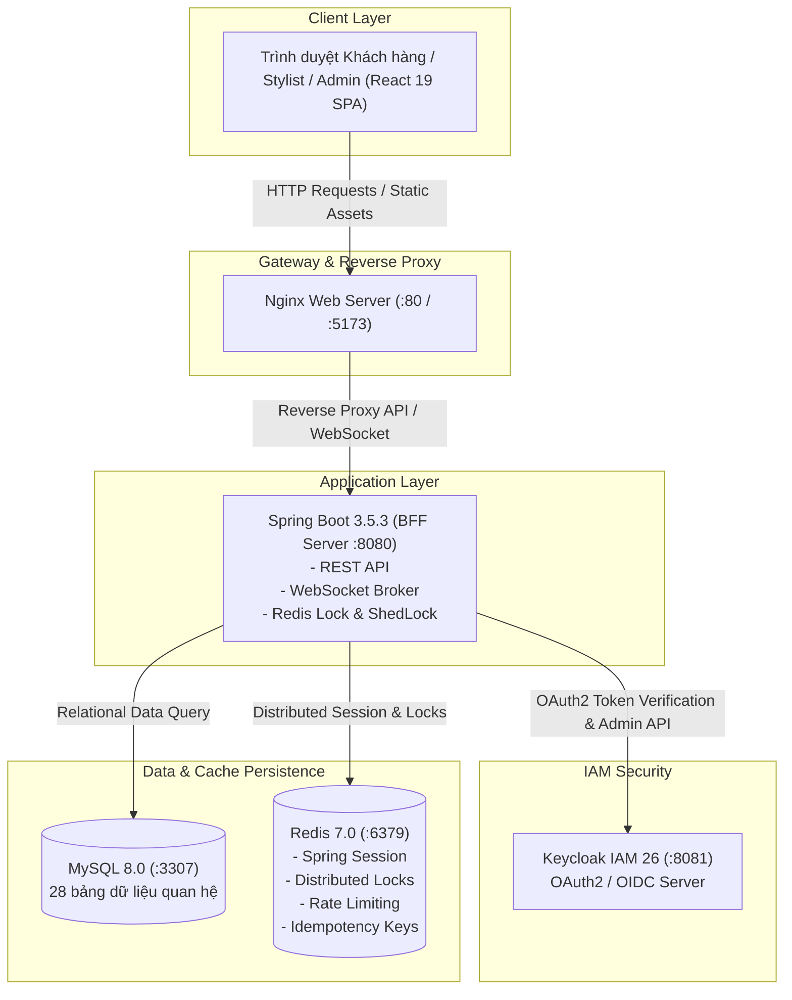
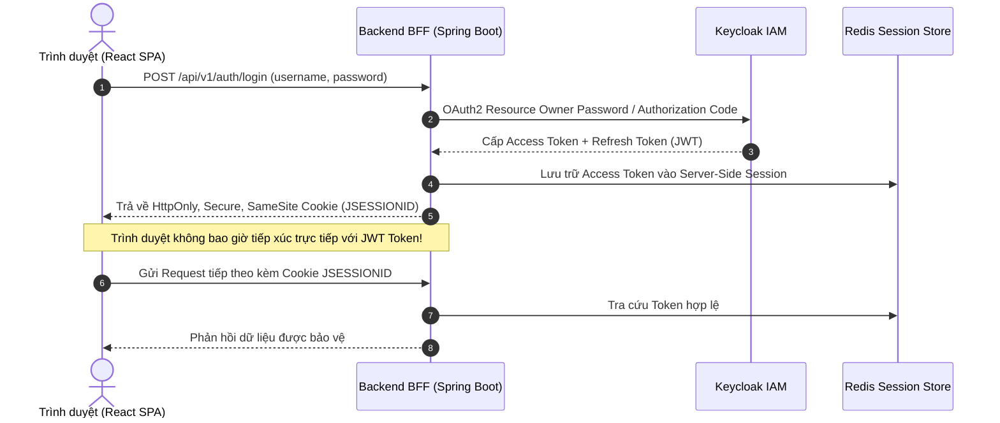
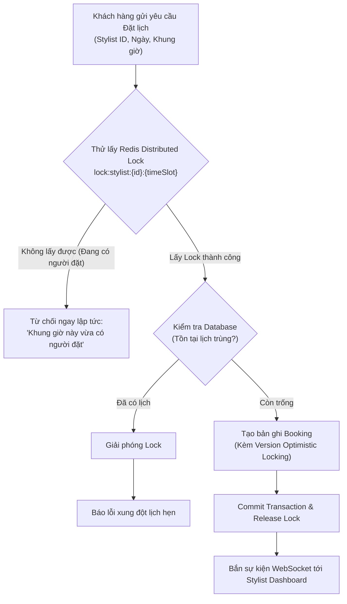
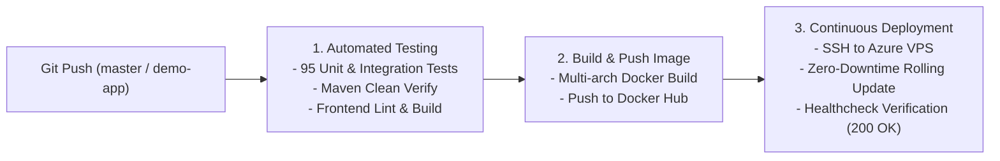

# ✂️ BookingSalon - Nền tảng Đặt lịch & Quản lý Chuỗi Salon Tóc Thông Minh

> Dự án xây dựng theo kiến trúc **BFF (Backend-For-Frontend)**, bảo mật định danh tập trung với **Keycloak SSO (OAuth2/OIDC)**, giao tiếp thời gian thực **WebSocket STOMP**, đồng bộ phiên phân tán với **Spring Session Redis**, và tối ưu hóa trải nghiệm người dùng với **React 19**.

---

## 📑 Mục lục
1. [Tổng quan Kiến trúc Hệ thống](#1-tổng-quan-kiến-trúc-hệ-thống)
2. [Cấu trúc Dự án Chuẩn mực (Project Layout)](#2-cấu-trúc-dự-án-chuẩn-mực-project-layout)
3. [Hướng dẫn Khởi chạy Nhanh (Zero-Config)](#3-hướng-dẫn-khởi-chạy-nhanh-zero-config)
4. [Danh sách Tài khoản Thử nghiệm](#4-danh-sách-tài-khoản-thử-nghiệm)
5. [Các Chức năng & Workflow Kỹ thuật Cốt lõi](#5-các-chức-năng--workflow-kỹ-thuật-cốt-lõi)
   - [Bảo mật BFF & Xác thực Keycloak](#51-bảo-mật-bff--xác-thực-keycloak)
   - [Đặt lịch & Chống Race Condition (Double-Booking)](#52-đặt-lịch--chống-race-condition-double-booking)
   - [Điều phối Lịch hẹn Thời gian thực (Real-time WebSocket)](#53-điều-phối-lịch-hẹn-thời-gian-thực-real-time-websocket)
   - [Thanh toán Trực tuyến & Idempotent Webhook](#54-thanh-toán-trực-tuyến--idempotent-webhook)
6. [Quy trình CI/CD Pipeline](#6-quy-trình-cicd-pipeline)
7. [Các lệnh Vận hành & Xử lý sự cố (Troubleshooting)](#7-các-lệnh-vận-hành--xử-lý-sự-cố-troubleshooting)

---

## 1. Tổng quan Kiến trúc Hệ thống

Hệ thống được thiết kế theo tiêu chuẩn công nghiệp nhằm đảm bảo tính **sẵn sàng cao (High Availability)**, **bảo mật tuyệt đối (Zero Trust)** và khả năng **mở rộng quy mô (Scalability)**:



### Điểm nhấn công nghệ:
* **Backend:** Java 21, Spring Boot 3.5.3, Spring Security 6 (OAuth2 Resource Server), Spring Data JPA, Spring WebSocket STOMP, Flyway Migration, Redisson.
* **Frontend:** React 19, Vite 8, Ant Design, Tailwind CSS, Redux Toolkit, StompJS/SockJS.
* **Identity & Access Management (IAM):** Keycloak 26.7 (Role-Based Access Control: `ADMIN`, `STYLIST`, `USER`).
* **Cache & Distributed State:** Redis 7 Alpine (Spring Session Redis, Rate Limiting Token Bucket, Idempotent Caching).
* **Cơ sở dữ liệu:** MySQL 8.0 (Đã nạp sẵn cấu trúc và dữ liệu thực tế cho 28 bảng).

---

## 2. Cấu trúc Dự án Chuẩn mực (Project Layout)

Dự án được tái cấu trúc theo các tiêu chuẩn công nghiệp (**Oracle & Google Java Style Guide**, **React Production Best Practices**):

```text
BookingSalon/
├── backend/                                # Spring Boot 3.5.3 (Java 21)
│   ├── src/main/java/demo/bookingsalon/
│   │   ├── config/                         # Các cấu hình hệ thống (Redis, Keycloak, Async, ShedLock...)
│   │   ├── controller/                     # REST API Controllers (Admin, Booking, Order, Stylist...)
│   │   │   └── keycloak/                   # Keycloak Admin Client Controllers
│   │   ├── dto/                            # Data Transfer Objects & Payloads
│   │   │   ├── admin/                      # DTO dành riêng cho Admin
│   │   │   ├── request/                    # Request Body (Business & Keycloak)
│   │   │   └── response/                   # API Response Wrapper (Business, Keycloak, Common Page)
│   │   ├── entity/                         # JPA Entities (28 bảng quan hệ)
│   │   ├── enums/                          # Hệ thống Enums chuẩn mực (tránh reserved keyword)
│   │   ├── event/                          # Domain Events nội bộ (Spring ApplicationEvent)
│   │   ├── exception/                      # Global Exception Handling & Custom Exceptions
│   │   ├── factory/                        # Factory Pattern khởi tạo Strategy
│   │   ├── handler/                        # WebSocket Session & STOMP Handler
│   │   ├── listener/                       # Async Event Listeners (Email, Payment)
│   │   ├── mapper/                         # MapStruct Mappers ánh xạ Entity <-> DTO
│   │   ├── publisher/                      # Event Publishers
│   │   ├── repository/                     # Spring Data JPA Repositories
│   │   ├── scheduler/                      # Cron Jobs & Scheduled Tasks (ShedLock)
│   │   ├── security/                       # Security Filters & Distributed Rate Limiting (Token Bucket)
│   │   ├── service/                        # Business Services & Keycloak Integration
│   │   │   └── idempotency/                # Redis Idempotent Execution Service
│   │   ├── storage/                        # Cloudinary Media Storage Strategy
│   │   ├── strategy/                       # Strategy Pattern thanh toán (VNPay, Sepay, COD, Bank)
│   │   ├── util/                           # Helper Utilities thuần túy (Signature, QR, Slug...)
│   │   └── validation/                     # Custom Validators
│   └── src/test/java/demo/bookingsalon/    # 95 Test Cases (Unit & Integration Tests)
│
├── frontend/                               # React 19 + Vite 8 SPA
│   ├── src/
│   │   ├── auth/                           # Keycloak OIDC Client & AuthProvider Context
│   │   ├── components/                     # Reusable Components phân tầng chuyên nghiệp
│   │   │   ├── layout/                     # Header, Footer, Navbar, Skeletons...
│   │   │   ├── common/                     # ErrorBoundary, ScrollToTop, PageTitle...
│   │   │   └── modals/                     # MediaUpload, Notification, Auth Modals...
│   │   ├── context/                        # Global State Contexts (Booking, Notification)
│   │   ├── hooks/                          # Custom Hooks (WebSocket STOMP, Review, Roles)
│   │   ├── pages/                          # Các trang nghiệp vụ (Gom nhóm theo Domain)
│   │   │   ├── Auth/                       # Login, Register, OTP Verification, OAuth2 Callback
│   │   │   ├── BookingPage/                # Luồng đặt lịch hẹn 5 bước
│   │   │   ├── CartPage/                   # Quản lý giỏ hàng độc lập
│   │   │   ├── ShopPage/                   # Cửa hàng sản phẩm chăm sóc tóc
│   │   │   ├── StylistPage/                # Dashboard điều phối lịch hẹn thợ
│   │   │   └── AdminPage/                  # Dashboard quản trị doanh thu & salon
│   │   ├── redux/                          # Redux Toolkit State Management
│   │   ├── routes/                         # Định tuyến AppRoutes & ProtectedRoute theo Role
│   │   └── services/                       # API Clients & WebSocket Services
│
├── keycloak-import/                        # File export cấu hình Realm & 18 tài khoản test
├── docker-compose.yml                      # Cấu hình cụm Docker 5 containers (Local Dev)
├── docker-compose.prod.yml                 # Cấu hình cụm Docker Production (VPS Azure)
├── initData.sql                            # Tự động nạp toàn bộ cấu trúc & dữ liệu 28 bảng
└── README.md                               # Hướng dẫn chi tiết dự án
```

---

## 3. Hướng dẫn Khởi chạy Nhanh (Zero-Config)

Dự án đã được đóng gói theo triết lý **Zero-Config**: Toàn bộ dữ liệu nghiệp vụ, cấu hình Realm Keycloak, tài khoản test và secret nội bộ đã được cấu hình sẵn fallback an toàn. Người mới clone dự án về **không cần tạo file `.env`** và **không cần cài đặt môi trường Java hay Node.js**.

### Yêu cầu tiên quyết:
* Máy tính đã cài đặt **[Docker Desktop](https://www.docker.com/products/docker-desktop/)** (hoặc Docker Engine & Docker Compose).
* Đảm bảo Docker Desktop đang ở trạng thái **Running**.

### Các bước thực hiện:

#### Bước 1: Clone kho mã nguồn về máy
```bash
git clone https://github.com/nguyenback/BookingSalon.git
cd BookingSalon
```

#### Bước 2: Khởi động toàn bộ cụm dịch vụ bằng 1 lệnh duy nhất
```bash
docker compose up -d --build
```
> *Lệnh này sẽ tự động tải các base images, biên dịch Backend Java 21, đóng gói Frontend React 19, tự động nạp cấu hình Keycloak Realm và nạp 28 bảng dữ liệu mẫu MySQL.*

#### Bước 3: Truy cập hệ thống qua trình duyệt

| Dịch vụ | Địa chỉ truy cập | Ghi chú |
| :--- | :--- | :--- |
| **Giao diện Web Khách hàng & Salon** | **[http://localhost](http://localhost)** *(hoặc [http://localhost:5173](http://localhost:5173))* | Ứng dụng React 19 SPA hoàn chỉnh |
| **Backend API (BFF Server)** | **[http://localhost:8080](http://localhost:8080)** | Spring Boot 3 RESTful APIs |
| **Keycloak Admin Console** | **[http://localhost:8081](http://localhost:8081)** | Quản trị IAM (`admin` / `admin`) |
| **MySQL Database** | `localhost:3308` | User: `bookingsalon_user` / Pass: `rootpassword123` |
| **Redis Cache** | `localhost:6379` | Database 0 (No password mặc định) |

---

## 4. Danh sách Tài khoản Thử nghiệm

Hệ thống đã nạp sẵn danh sách người dùng mẫu tương ứng với các quyền hạn khác nhau để bạn có thể đăng nhập trải nghiệm ngay lập tức:

> [!NOTE]
> **MẬT KHẨU CHUNG CHO TẤT CẢ TÀI KHOẢN DƯỚI ĐÂY:** `BachBarber@2026`

| Vai trò (Role) | Tên đăng nhập (Username) | Họ và tên | Chức năng có thể trải nghiệm |
| :--- | :--- | :--- | :--- |
| **👑 ADMIN** | `admin.bach` | Nguyễn Bách | Xem Dashboard thống kê doanh thu, quản lý danh sách salon, quản lý thợ cắt tóc, duyệt voucher, xem toàn bộ đơn hàng và lịch đặt. |
| **👑 ADMIN** | `admin.manager` | Trần Quản Lý | Quản lý vận hành hàng ngày của salon. |
| **✂️ STYLIST** | `alex.bach` | Alex Bach (Top Stylist) | Dashboard thợ: Xem lịch hẹn theo ca, nhận thông báo đặt lịch real-time, chuyển trạng thái phục vụ (Đang cắt $\rightarrow$ Hoàn thành). |
| **✂️ STYLIST** | `tony.tran` | Tony Trần | Dashboard thợ cắt tóc. |
| **✂️ STYLIST** | `ken.nguyen` | Ken Nguyễn | Dashboard thợ cắt tóc. |
| **✂️ STYLIST** | `leo.huy` | Leo Huy | Dashboard thợ cắt tóc. |
| **✂️ STYLIST** | `harry.pham` | Harry Phạm | Dashboard thợ cắt tóc. |
| **👤 CUSTOMER**| `nguyen.van.minh` | Nguyễn Văn Minh (Hạng Vàng) | Đặt lịch cắt tóc, chọn thợ, mua sản phẩm, thanh toán giả lập VNPay, xem lịch sử đặt hẹn. |
| **👤 CUSTOMER**| `tran.thi.lan` | Trần Thị Lan (Hạng Bạc) | Mua sắm sản phẩm chăm sóc tóc, quản lý giỏ hàng. |
| **👤 CUSTOMER**| `pham.thi.hoa` | Phạm Thị Hoa (Hạng VIP) | Đặt lịch dịch vụ cao cấp, áp dụng mã voucher VIP. |

---

## 5. Các Chức năng & Workflow Kỹ thuật Cốt lõi

### 5.1. Bảo mật BFF & Xác thực Keycloak
Dự án áp dụng mô hình **Backend-For-Frontend (BFF)** hiện đại nhằm loại bỏ nguy cơ rò rỉ JWT Token trên LocalStorage của trình duyệt:



* **Chống XSS/CSRF:** Access Token được cất giấu an toàn trên Server; Cookie trao đổi với client được gán cờ `HttpOnly`, `SameSite=Lax`.
* **Phân tán phiên:** Quản lý phiên bằng `Spring Session Redis`, cho phép Backend mở rộng không giới hạn mà không làm mất phiên đăng nhập của người dùng.
* **Distributed IP Rate Limiting:** Ứng dụng thuật toán Token Bucket phân tán qua Redis để chặn đứng tấn công brute-force vào các endpoint `/login` và `/otp`.

---

### 5.2. Đặt lịch & Chống Race Condition (Double-Booking)
Vấn đề nan giải nhất của hệ thống Salon là **nhiều khách hàng cùng bấm đặt 1 Stylist vào cùng 1 khung giờ tại cùng 1 giây**. Hệ thống giải quyết triệt để bằng cơ chế 3 lớp bảo vệ:



1. **Lớp 1 - Redis Distributed Lock:** Khóa tạm thời khung giờ của Stylist trong vài giây để xử lý tuần tự (Serializing requests).
2. **Lớp 2 - Database Unique & Optimistic Locking:** Cột `@Version` của JPA kết hợp với ràng buộc logic ngăn chặn ghi đè trạng thái.
3. **Lớp 3 - Retryable Pattern:** Tự động thử lại an toàn nếu phát hiện xung đột lạc quan tạm thời.

---

### 5.3. Điều phối Lịch hẹn Thời gian thực (Real-time WebSocket)
* **Giao thức:** Native WebSocket kết hợp STOMP Sub-protocol và SockJS fallback.
* **Độ trễ:** Dưới **50ms** từ khi khách hàng hoàn tất đặt lịch đến khi màn hình của Stylist hiển thị thẻ lịch hẹn mới.
* **Cơ chế chịu lỗi:** 
  * Tự động kết nối lại (Auto-reconnection) với chiến lược Exponential Backoff.
  * Nhịp tim (Heartbeat ping/pong 25s) duy trì kết nối bền vững qua proxy/firewall.
  * Phân luồng kênh thông báo: `/topic/stylist.{id}.schedule` và `/user/queue/notifications`.

---

### 5.4. Thanh toán Trực tuyến & Idempotent Webhook
* **VNPay Simulator Mode:** Tích hợp cổng thanh toán VNPay Sandbox với chế độ giả lập cục bộ (Local Simulator) giúp lập trình viên kiểm thử trọn vẹn luồng thanh toán mà không cần cấu hình IP tĩnh hay ngrok.
* **Sepay VietQR Automation:** Hỗ trợ quét mã QR ngân hàng tự động nhận diện giao dịch.
* **Chống thanh toán trùng lặp (Idempotent Webhook):**
  * Khi cổng thanh toán gửi Webhook IPN callback nhiều lần, Backend sử dụng khóa phân tán `idempotency:payment:{txnRef}` trên Redis để đảm bảo đơn hàng **chỉ được cập nhật trạng thái đúng 1 lần duy nhất**, triệt tiêu nguy cơ cộng tiền/giao dịch trùng lặp.

---

## 6. Quy trình CI/CD Pipeline

Mã nguồn được tích hợp quy trình kiểm thử và triển khai tự động qua **GitHub Actions** (`.github/workflows/ci.yml`):



* **Kiểm soát chất lượng (Automated Testing):**
  * Chạy toàn bộ **95 test cases** (Unit & Integration tests) kiểm thử toàn diện các service, controller, security, payment strategy: Order, Booking Lifecycle, Payment Webhook, Email OTP, Voucher Engine, Review, Rate Limiting...
  * Kiểm tra chất lượng mã nguồn Frontend bằng `oxlint` (0 lỗi) và build hoàn tất không lỗi.
* **Bảo vệ Secret giữa các môi trường:**
  * Môi trường **Local**: Tự động sử dụng secret dev công khai an toàn, không lo rò rỉ.
  * Môi trường **Production (VPS)**: Toàn bộ secret (SSH key, DB password, Keycloak Client Secret thật) được lưu trữ mã hóa trong **GitHub Repository Secrets**, tách biệt hoàn toàn với mã nguồn.

---

## 7. Các lệnh Vận hành & Xử lý sự cố (Troubleshooting)

### Kiểm tra trạng thái các container đang chạy
```bash
docker compose ps
```

### Xem nhật ký hoạt động (Logs) theo thời gian thực
```bash
# Xem toàn bộ logs của các dịch vụ:
docker compose logs -f

# Xem riêng nhật ký của Backend:
docker compose logs -f backend

# Xem riêng nhật ký của Keycloak:
docker compose logs -f keycloak
```

### Tạm dừng hoặc Dừng hệ thống
```bash
# Tạm dừng các container (vẫn giữ nguyên dữ liệu):
docker compose stop

# Khởi động lại:
docker compose start

# Tắt và xóa toàn bộ container:
docker compose down
```

### Reset dữ liệu về trạng thái ban đầu (Clean Reset)
Nếu bạn muốn xóa sạch toàn bộ dữ liệu vừa thao tác và để hệ thống tự nạp lại từ đầu từ file `initData.sql` và `booking-salon-realm-realm.json`:
```bash
# Dừng container và xóa bỏ volume lưu trữ:
docker compose down -v

# Khởi tạo lại hệ thống sạch hoàn toàn:
docker compose up -d --build
```

---

## 👨‍💻 Tác giả
* **Họ và tên:** Nguyễn Tiến Bách
* **Dự án:** BookingSalon Enterprise Platform

