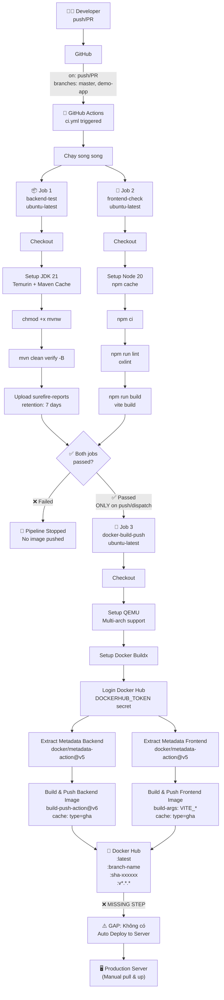
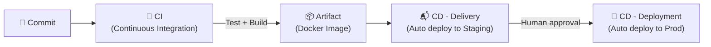
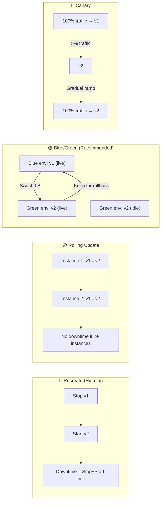
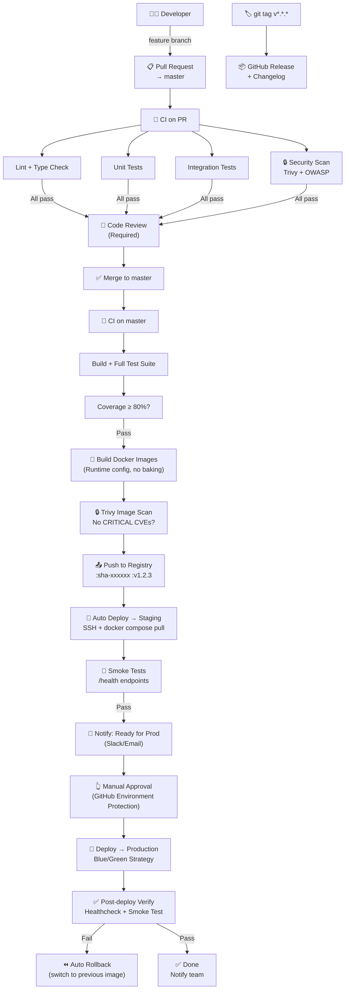

# 🔍 Review CI/CD Workflow — BookingSalon

> **Ngày review:** 2026-11-02 | **Stack:** Spring Boot 3.5 · React 19 · Keycloak 26 · MySQL 8 · Redis 7 · Docker

---

## 📋 Mục lục

1. [Tổng quan kiến trúc CI/CD hiện tại](#1-tổng-quan-kiến-trúc-cicd-hiện-tại)
2. [Phân tích chi tiết từng thành phần](#2-phân-tích-chi-tiết-từng-thành-phần)
3. [Bảng đánh giá ưu/nhược điểm](#3-bảng-đánh-giá-ưunhược-điểm)
4. [Các vấn đề nghiêm trọng cần sửa ngay](#4-các-vấn-đề-nghiêm-trọng-cần-sửa-ngay)
5. [Kiến thức lý thuyết nền tảng](#5-kiến-thức-lý-thuyết-nền-tảng)
6. [Đề xuất kiến trúc CI/CD chuẩn Production](#6-đề-xuất-kiến-trúc-cicd-chuẩn-production)
7. [Lộ trình nâng cấp từng bước](#7-lộ-trình-nâng-cấp-từng-bước)

---

## 1. Tổng quan kiến trúc CI/CD hiện tại

### 1.1 Workflow tổng thể (hiện tại)



### 1.2 Cấu trúc file quan trọng

| File | Vai trò |
|------|---------|
| `.github/workflows/ci.yml` | Định nghĩa toàn bộ CI/CD pipeline (158 dòng) |
| `backend/Dockerfile` | Multi-stage build: maven builder → jre-alpine runtime |
| `frontend/Dockerfile` | Multi-stage build: node builder → nginx:alpine static server |
| `docker-compose.yml` | Môi trường **Development** — build từ source |
| `docker-compose.prod.yml` | Môi trường **Production** — pull image từ Docker Hub |
| `frontend/nginx.conf` | Nginx config: SPA routing + API proxy + static cache |
| `backend/.env.example` | Template biến môi trường |

---

## 2. Phân tích chi tiết từng thành phần

### 2.1 GitHub Actions Workflow (`ci.yml`)

#### Trigger Configuration

```yaml
on:
  push:
    branches:
      - master
      - demo-app
    tags:
      - 'v*.*.*'
  pull_request:
    branches:
      - master
      - demo-app
  workflow_dispatch:
```

> [!NOTE]
> Pipeline kích hoạt đúng trên cả **push**, **PR** (chỉ CI, không push image), và **manual dispatch**. Đây là pattern chuẩn. Tuy nhiên thiếu branch protection rules ở phía GitHub repository settings.

#### Job 1: `backend-test`

```yaml
- name: Run Backend Tests & Verify
  working-directory: backend
  run: ./mvnw clean verify -B
```

**Điểm mạnh:**
- Dùng `mvn verify` thay vì chỉ `test` → chạy cả integration tests (nếu có bound trong verify phase)
- Maven cache với `cache: 'maven'` → tiết kiệm thời gian download dependencies
- Upload test report với `if: always()` → luôn có report kể cả khi fail

**Điểm yếu:**
- Thiếu cache cho `~/.m2` theo `pom.xml` hash → cache có thể stale
- Không có bước coverage report (JaCoCo)
- Không publish test results dưới dạng GitHub Check annotations

#### Job 2: `frontend-check`

```yaml
- name: Lint Frontend
  run: npm run lint      # oxlint
- name: Build Frontend SPA
  run: npm run build     # vite build
```

**Điểm mạnh:**
- Dùng `npm ci` (reproducible install) thay vì `npm install`
- Cache theo `cache-dependency-path: frontend/package-lock.json`
- Dùng oxlint (Rust-based, rất nhanh)

**Điểm yếu:**
- Thiếu TypeScript type-check (nếu có)
- Không có unit test frontend (Vitest/Jest)
- Build artifact không được reuse sang job docker-build-push → build lại lần 2

#### Job 3: `docker-build-push`

```yaml
if: github.event_name == 'push' || github.event_name == 'workflow_dispatch'
```

**Điểm mạnh:**
- Đúng đắn khi chỉ push image khi có `push` event (không push khi PR)
- Dùng `docker/metadata-action` tạo tags tự động (latest, branch, sha, semver)
- Docker layer cache với `type=gha` → tối ưu thời gian build

**Điểm yếu — NGHIÊM TRỌNG:**

```yaml
# ❌ VẤN ĐỀ: Frontend config bị bake vào image lúc build!
build-args: |
  VITE_API_URL=${{ vars.VITE_API_URL || 'http://localhost:8080' }}
  VITE_KEYCLOAK_URL=${{ vars.VITE_KEYCLOAK_URL || 'http://localhost:8081' }}
```

Đây là **lỗi kiến trúc nghiêm trọng** — xem chi tiết ở mục 4.

---

### 2.2 Backend Dockerfile

```dockerfile
# Stage 1: Builder
FROM maven:3.9-eclipse-temurin-21-alpine AS builder
COPY pom.xml .
RUN mvn dependency:resolve -B      # ← Cache dependencies trước
COPY src ./src
RUN mvn clean package -DskipTests -B

# Stage 2: Runtime
FROM eclipse-temurin:21-jre-alpine
RUN addgroup -S appgroup && adduser -S appuser -G appgroup
RUN apk add --no-cache curl tzdata
ENTRYPOINT ["java",
  "-XX:+UseContainerSupport",
  "-XX:MaxRAMPercentage=75.0",
  "-Djava.security.egd=file:/dev/./urandom",
  "-jar", "app.jar"]
```

**Điểm mạnh:**
- ✅ Multi-stage build (image production không chứa Maven, source code)
- ✅ Non-root user (`appuser`) — bảo mật container
- ✅ JVM container-aware flags (`UseContainerSupport`, `MaxRAMPercentage`)
- ✅ `/dev/./urandom` — tránh blocking entropy cho SecureRandom
- ✅ Alpine base image → kích thước nhỏ

**Điểm yếu:**
- ❌ `mvn dependency:resolve` không cache hiệu quả bằng `dependency:go-offline`
- ❌ Không có `HEALTHCHECK` directive trong Dockerfile (phụ thuộc docker-compose)
- ❌ Không có `.dockerignore` ở root (chỉ có ở `backend/`)
- ❌ Không pin version của base image (dùng `maven:3.9-...` thay vì digest)

---

### 2.3 Frontend Dockerfile + Nginx

```dockerfile
# Stage 1: Build React
FROM node:22-alpine AS builder
ARG VITE_API_URL=http://localhost:8080
ENV VITE_API_URL=$VITE_API_URL
RUN npm ci && npm run build

# Stage 2: Nginx
FROM nginx:alpine
COPY --from=builder /app/dist .
COPY nginx.conf /etc/nginx/conf.d/default.conf
```

**Điểm mạnh:**
- ✅ Multi-stage build tách build env khỏi runtime
- ✅ Nginx với gzip, SPA fallback, static cache headers đúng
- ✅ Proxy `/api/` và `/ws/` về backend container (tránh CORS issue)

**Điểm yếu — NGHIÊM TRỌNG:**
- ❌ **VITE build-time bake**: URL API bị cứng vào bundle JS, không thể thay đổi không cần rebuild
- ❌ Nginx chạy mà không có rate limiting
- ❌ Thiếu security headers (CSP, HSTS, X-Frame-Options)
- ❌ `nginx:alpine` không pin version → không reproducible

---

### 2.4 Docker Compose (Dev vs Prod)

#### Vấn đề Dev (`docker-compose.yml`)

```yaml
# ❌ Password hardcode trong compose file
MYSQL_ROOT_PASSWORD: ${DB_PASSWORD:-Bach@vt05}
KEYCLOAK_ADMIN: admin
KEYCLOAK_ADMIN_PASSWORD: admin
```

```yaml
# ❌ Keycloak dev mode trong môi trường prod là NGUY HIỂM
command: start-dev --import-realm
```

#### So sánh Dev vs Prod compose

| Điểm khác biệt | docker-compose.yml (dev) | docker-compose.prod.yml (prod) |
|---|---|---|
| Backend image | `build: ./backend` | `image: dockerhub/...:${IMAGE_TAG}` |
| Keycloak mode | `start-dev` ❌ | `start-dev` ❌ (vẫn sai!) |
| Keycloak DB | H2 in-memory ❌ | MySQL ✅ |
| Admin password | hardcode `admin` ❌ | Env var ✅ |
| Port 5173:80 | ✅ dev convenience | ✅ nhưng không cần thiết ở prod |
| Keycloak healthcheck | Basic TCP | TCP với fallback ✅ |

> [!CAUTION]
> File `docker-compose.prod.yml` vẫn dùng `command: start-dev` cho Keycloak. Đây là **chế độ phát triển**, tắt tất cả security optimizations, không phù hợp cho production bất kỳ hoàn cảnh nào.

---

### 2.5 Flyway Migration Configuration

```yaml
# docker-compose.yml backend environment:
SPRING_FLYWAY_VALIDATE_ON_MIGRATE: "false"
SPRING_FLYWAY_OUT_OF_ORDER: "true"
SPRING_FLYWAY_IGNORE_MIGRATION_PATTERNS: "*:*"
```

> [!CAUTION]
> Đây là cấu hình **nguy hiểm nhất** trong toàn bộ project cho môi trường production:
> - `VALIDATE_ON_MIGRATE=false` → Flyway không kiểm tra checksum, migration bị sửa sẽ không bị phát hiện
> - `OUT_OF_ORDER=true` → Cho phép migration chạy không theo thứ tự → có thể gây data corruption
> - `IGNORE_MIGRATION_PATTERNS=*:*` → Bỏ qua TẤT CẢ lỗi migration → lỗi im lặng, rất nguy hiểm

---

## 3. Bảng đánh giá ưu/nhược điểm

### ✅ Điểm mạnh tổng thể

| # | Ưu điểm | Mức độ |
|---|---------|--------|
| 1 | CI/CD end-to-end tự động từ commit → Docker Hub | 🟢 Tốt |
| 2 | Parallel jobs (backend + frontend chạy song song) | 🟢 Tốt |
| 3 | Semantic versioning với git tags (`v*.*.*`) | 🟢 Tốt |
| 4 | Docker layer caching với GHA cache | 🟢 Tốt |
| 5 | Multi-stage Dockerfile cho cả backend & frontend | 🟢 Tốt |
| 6 | Non-root user trong container backend | 🟢 Tốt |
| 7 | JVM container-aware flags | 🟢 Tốt |
| 8 | Nginx SPA fallback + API proxy đúng cách | 🟢 Tốt |
| 9 | Health check cho tất cả services | 🟢 Tốt |
| 10 | `depends_on: condition: service_healthy` | 🟢 Tốt |
| 11 | `.env.example` template rõ ràng với comment | 🟢 Tốt |
| 12 | Flyway migration quản lý schema có version | 🟢 Tốt |
| 13 | Test coverage đa dạng (Unit + Integration) | 🟢 Tốt |
| 14 | Tách biệt dev/prod compose files | 🟢 Tốt |

### ❌ Điểm yếu & Rủi ro

| # | Nhược điểm | Mức độ | Tác động |
|---|-----------|--------|----------|
| 1 | **VITE env vars bị bake vào image** | 🔴 Critical | 1 image/environment, không reuse được |
| 2 | **Keycloak `start-dev` ở production** | 🔴 Critical | Zero security, unsupported config |
| 3 | **Flyway validation disabled hoàn toàn** | 🔴 Critical | Data corruption im lặng |
| 4 | **Không có CD step** (deploy lên server) | 🔴 Critical | Không có Continuous Delivery |
| 5 | Hardcode password `Bach@vt05` trong compose | 🟠 High | Secret leak nếu file được share |
| 6 | Frontend build lại lần 2 trong docker job | 🟠 High | Tốn 3–5 phút build thêm |
| 7 | Thiếu security headers trong Nginx | 🟠 High | XSS, clickjacking, MIME sniffing |
| 8 | Không có environment separation (staging) | 🟠 High | Deploy thẳng dev → prod |
| 9 | Không có rollback strategy | 🟠 High | Downtime khi deploy lỗi |
| 10 | `latest` tag overwrite → không biết version nào đang chạy | 🟡 Medium | Debug/rollback khó khăn |
| 11 | Không có DAST/security scanning | 🟡 Medium | Vuln không được phát hiện sớm |
| 12 | Không có coverage threshold | 🟡 Medium | Coverage giảm không bị chặn |
| 13 | Port 3307, 6379 expose ra ngoài | 🟡 Medium | Attack surface lớn hơn cần thiết |
| 14 | Nginx không có rate limiting | 🟡 Medium | DDoS / brute force dễ hơn |
| 15 | Docker image không scan vulnerability | 🟡 Medium | CVE không được phát hiện |
| 16 | Không có branch protection rules | 🟡 Medium | Push trực tiếp vào master |
| 17 | Không có pre-commit hooks | 🟡 Medium | Code quality check muộn |

---

## 4. Các vấn đề nghiêm trọng cần sửa ngay

### 🔴 Vấn đề 1: VITE Build-Time Configuration Baking

#### Lý thuyết: Build-time vs Runtime Configuration

```
┌─────────────────────────────────────────────────────────────────┐
│              BUILD-TIME vs RUNTIME CONFIG                       │
│                                                                 │
│  ❌ CÁCH HIỆN TẠI (Build-time baking):                          │
│                                                                 │
│  Source ──[npm run build]──> bundle.js (chứa URL API hardcode)  │
│                                    │                           │
│              ┌─────────────────────┤                           │
│              ▼                     ▼                           │
│      dev-bundle.js         prod-bundle.js                       │
│   (localhost:8080)      (api.production.com)                   │
│                                                                 │
│  → CẦN 2 image khác nhau cho dev và prod!                       │
│  → Build lại khi đổi domain → không immutable                   │
│                                                                 │
│  ✅ CÁCH ĐÚNG (Runtime injection):                              │
│                                                                 │
│  Source ──[npm run build]──> bundle.js (có placeholder)         │
│                                    │                           │
│              ┌─────────────────────┤                           │
│              ▼                     ▼                           │
│         SAME IMAGE             SAME IMAGE                       │
│    + env-config-dev.js     + env-config-prod.js                 │
│   (mount via volume hoặc  (inject qua entrypoint)               │
│    nginx serve /config.js)                                      │
│                                                                 │
│  → 1 image chạy được ở MỌI môi trường!                         │
└─────────────────────────────────────────────────────────────────┘
```

**Vấn đề cụ thể trong code:**

```dockerfile
# ❌ frontend/Dockerfile - dòng 8-18
ARG VITE_API_URL=http://localhost:8080
ENV VITE_API_URL=$VITE_API_URL
RUN npm run build    # URL này được bundle INTO JavaScript files!
```

Khi Vite build, nó replace `import.meta.env.VITE_API_URL` thành string literal trong JS. Container runtime không thể thay đổi giá trị này nữa.

**Fix đề xuất — Runtime Config Injection:**

```nginx
# nginx.conf — thêm endpoint /config.js
location = /config.js {
    alias /usr/share/nginx/html/config.js;
    add_header Cache-Control "no-store";
}
```

```dockerfile
# frontend/Dockerfile — entrypoint script
COPY docker-entrypoint.sh /docker-entrypoint.sh
RUN chmod +x /docker-entrypoint.sh
ENTRYPOINT ["/docker-entrypoint.sh"]
```

```bash
#!/bin/sh
# docker-entrypoint.sh
cat > /usr/share/nginx/html/config.js << EOF
window.__RUNTIME_CONFIG__ = {
  API_URL: "${RUNTIME_API_URL:-http://localhost:8080}",
  WS_URL: "${RUNTIME_WS_URL:-ws://localhost:8080}",
  KEYCLOAK_URL: "${RUNTIME_KEYCLOAK_URL:-http://localhost:8081}",
  KEYCLOAK_REALM: "${RUNTIME_KEYCLOAK_REALM:-booking-salon-realm}",
  KEYCLOAK_CLIENT_ID: "${RUNTIME_KEYCLOAK_CLIENT_ID:-booking-salon-client}"
};
EOF
exec nginx -g "daemon off;"
```

```html
<!-- index.html — load config trước React bundle -->
<script src="/config.js"></script>
```

```javascript
// src/config.js — dùng runtime config thay vì import.meta.env
const runtimeConfig = window.__RUNTIME_CONFIG__ || {};
export const API_URL = runtimeConfig.API_URL || import.meta.env.VITE_API_URL;
```

---

### 🔴 Vấn đề 2: Keycloak Production Mode

#### Lý thuyết: Keycloak `start-dev` vs `start`

```
┌─────────────────────────────────────────────────────────┐
│          KEYCLOAK MODES COMPARISON                       │
│                                                         │
│  start-dev (DEVELOPMENT):                               │
│  ├── H2 in-memory DB (data lost on restart)             │
│  ├── HTTP enabled (no TLS enforcement)                  │
│  ├── Lazy loading (slower first request)                │
│  ├── No clustering support                              │
│  ├── Relaxed hostname validation                        │
│  └── NOT SUPPORTED for production by Keycloak team      │
│                                                         │
│  start (PRODUCTION):                                    │
│  ├── External DB (MySQL/PostgreSQL)                     │
│  ├── TLS enforcement (hoặc proxy TLS)                   │
│  ├── Optimized build with quarkus                       │
│  ├── Strict hostname validation                         │
│  └── Supported, stable, secure                          │
└─────────────────────────────────────────────────────────┘
```

**Fix đề xuất cho `docker-compose.prod.yml`:**

```yaml
keycloak:
  image: quay.io/keycloak/keycloak:26.7.0
  # ❌ Hiện tại:
  # command: start-dev --import-realm

  # ✅ Đúng cho production:
  command: start --optimized --import-realm
  environment:
    KC_DB: mysql
    KC_HOSTNAME: your-domain.com          # Domain thực
    KC_HOSTNAME_STRICT: "true"
    KC_HTTP_ENABLED: "true"               # Nếu dùng reverse proxy TLS
    KC_PROXY: edge                        # Nếu đứng sau nginx/traefik
    KC_HEALTH_ENABLED: "true"
```

---

### 🔴 Vấn đề 3: Flyway Configuration

**Fix đề xuất — tách config theo environment:**

```yaml
# Cho Development (docker-compose.yml) — có thể linh hoạt hơn
SPRING_FLYWAY_OUT_OF_ORDER: "true"       # OK cho dev
SPRING_FLYWAY_VALIDATE_ON_MIGRATE: "false"  # OK cho dev

# Cho Production (docker-compose.prod.yml) — NGHIÊM NGẶT
SPRING_FLYWAY_VALIDATE_ON_MIGRATE: "true"   # ✅ BẮT BUỘC ở prod
SPRING_FLYWAY_OUT_OF_ORDER: "false"          # ✅ Chỉ chạy theo thứ tự
SPRING_FLYWAY_IGNORE_MIGRATION_PATTERNS: ""  # ✅ Không ignore gì cả
```

---

### 🔴 Vấn đề 4: Thiếu CD Step (Continuous Delivery)

Pipeline hiện tại dừng ở **push image lên Docker Hub**. Không có bước nào deploy lên server. Đây là "CI/CD" nhưng thực ra chỉ là CI + Container Registry Push.

**Flow cần thêm:**

```
Docker Hub ──[image pushed]──> Trigger CD ──> SSH to server ──> docker compose pull && up -d
```

---

## 5. Kiến thức lý thuyết nền tảng

### 5.1 Triết lý CI/CD: The Deployment Pipeline



> [!NOTE]
> **Continuous Integration (CI)**: Mỗi commit được tự động test và build. Mục tiêu: phát hiện lỗi sớm nhất có thể (Fail Fast).
>
> **Continuous Delivery (CD)**: Artifact từ CI luôn trong trạng thái sẵn sàng deploy. Có thể cần manual approval trước khi lên prod.
>
> **Continuous Deployment**: Hoàn toàn tự động đến production không cần approval. Phù hợp khi coverage và confidence cao.

---

### 5.2 The 12-Factor App & Configuration

Nguyên tắc [12-Factor App](https://12factor.net/) — Factor III: Config

```
┌─────────────────────────────────────────────────────────────────┐
│                    FACTOR III: CONFIG                           │
│                                                                 │
│  "Store config in the environment"                              │
│                                                                 │
│  ❌ ANTI-PATTERN:                                               │
│  Config hardcoded in code/Dockerfile build args                 │
│  → Cần build lại khi đổi environment                            │
│                                                                 │
│  ✅ CORRECT:                                                    │
│  Config inject qua environment variables AT RUNTIME             │
│  → 1 artifact (image) deploy được nhiều environment             │
│                                                                 │
│  Test: Có thể open-source code ngay bây giờ không?             │
│  Nếu cần che credentials/URLs → bạn đang vi phạm Factor III    │
└─────────────────────────────────────────────────────────────────┘
```

**Vấn đề của Vite** là nó chạy trên browser (không có server runtime), nên không thể đọc env vars như Node.js. Solution là **runtime config injection** qua `window.__RUNTIME_CONFIG__` như đã trình bày ở mục 4.

---

### 5.3 Docker Image Tagging Strategy

```
┌─────────────────────────────────────────────────────────────────┐
│                 IMAGE TAGGING STRATEGY                          │
│                                                                 │
│  Project hiện tại tạo các tags:                                 │
│  ├── :latest        ← overwrite mỗi push → không biết version  │
│  ├── :master        ← branch name                              │
│  ├── :demo-app      ← branch name                              │
│  ├── :sha-a1b2c3    ← immutable, specific commit               │
│  └── :v1.2.3        ← semantic version khi có git tag           │
│                                                                 │
│  PRODUCTION BEST PRACTICE:                                      │
│  ├── :sha-a1b2c3    ← Deploy cái này (immutable)               │
│  ├── :v1.2.3        ← Tag release cho rollback                 │
│  └── :latest        ← KHÔNG deploy cái này (mutable)           │
│                                                                 │
│  Lý do KHÔNG dùng :latest ở production:                        │
│  - Không biết chính xác code nào đang chạy                     │
│  - Không thể rollback xác định                                  │
│  - docker pull :latest có thể kéo version khác nhau            │
│    ở những thời điểm khác nhau → không reproducible            │
└─────────────────────────────────────────────────────────────────┘
```

---

### 5.4 Secrets Management: GitHub Secrets vs Vars

```
┌──────────────────────────────────────────────────────────────────┐
│             GITHUB SECRETS vs VARS                               │
│                                                                  │
│  secrets.*  (Encrypted)         vars.*  (Plaintext)              │
│  ├── Không hiện trong logs      ├── Hiện trong logs              │
│  ├── Không thể đọc sau khi set  ├── Có thể xem lại               │
│  └── Dùng cho: credentials,     └── Dùng cho: URLs, config       │
│      tokens, passwords              không nhạy cảm               │
│                                                                  │
│  Project đang dùng vars.* cho VITE_* URLs → ✅ ĐÚNG              │
│  Project dùng secrets.* cho DOCKERHUB_TOKEN → ✅ ĐÚNG            │
│                                                                  │
│  ⚠️ Nhưng: VITE_* được bake vào image → lộ ra trong bundle.js   │
│     Bất kỳ ai inspect JS có thể thấy URL, realm names, etc.     │
└──────────────────────────────────────────────────────────────────┘
```

---

### 5.5 Deployment Strategies



> [!TIP]
> Với project BookingSalon (single server, monolith), **Blue/Green** là lựa chọn thực tế nhất:
> - Chạy 2 docker-compose stack song song (port khác nhau)
> - Nginx upstream switch
> - Zero downtime
> - Rollback tức thì (switch nginx back)

---

## 6. Đề xuất kiến trúc CI/CD chuẩn Production

### 6.1 Workflow tổng thể đề xuất



---

### 6.2 Đề xuất file `ci.yml` chuẩn Production

```yaml
name: BookingSalon CI/CD Pipeline

on:
  push:
    branches: [master]
    tags: ['v*.*.*']
  pull_request:
    branches: [master]
  workflow_dispatch:
    inputs:
      deploy_env:
        description: 'Deploy to environment'
        required: false
        default: 'staging'
        type: choice
        options: [staging, production]

env:
  REGISTRY: docker.io
  BACKEND_IMAGE: ${{ secrets.DOCKERHUB_USERNAME }}/bookingsalon-backend
  FRONTEND_IMAGE: ${{ secrets.DOCKERHUB_USERNAME }}/bookingsalon-frontend

jobs:
  # ─────────────────────────────────────────────────────────
  # JOB 1: Backend CI
  # ─────────────────────────────────────────────────────────
  backend-ci:
    name: Backend Test & Build
    runs-on: ubuntu-latest
    outputs:
      jar-artifact: ${{ steps.upload.outputs.artifact-id }}
    steps:
      - uses: actions/checkout@v4

      - name: Set up JDK 21
        uses: actions/setup-java@v4
        with:
          java-version: '21'
          distribution: 'temurin'
          cache: 'maven'

      - name: Run Tests with Coverage
        working-directory: backend
        run: ./mvnw clean verify -B -Pcoverage
        env:
          # Test với H2 in-memory, không cần external services
          SPRING_DATASOURCE_URL: jdbc:h2:mem:testdb

      # ✅ THÊM: Coverage threshold enforcement
      - name: Check Coverage Threshold
        working-directory: backend
        run: ./mvnw jacoco:check -B

      # ✅ THÊM: Test report as GitHub Check annotations
      - name: Publish Test Results
        if: always()
        uses: EnricoMi/publish-unit-test-result-action@v2
        with:
          files: backend/target/surefire-reports/*.xml

      - name: Upload Test Artifacts
        if: always()
        uses: actions/upload-artifact@v4
        with:
          name: surefire-test-reports
          path: backend/target/surefire-reports/
          retention-days: 7

      # ✅ BUILD JAR một lần, reuse cho docker job
      - name: Package JAR
        working-directory: backend
        run: ./mvnw clean package -DskipTests -B

      - name: Upload JAR Artifact
        id: upload
        uses: actions/upload-artifact@v4
        with:
          name: backend-jar
          path: backend/target/*.jar
          retention-days: 1

  # ─────────────────────────────────────────────────────────
  # JOB 2: Frontend CI
  # ─────────────────────────────────────────────────────────
  frontend-ci:
    name: Frontend Lint, Test & Build
    runs-on: ubuntu-latest
    steps:
      - uses: actions/checkout@v4

      - name: Set up Node.js 20
        uses: actions/setup-node@v4
        with:
          node-version: 20
          cache: 'npm'
          cache-dependency-path: frontend/package-lock.json

      - name: Install Dependencies
        working-directory: frontend
        run: npm ci

      - name: Lint
        working-directory: frontend
        run: npm run lint

      # ✅ THÊM: Unit tests (nếu có Vitest)
      # - name: Unit Tests
      #   working-directory: frontend
      #   run: npm run test:unit

      # ✅ BUILD để verify, artifact reuse cho docker job
      - name: Build (with placeholder config)
        working-directory: frontend
        run: npm run build
        env:
          # Dùng placeholder, runtime config sẽ inject qua window.__RUNTIME_CONFIG__
          VITE_API_URL: "__RUNTIME_API_URL__"

      - name: Upload Frontend Dist
        uses: actions/upload-artifact@v4
        with:
          name: frontend-dist
          path: frontend/dist/
          retention-days: 1

  # ─────────────────────────────────────────────────────────
  # JOB 3: Security Scanning
  # ─────────────────────────────────────────────────────────
  security-scan:
    name: Security & Dependency Scan
    runs-on: ubuntu-latest
    steps:
      - uses: actions/checkout@v4

      # ✅ THÊM: Dependency vulnerability check
      - name: OWASP Dependency Check (Backend)
        uses: dependency-check/Dependency-Check_Action@main
        with:
          project: 'BookingSalon-Backend'
          path: './backend'
          format: 'HTML'
          args: --failOnCVSS 9

      - name: Upload OWASP Report
        if: always()
        uses: actions/upload-artifact@v4
        with:
          name: owasp-dependency-check-report
          path: reports/

  # ─────────────────────────────────────────────────────────
  # JOB 4: Docker Build & Push (chỉ khi CI pass)
  # ─────────────────────────────────────────────────────────
  docker-build-push:
    name: Build & Push Docker Images
    needs: [backend-ci, frontend-ci]
    if: github.event_name == 'push' || github.event_name == 'workflow_dispatch'
    runs-on: ubuntu-latest
    outputs:
      image-tag: ${{ steps.meta.outputs.version }}
    steps:
      - uses: actions/checkout@v4

      # ✅ Download artifacts thay vì build lại từ đầu
      - name: Download Backend JAR
        uses: actions/download-artifact@v4
        with:
          name: backend-jar
          path: backend/target/

      - name: Download Frontend Dist
        uses: actions/download-artifact@v4
        with:
          name: frontend-dist
          path: frontend/dist/

      - name: Set up Docker Buildx
        uses: docker/setup-buildx-action@v3

      - name: Login to Docker Hub
        uses: docker/login-action@v3
        with:
          username: ${{ secrets.DOCKERHUB_USERNAME }}
          password: ${{ secrets.DOCKERHUB_TOKEN }}

      - name: Extract Image Metadata
        id: meta
        uses: docker/metadata-action@v5
        with:
          images: |
            ${{ env.BACKEND_IMAGE }}
            ${{ env.FRONTEND_IMAGE }}
          tags: |
            type=sha,format=short,prefix=sha-
            type=ref,event=branch
            type=semver,pattern={{version}}
            type=semver,pattern={{major}}.{{minor}}
            # ⚠️ latest chỉ cho master/demo-app
            type=raw,value=latest,enable=${{ github.ref == 'refs/heads/master' }}

      # ✅ Backend: copy JAR đã build thay vì build lại
      - name: Build & Push Backend (from pre-built JAR)
        uses: docker/build-push-action@v6
        with:
          context: ./backend
          file: ./backend/Dockerfile
          push: true
          tags: |
            ${{ env.BACKEND_IMAGE }}:sha-${{ github.sha }}
            ${{ env.BACKEND_IMAGE }}:${{ github.ref_name }}
          labels: ${{ steps.meta.outputs.labels }}
          cache-from: type=gha
          cache-to: type=gha,mode=max
          # ✅ Build arg target: bỏ qua mvn build stage
          target: runtime  # multi-stage target

      # ✅ Frontend: runtime config, không bake URLs
      - name: Build & Push Frontend (Runtime Config)
        uses: docker/build-push-action@v6
        with:
          context: ./frontend
          file: ./frontend/Dockerfile
          push: true
          tags: |
            ${{ env.FRONTEND_IMAGE }}:sha-${{ github.sha }}
            ${{ env.FRONTEND_IMAGE }}:${{ github.ref_name }}
          labels: ${{ steps.meta.outputs.labels }}
          cache-from: type=gha
          cache-to: type=gha,mode=max
          # ✅ KHÔNG có build-args VITE_* → runtime injection

      # ✅ THÊM: Scan image sau khi build
      - name: Scan Backend Image for CVEs
        uses: aquasecurity/trivy-action@master
        with:
          image-ref: '${{ env.BACKEND_IMAGE }}:sha-${{ github.sha }}'
          format: 'sarif'
          output: 'trivy-backend.sarif'
          severity: 'CRITICAL,HIGH'
          exit-code: '1'  # Fail pipeline nếu có CRITICAL

      - name: Upload Trivy Results
        if: always()
        uses: github/codeql-action/upload-sarif@v3
        with:
          sarif_file: 'trivy-backend.sarif'

  # ─────────────────────────────────────────────────────────
  # JOB 5: Deploy to Staging (Auto)
  # ─────────────────────────────────────────────────────────
  deploy-staging:
    name: Deploy to Staging
    needs: docker-build-push
    if: github.ref == 'refs/heads/master'
    runs-on: ubuntu-latest
    environment:
      name: staging
      url: https://staging.bookingsalon.com
    steps:
      - name: Deploy to Staging Server
        uses: appleboy/ssh-action@master
        with:
          host: ${{ secrets.STAGING_HOST }}
          username: ${{ secrets.STAGING_USER }}
          key: ${{ secrets.STAGING_SSH_KEY }}
          script: |
            cd /opt/bookingsalon
            export IMAGE_TAG=sha-${{ github.sha }}
            export DOCKERHUB_USERNAME=${{ secrets.DOCKERHUB_USERNAME }}
            docker compose -f docker-compose.prod.yml pull
            docker compose -f docker-compose.prod.yml up -d --remove-orphans
            docker system prune -f

      - name: Smoke Test Staging
        run: |
          sleep 30  # Chờ services khởi động
          curl -f https://staging.bookingsalon.com/api/actuator/health || exit 1
          echo "✅ Staging deployment verified"

  # ─────────────────────────────────────────────────────────
  # JOB 6: Deploy to Production (Manual Approval)
  # ─────────────────────────────────────────────────────────
  deploy-production:
    name: Deploy to Production
    needs: deploy-staging
    runs-on: ubuntu-latest
    environment:
      name: production          # ← GitHub Environment với required reviewers
      url: https://bookingsalon.com
    steps:
      - name: Deploy Production (Blue/Green)
        uses: appleboy/ssh-action@master
        with:
          host: ${{ secrets.PROD_HOST }}
          username: ${{ secrets.PROD_USER }}
          key: ${{ secrets.PROD_SSH_KEY }}
          script: |
            cd /opt/bookingsalon
            export PREV_TAG=$(docker inspect bookingsalon_backend --format='{{.Config.Image}}' | cut -d: -f2)
            export IMAGE_TAG=sha-${{ github.sha }}
            
            # Blue/Green: start new stack
            docker compose -f docker-compose.prod.yml pull
            docker compose -f docker-compose.prod.yml up -d --remove-orphans
            
            # Health check
            sleep 30
            if ! curl -f http://localhost:8080/api/actuator/health; then
              echo "❌ Health check failed! Rolling back to $PREV_TAG..."
              export IMAGE_TAG=$PREV_TAG
              docker compose -f docker-compose.prod.yml up -d
              exit 1
            fi
            echo "✅ Production deployment verified"
```

---

### 6.3 Đề xuất cấu trúc `docker-compose.prod.yml` chuẩn

```yaml
# ✅ Các thay đổi cần thiết cho docker-compose.prod.yml

services:
  keycloak:
    image: quay.io/keycloak/keycloak:26.7.0
    # ✅ FIX: Thay start-dev bằng start
    command: start --import-realm
    environment:
      KC_DB: mysql
      KC_HOSTNAME: ${KEYCLOAK_HOSTNAME}          # ✅ Domain thực
      KC_HOSTNAME_STRICT: "true"                 # ✅ Strict mode
      KC_HTTP_ENABLED: "true"                    # ✅ Nếu dùng reverse proxy
      KC_PROXY: edge                             # ✅ Behind nginx/traefik
      KC_HEALTH_ENABLED: "true"

  frontend:
    image: ${DOCKERHUB_USERNAME}/bookingsalon-frontend:${IMAGE_TAG}
    # ✅ THÊM: Runtime config injection
    environment:
      RUNTIME_API_URL: ${FRONTEND_API_URL}
      RUNTIME_WS_URL: ${FRONTEND_WS_URL}
      RUNTIME_KEYCLOAK_URL: ${KEYCLOAK_PUBLIC_URL}
      RUNTIME_KEYCLOAK_REALM: ${KEYCLOAK_REALM}
      RUNTIME_KEYCLOAK_CLIENT_ID: ${KEYCLOAK_FRONTEND_CLIENT_ID}
    # ✅ KHÔNG expose port 5173 ở production
    ports:
      - "80:80"
    # ✅ THÊM: healthcheck
    healthcheck:
      test: ["CMD", "wget", "-q", "--spider", "http://localhost:80"]
      interval: 10s
      timeout: 5s
      retries: 3

  backend:
    environment:
      # ✅ Flyway production-safe settings
      SPRING_FLYWAY_VALIDATE_ON_MIGRATE: "true"
      SPRING_FLYWAY_OUT_OF_ORDER: "false"
      SPRING_FLYWAY_IGNORE_MIGRATION_PATTERNS: ""
```

---

### 6.4 Nginx Security Headers (cần thêm vào `nginx.conf`)

```nginx
server {
    listen 80;
    server_name localhost;

    # ✅ THÊM: Security Headers
    add_header X-Frame-Options "SAMEORIGIN" always;
    add_header X-Content-Type-Options "nosniff" always;
    add_header X-XSS-Protection "1; mode=block" always;
    add_header Referrer-Policy "strict-origin-when-cross-origin" always;
    add_header Content-Security-Policy "default-src 'self'; script-src 'self' 'unsafe-inline'; style-src 'self' 'unsafe-inline'; img-src 'self' data: https:; connect-src 'self' https: wss:;" always;

    # ✅ THÊM: Rate limiting (khai báo ở http block)
    # limit_req_zone $binary_remote_addr zone=api_limit:10m rate=30r/m;
    location /api/ {
        # limit_req zone=api_limit burst=10 nodelay;
        proxy_pass http://backend:8080;
        proxy_set_header Host $host;
        proxy_set_header X-Real-IP $remote_addr;
        proxy_set_header X-Forwarded-For $proxy_add_x_forwarded_for;
        proxy_set_header X-Forwarded-Proto $scheme;

        # ✅ THÊM: Timeout settings
        proxy_connect_timeout 10s;
        proxy_read_timeout 30s;
        proxy_send_timeout 10s;
    }

    # ✅ THÊM: Runtime config endpoint (không cache)
    location = /config.js {
        add_header Cache-Control "no-store, no-cache, must-revalidate";
        try_files $uri =404;
    }

    location / {
        try_files $uri $uri/ /index.html;
    }
}
```

---

## 7. Lộ trình nâng cấp từng bước

### Phase 1 — Critical Fixes (Tuần 1) 🔴

| Task | File cần sửa | Độ ưu tiên |
|------|-------------|-----------|
| Fix Keycloak `start-dev` → `start` | `docker-compose.prod.yml` | 🔴 P0 |
| Fix Flyway validation cho production | `docker-compose.prod.yml` | 🔴 P0 |
| Xóa hardcode password `Bach@vt05` | `docker-compose.yml` | 🔴 P0 |
| Thêm security headers vào Nginx | `frontend/nginx.conf` | 🔴 P0 |

### Phase 2 — Architecture Fixes (Tuần 2-3) 🟠

| Task | File cần sửa | Độ ưu tiên |
|------|-------------|-----------|
| Implement runtime config injection | `frontend/Dockerfile`, `nginx.conf` | 🟠 P1 |
| Thêm CD deploy step vào ci.yml | `.github/workflows/ci.yml` | 🟠 P1 |
| Thêm rollback mechanism | `ci.yml` + deploy script | 🟠 P1 |
| Pin Docker image versions với digest | `Dockerfile` files | 🟠 P1 |

### Phase 3 — Quality Improvements (Tháng 2) 🟡

| Task | Ghi chú | Độ ưu tiên |
|------|---------|-----------|
| Thêm Trivy image scanning | `ci.yml` | 🟡 P2 |
| Thêm coverage threshold (JaCoCo) | `pom.xml` + `ci.yml` | 🟡 P2 |
| Thêm frontend unit tests (Vitest) | `frontend/` | 🟡 P2 |
| GitHub Environment protection rules | GitHub Settings | 🟡 P2 |
| Staging environment setup | Server + DNS | 🟡 P2 |

### Phase 4 — Production Excellence (Tháng 3+) 🟢

| Task | Ghi chú | Độ ưu tiên |
|------|---------|-----------|
| Observability: Prometheus + Grafana | Monitoring stack | 🟢 P3 |
| Centralized logging: Loki/ELK | Log aggregation | 🟢 P3 |
| OWASP Dependency Check | Security pipeline | 🟢 P3 |
| Performance testing (k6/Gatling) | Load testing | 🟢 P3 |
| Blue/Green deployment strategy | Zero-downtime | 🟢 P3 |

---

## Tổng kết

```
┌──────────────────────────────────────────────────────────────────┐
│                    ĐIỂM SỐ TỔNG THỂ                             │
│                                                                  │
│  CI (Continuous Integration):    7/10  🟡                        │
│  ├── Test coverage: ✅ Đa dạng unit + integration               │
│  ├── Build quality: ✅ Multi-stage Dockerfile tốt               │
│  ├── Docker push: ✅ Semantic tagging đúng                      │
│  └── Missing: Coverage threshold, image scanning, staging env   │
│                                                                  │
│  CD (Continuous Delivery):       2/10  🔴                        │
│  ├── ❌ Không có auto-deploy step                               │
│  ├── ❌ Không có rollback mechanism                             │
│  ├── ❌ Không có staging environment                            │
│  └── ❌ Không có deployment verification                        │
│                                                                  │
│  Security:                       4/10  🔴                        │
│  ├── ✅ Non-root container user                                 │
│  ├── ❌ Keycloak start-dev ở production                         │
│  ├── ❌ Flyway validation disabled                              │
│  ├── ❌ VITE config baked (URL exposure)                        │
│  └── ❌ Thiếu security headers, image scanning                  │
│                                                                  │
│  Overall:   4.5/10  — Cần cải thiện đáng kể trước production    │
└──────────────────────────────────────────────────────────────────┘
```

> [!IMPORTANT]
> **Ưu tiên tuyệt đối trước khi deploy production:**
> 1. Đổi Keycloak sang `start` mode
> 2. Bật Flyway validation
> 3. Xóa hardcode password khỏi source code
> 4. Thêm CD step với rollback mechanism
> 5. Implement runtime config cho frontend

---

*Review thực hiện bởi Antigravity AI trên codebase tại `e:\Projects\BookingSalon` — Nov 2, 2026*
