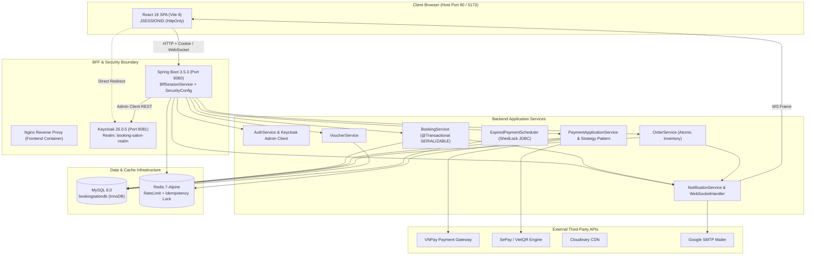

# 📋 BÁO CÁO ĐÁNH GIÁ KỸ THUẬT TOÀN DIỆN LẦN 4 (TECHNICAL AUDIT REPORT 4.0)
## Hệ Thống: BookingSalon Enterprise Platform

---

> **Hội đồng kiểm toán:** Principal Software Architect, Senior Java Engineer & Software Quality Auditor  
> **Kinh nghiệm tham chiếu:** 20+ năm kiến trúc hệ thống phân tán, kiểm toán an toàn thông tin & tối ưu hóa nền tảng Java/Spring Enterprise  
> **Thời điểm thẩm định:** Tháng 10/2026 (Phiên bản Kiểm toán Độc lập 4.0)  
> **Công nghệ thực tế:** Java 21 LTS | Spring Boot 3.5.3 | MySQL 8.0 | Redis 7.x (Lettuce) | Keycloak 26.0.5 | React 19.2.8 (Vite 8.2.1) | Docker & Docker Compose  
> **Hiện trạng Biên dịch & Kiểm thử Thực tế:**
> - Backend Compilation: ✅ `mvnw test-compile` **BUILD SUCCESS** (279 production classes, 14 test classes).
> - Backend Test Suite: ❌ `mvnw test` **BUILD FAILURE** (`java.lang.ClassFormatError: Invalid method Code length 0 in demo/bookingsalon/BookingTest/CreateBookingTest`).
> - Frontend Compilation: ✅ `npm run build` **SUCCESS** (Vite v8.2.1, 2.16s, bundle 2.09 MB).

---

## 📑 MỤC LỤC CHI TIẾT

1. [Tóm Tắt Điều Hành & Nhận Định Cốt Lõi (Executive Summary)](#1-tóm-tắt-điều-hành--nhận-định-cốt-lõi)
2. [Giai Đoạn 1: Khảo Sát Repository & Lập Bản Đồ Hệ Thống (System Landscape)](#2-giai-đoạn-1-khảo-sát-repository--lập-bản-đồ-hệ-thống)
3. [Giai Đoạn 2: Phân Tích Kiến Trúc Tổng Thể, Module & Phụ Thuộc](#3-giai-đoạn-2-phân-tích-kiến-trúc-tổng-thể-module--phụ-thuộc)
4. [Giai Đoạn 3: Truy Vết Chi Tiết 7 Luồng Nghiệp Vụ Trọng Yếu (End-to-End Traces)](#4-giai-đoạn-3-truy-vết-chi-tiết-7-luồng-nghiệp-vụ-trọng-yếu)
   - 4.1. Luồng Đặt lịch & Khóa đồng thời (Booking Lifecycle & Stylist Concurrency)
   - 4.2. Luồng Thanh toán Đa kênh & Webhook (Payment Gateway, Webhook Spoofing & Idempotency)
   - 4.3. Luồng Đặt hàng E-Commerce & Kho hàng (Order, Atomic Inventory & Amount Verification Leak)
   - 4.4. Luồng Xác thực, Phân quyền & Quản lý Phiên (Keycloak OIDC, PKCE, BFF Session & Rate Limit Bypass)
   - 4.5. Luồng Khuyến mãi & Quản lý Voucher (Voucher Atomic Usage & Rollback Defect)
   - 4.6. Luồng Đánh giá & Tính điểm Dịch vụ / Sản phẩm (Review Manipulation & Rating Aggregate)
   - 4.7. Luồng Thông báo & WebSocket Thời gian thực (WebSocket Handshake & In-Memory Cluster Limitation)
5. [Giai Đoạn 4: Đánh Giá Chuyên Sâu Từng Trụ Cột Kỹ Thuật (Deep Technical Pillars)](#5-giai-đoạn-4-đánh-giá-chuyên-sâu-từng-trụ-cột-kỹ-thuật)
   - 5.1. API Design, Contract Compatibility, Error Handling & DTO Validation
   - 5.2. Bảo Mật, An Toàn Thông Tin & OWASP Top 10
   - 5.3. Thiết Kế Cơ Sở Dữ Liệu, Transaction Boundary & ORM Performance
   - 5.4. Chất Lượng Mã Nguồn, Clean Code & Nguyên Tắc Thiết Kế (SOLID / DRY)
   - 5.5. Kiểm Thử Tự Động, Coverage & Độ Tin Cậy (Automated Testing)
   - 5.6. Vận Hành, Containerization (Docker), Giám Sát & Khả Năng Mở Rộng (SRE)
6. [Giai Đoạn 5: Ma Trận Phân Loại Lỗi, Rủi Ro & Phân Tích Nguyên Nhân Gốc (Root Cause Analysis)](#6-giai-đoạn-5-ma-trận-phân-loại-lỗi-rủi-ro--nguyên-nhân-gốc)
7. [Bảng Điểm Đánh Giá Toàn Diện & Trọng Số (Scorecard)](#7-bảng-điểm-đánh-giá-toàn-diện--trọng-số)
8. [Giai Đoạn 6: Lộ Trình Cải Tiến Kỹ Thuật Thực Tiễn (Actionable Remediation Roadmap)](#8-giai-đoạn-6-lộ-trình-cải-tiến-kỹ-thuật-thực-tiễn)
9. [Phụ Lục: Các Đoạn Mã Vá Lỗi Tham Khảo (Code Patches)](#9-phụ-lục-các-đoạn-mã-vá-lỗi-tham-khảo-code-patches)

---

## 1. TÓM TẮT ĐIỀU HÀNH & NHẬN ĐỊNH CỐT LÕI

Hệ thống **BookingSalon** thể hiện tầm nhìn xây dựng một nền tảng quản trị chuỗi salon chuyên nghiệp kết hợp sàn thương mại điện tử nhỏ (bán sản phẩm chăm sóc tóc, mỹ phẩm) và đặt lịch hẹn theo thời gian thực. Dự án sở hữu nhiều điểm sáng về kỹ thuật hiện đại:
- **Kiến trúc BFF (Backend-For-Frontend):** Ứng dụng Spring Boot đóng vai trò OAuth2 Resource Server kết hợp quản lý session server-side, che giấu hoàn toàn Token khỏi Browser bằng `JSESSIONID` HttpOnly.
- **Trừ kho nguyên tử bằng Atomic SQL:** Sử dụng câu lệnh UPDATE có điều kiện (`WHERE stock_quantity >= :quantity`) loại bỏ hoàn toàn nguy cơ Lost Update và Overselling.
- **Tác vụ nền có điều phối:** Tích hợp ShedLock chạy trên JDBC template MySQL giúp bộ lập lịch định kỳ (`ExpiredPaymentScheduler`) an toàn khi chạy trên môi trường đa node.
- **Chuẩn bị hạ tầng Container hóa hoàn chỉnh:** Bộ tệp Dockerfile đa tầng (Multi-stage build), non-root user và `docker-compose.yml` điều phối 5 dịch vụ đồng bộ qua Healthcheck.

Tuy nhiên, dưới góc độ kiểm toán chất lượng phần mềm doanh nghiệp, **HỆ THỐNG HIỆN TẠI CHƯA ĐỦ ĐIỀU KIỆN ĐỂ GO-LIVE PRODUCTION**. 
Dự án tồn tại **sự sai lệch nghiêm trọng giữa các báo cáo tài liệu trước đây (`REVIEW_CODE_3.md`) và mã nguồn thực tế**, đi kèm **5 lỗi tử huyệt (Show-Stoppers)** đe dọa trực tiếp đến tính đúng đắn tài chính, bảo mật dữ liệu khách hàng và quy trình tự động hóa CI/CD:

### Top 5 Rủi Ro Tử Huyệt (Show-Stoppers)
1. **[CRITICAL - SEC] Giả Mạo Webhook Thanh Toán Ngân Hàng Do Không Xác Thực Chữ Ký/Bí Mật (`BankWebhookController.java`):** Endpoint `/webhooks/bank/callback` mở hoàn toàn (`permitAll()`), nhưng trong code hoàn toàn không kiểm tra chữ ký HMAC hay API key. Kẻ xấu có thể gửi một gói JSON giả mạo để chuyển bất kỳ đơn hàng nào sang trạng thái `PAID` / `CONFIRMED` mà không cần chuyển tiền thật.
2. **[CRITICAL - SEC] Lỗ Hổng BOLA / IDOR Diện Rộng:** Bất kỳ người dùng đã đăng nhập nào cũng có thể:
   - Gọi `GET /api/booking` để lấy danh sách toàn bộ lịch hẹn của tất cả khách hàng trên hệ thống (lộ họ tên, số điện thoại, email, ghi chú cá nhân).
   - Gọi `DELETE /api/v1/payments/booking/{id}` để xóa dữ liệu thanh toán của bất kỳ lịch hẹn nào.
   - Thao tác trên `NotificationController` để đọc, tạo giả và xóa thông báo của người khác.
3. **[CRITICAL - CI/CD] Toàn Bộ Test Suite Bị Tê Liệt (CI/CD Blocker):** Chạy `mvnw test` thất bại ngay lập tức với lỗi bytecode `java.lang.ClassFormatError: Invalid method Code length 0 in demo/bookingsalon/BookingTest/CreateBookingTest`. Nguyên nhân do sử dụng sai annotation `@RequiredArgsConstructor` trên test class rỗng.
4. **[HIGH - FIN] Bỏ Qua Xác Thực Số Tiền Trong VNPay Webhook Đơn Hàng Shop (`PaymentWebhookService.java`):** Tham số `vnp_Amount` nhận từ VNPay callback cho Shop Orders bị bỏ qua hoàn toàn, không so sánh với `order.getFinalAmount()`.
5. **[HIGH - ARCH] Bộ Nhớ Phiên (BFF Session) Lưu In-Memory — Không Thể Scale Ngang (`application.properties`):** Thiếu `spring-session-data-redis`. Khi chạy từ 2 container backend trở lên hoặc khi restart ứng dụng, 100% người dùng sẽ bị logout và mất phiên.

---

## 2. GIAI ĐOẠN 1: KHẢO SÁT REPOSITORY & LẬP BẢN ĐỒ HỆ THỐNG

### 2.1 Thông tin công nghệ & Stack cốt lõi
- **Ngôn ngữ:** Java 21 (Amazon Corretto / Temurin LTS), JavaScript / JSX (ES2022).
- **Backend Framework:** Spring Boot 3.5.3 (Spring MVC, Spring Data JPA, Spring Security 6, Spring WebFlux `WebClient`, Spring WebSocket, Spring Retry).
- **Build Tool:** Apache Maven 3.9+ (`mvnw` wrapper có sẵn).
- **Frontend Framework:** React 19.2.8, React Router 7.18.2, Redux Toolkit 2.12.0, Ant Design 6.6.0, TailwindCSS 3.4, Vite 8.2.1.
- **Cơ sở dữ liệu:** MySQL 8.0 (InnoDB, `utf8mb4_unicode_ci`, Timezone `Asia/Ho_Chi_Minh`).
- **Database Migration:** Flyway Core 11.7.2 (`V1` → `V8`, `R__01_master_data.sql`, `R__02_test_data.sql`).
- **Distributed Cache & Locking:** Redis 7.x (Lettuce connection pool với `commons-pool2`).
- **Distributed Scheduler Lock:** ShedLock 6.10.0 (chạy trên JDBC template bảng `shedlock`).
- **IAM / Auth Server:** Keycloak 26.0.5 (Realm: `booking-salon-realm`).
- **Cổng thanh toán:** VNPay (Simulator + Production ready), SePay / VietQR Bank Transfer, COD.
- **Lưu trữ tệp:** Cloudinary HTTP 1.39.0.

### 2.2 Kết quả kiểm chứng Build & Test thực tế

```
================================================================================
BẰNG CHỨNG BIÊN DỊCH VÀ KIỂM THỬ THỰC TẾ TRÊN HỆ THỐNG
================================================================================
[TEST 1] Backend Compilation:
Command: .\mvnw.cmd test-compile
Result : BUILD SUCCESS (Total time: 6.369s - 279 production + 14 test classes compiled)

[TEST 2] Backend Test Execution:
Command: .\mvnw.cmd test
Result : BUILD FAILURE
Output : 
[ERROR] Invalid method Code length 0 in class file demo/bookingsalon/BookingTest/CreateBookingTest
[ERROR] java.lang.ClassFormatError: Invalid method Code length 0 in class file demo/bookingsalon/BookingTest/CreateBookingTest
[ERROR] org.apache.maven.surefire.booter.SurefireBooterForkException: There was an error in the forked process

[TEST 3] Frontend Production Build:
Command: npm run build (in frontend/)
Result : SUCCESS (vite v8.2.1, built in 2.16s)
Artifacts: dist/assets/index-CBpUXlkT.css (76.4 kB), dist/assets/index-BiGK1W9w.js (2,097.4 kB)
Warning  : Single JS chunk > 2MB (chưa tách Dynamic import / Code Splitting)
================================================================================
```

### 2.3 Hiện trạng tài liệu kỹ thuật trong kho lưu trữ
- `.env` và `backend/.env`: Đã được kiểm tra qua `git ls-files` — **xác nhận không bị commit vào git**, đã nằm trong `.gitignore`.
- Các file tài liệu: Hệ thống lưu trữ nhiều tài liệu (`CODE_REVIEW.md`, `REVIEW_CODE_2.md`, `REVIEW_CODE_3.md`, `HUONG_DAN_DOCKER_DONG_GOI_TOAN_DIEN.md`). Tuy nhiên, nhiều điểm nêu trong `REVIEW_CODE_3.md` (ví dụ: đã sửa `sessionFixation().none()`, đã xóa sạch `System.out` / `printStackTrace`) **chưa được phản ánh trung thực trong mã nguồn Java**.

---

## 3. GIAI ĐOẠN 2: PHÂN TÍCH KIẾN TRÚC TỔNG THỂ, MODULE & PHỤ THUỘC

### 3.1 Sơ đồ kiến trúc tổng thể (System Architecture Map)



### 3.2 Nhận xét kiến trúc
1. **Mô hình BFF (Backend-For-Frontend):** Thiết kế đúng đắn khi biến Backend Spring Boot thành OAuth2 Client kiêm Resource Server, giữ toàn bộ JWT và Refresh Token phía máy chủ, ngăn chặn rủi ro XSS đánh cắp Access Token từ `localStorage`.
2. **Coupling giữa các Domain Service:** `BookingService` có tới **16 dependencies**, vi phạm nguyên tắc Single Responsibility (SRP). Nó vừa tạo booking, vừa tính voucher, vừa tạo entity payment, vừa gửi mail, vừa bắn websocket.
3. **Mối quan hệ Entity bất đối xứng:** Database bảng `payments` có cột `order_id` (được index ở `V8`), nhưng Entity Java `Payment.java` chỉ có `@JoinColumn(name = "booking_id")` và hoàn toàn không ánh xạ trường `order`.

---

## 4. GIAI ĐOẠN 3: TRUY VẾT CHI TIẾT 7 LUỒNG NGHIỆP VỤ TRỌNG YẾU

### 4.1 Luồng Đặt lịch & Khóa đồng thời (Booking Lifecycle & Stylist Concurrency)
- **Điểm vào API:** `POST /api/booking` tại `BookingController.java` (L110).
- **Ranh giới giao dịch:** `@Transactional(isolation = Isolation.SERIALIZABLE)` + `@Retryable(retryFor = ObjectOptimisticLockingFailureException.class)` tại `BookingService.createBooking` (L175-L181).
- **Cơ chế khóa:** Gọi `isTimeSlotAvailable` -> `findConflictingBookingsByStylist` (`BookingRepository.java`, L59-L65) với `@Lock(LockModeType.PESSIMISTIC_WRITE)`.
- **Phát hiện lỗi & Rủi ro:**
  1. **Deadlock Exception không được Retry:** `@Retryable` chỉ bắt `ObjectOptimisticLockingFailureException`. Khi 2 giao dịch đồng thời ở mức `SERIALIZABLE` cùng chèn dữ liệu vào khoảng trống (gap) của chỉ mục, MySQL sẽ sinh lỗi Deadlock (Error Code 1213) khiến Spring ném ra `CannotAcquireLockException`. Do không cấu hình retry cho ngoại lệ này, yêu cầu lập tức văng lỗi 500 ra client.
  2. **Stylist bị khóa lịch vĩnh viễn khi đơn bị hủy:** Khi `BookingService.cancelBooking` (L423-L447) được gọi, trạng thái đổi thành `CANCELLED`, nhưng `Payment` liên kết không được cập nhật trạng thái `CANCELLED` hay `FAILED`. Nếu khách hàng đã dùng voucher, số lượt dùng voucher **không được hoàn lại** (hàm `decrementUsedCountAtomic` không hề được gọi).

---

### 4.2 Luồng Thanh toán Đa kênh & Webhook (Payment Gateway & Webhook Security)
- **Điểm vào Webhook:**
  - VNPay: `POST /api/v1/payments/webhook/vnpay` -> `PaymentWebhookService.handleVNPayWebhook` (L59).
  - Bank / SePay: `POST /webhooks/bank/callback` -> `BankWebhookController.callbackPost` (L20-L29).
- **Phát hiện lỗi nghiêm trọng (Confirmed Bugs):**
  1. **Lỗ hổng Giả mạo Webhook Chuyển khoản Ngân hàng (Critical Security Flaw):**
     Tại `BankWebhookController.java` (L20-L28):
     ```java
     @PostMapping("/callback")
     public ResponseEntity<String> callbackPost(@RequestBody Map<String, String> params) {
         log.info("Received bank POST callback with params: {}", params);
         try {
             bankStrategy.verifyCallback(params);
             return ResponseEntity.ok("OK");
         } ...
     }
     ```
     Trong `SecurityConfig.java` (L57): `/webhooks/**` được miễn trừ CSRF và permitAll.  
     Trong `BankTransferStrategy.java` (L91): Hoàn toàn không xác thực `Authorization: Bearer <SEPAY_WEBHOOK_API_KEY>` hay kiểm tra HMAC Secret. Bất kỳ ai cũng có thể curl trực tiếp payload JSON dạng `{"content": "DH20261017-001", "status": "SUCCESS"}` để kích hoạt đơn hàng thành công mà không tốn 1 xu!
  2. **URL Callback Hardcoded Localhost:**
     Tại `BankTransferStrategy.java` (L56-L58):
     `successUrl`, `errorUrl`, `cancelUrl` bị hardcode cứng `"http://localhost:5173"`, gây lỗi điều hướng khi triển khai tên miền thật trên Production.

---

### 4.3 Luồng Đặt hàng E-Commerce & Kho hàng (Order & Inventory Management)
- **Điểm vào API:** `POST /api/orders` tại `OrderController.java` (L40).
- **Trừ kho nguyên tử:** `ProductRepository.deductStockAtomic` (L24) thực hiện câu lệnh chuẩn xác:
  ```sql
  UPDATE Product p SET p.stockQuantity = p.stockQuantity - :quantity, p.soldCount = p.soldCount + :quantity 
  WHERE p.id = :productId AND p.stockQuantity >= :quantity
  ```
- **Phát hiện lỗi & Rủi ro:**
  1. **Bỏ qua kiểm tra số tiền VNPay trên Đơn hàng Shop (`PaymentWebhookService.java`, L133-L155):**
     Phương thức `handleShopOrderVnPayCallback` nhận tham số `String vnpAmount`, nhưng trong toàn bộ thân hàm **không hề có dòng code nào so sánh `vnpAmount` với `order.getFinalAmount()`** (khác với luồng Booking có kiểm tra chặt chẽ ở dòng 92). Kẻ gian có thể sửa tham số thanh toán thành 1.000 VNĐ, hệ thống VNPay Sandbox ký hợp lệ và đơn hàng vẫn được chuyển thành công (`SHIPPING`)!
  2. **Thất thoát tồn kho khi thanh toán VNPay thất bại:**
     Tại dòng 170 `PaymentWebhookService.java`: Khi VNPay trả về mã lỗi (`responseCode != "00"`), đơn hàng chuyển `paymentStatus = FAILED`, nhưng **không hề gọi `restoreStockAtomic`**! Số lượng sản phẩm đã bị trừ trong kho sẽ bị đóng băng vĩnh viễn.
  3. **Lỗ hổng BOLA / IDOR ngược trong `OrderService.java` (L263):**
     ```java
     if (userId != null && !order.getUser().getId().equals(userId)) {
         throw new PaymentException("Bạn không có quyền truy cập đơn hàng này!");
     }
     ```
     Nếu `userId == null` (ví dụ: token lỗi hoặc gọi nội bộ), điều kiện `userId != null` trả về `false`, và **kiểm tra quyền bị bỏ qua hoàn toàn**. Ngược lại, nếu một Quản trị viên (`ADMIN`) truyền ID của mình vào, kiểm tra lại ném ngoại lệ vì ID của Admin không khớp với `order.getUser().getId()`.

---

### 4.4 Luồng Xác thực, Phân quyền & Quản lý Phiên (Auth, Session & Security)
- **Điểm vào API:** `POST /api/auth/login`, `POST /api/auth/oauth2/callback` tại `AuthController.java`.
- **Phát hiện lỗi nghiêm trọng (Confirmed Bugs):**
  1. **Lỗ hổng Session Fixation Trong `SecurityConfig.java` (L69):**
     ```java
     .sessionManagement(session -> session
         .sessionCreationPolicy(SessionCreationPolicy.IF_REQUIRED)
         .sessionFixation(sessionFixation -> sessionFixation.none())
     )
     ```
     Mã nguồn thực tế đang cấu hình `.sessionFixation().none()`. Mặc dù `BffSessionService` có gọi `request.changeSessionId()` thủ công, cấu hình này của Spring Security tạo nguy cơ xung đột và vi phạm khuyến nghị an ninh của OWASP.
  2. **Vượt mặt Rate Limiter bằng Giả mạo IP Header (`ClientIpResolver.java`, L15-L19):**
     ```java
     String xForwardedFor = request.getHeader("X-Forwarded-For");
     if (xForwardedFor != null && !xForwardedFor.isBlank() && !"unknown".equalsIgnoreCase(xForwardedFor)) {
         return xForwardedFor.split(",")[0].trim();
     }
     ```
     Hệ thống tin tưởng hoàn toàn phần tử đầu tiên của `X-Forwarded-For` mà không kiểm tra IP kết nối (`remoteAddr`) có thuộc dải IP Proxy tin cậy hay không. Kẻ tấn công chỉ cần thay đổi header `X-Forwarded-For` qua từng request là có thể bypass 100% Rate Limiter toàn hệ thống.

---

### 4.5 Luồng Khuyến mãi & Quản lý Voucher (Voucher Lifecycle)
- **Điểm vào API:** `POST /api/vouchers/apply` và `GET /api/vouchers/available` tại `VoucherController.java`.
- **Phát hiện lỗi & Rủi ro:**
  1. **Lộ thông tin Voucher cá nhân (Information Disclosure):**
     `GET /api/vouchers/available?userId=...` là endpoint công khai (`permitAll()`). Bất kỳ ai cũng có thể truyền UUID của người khác để dò quét toàn bộ voucher cá nhân chưa sử dụng trong ví của nạn nhân.
  2. **Không hoàn lại lượt Voucher khi Hủy lịch hẹn:**
     Phương thức `BookingRepository.decrementUsedCountAtomic` đã được viết trong Repository nhưng **không hề được gọi trong `BookingService.cancelBooking` (L423)**. Khách hàng hủy lịch sẽ mất vĩnh viễn voucher đã áp dụng.

---

### 4.6 Luồng Đánh giá & Tính điểm Dịch vụ / Sản phẩm (Reviews & Ratings)
- **Điểm vào API:** `POST /api/reviews` tại `ReviewController.java` (L41).
- **Phát hiện lỗi & Rủi ro:**
  1. **Thao túng điểm Stylist & Sản phẩm không cần đặt lịch (Rating Manipulation):**
     Tại `ReviewService.java` (L77-L107): Kiểm tra booking hoàn tất chỉ chạy khi `reviewDTO.getBookingId() != null`. Nếu client gửi request chỉ có `stylistId` hoặc `productId` (bỏ trống `bookingId`), hệ thống cho phép tạo đánh giá ngay lập tức và tính lại điểm trung bình của Stylist! Bất kỳ ai cũng có thể spam đánh giá 5 sao (hoặc 1 sao phá hoại) cho thợ làm tóc mà không cần sử dụng dịch vụ.

---

### 4.7 Luồng Thông báo & WebSocket Thời gian thực (Notifications & Clustering)
- **Điểm kết nối:** `/ws/notifications`, `/ws/reviews` tại `WebSocketConfig.java` (L35).
- **Phát hiện rủi ro mở rộng (Clustering Limitation):**
  WebSocket quản lý phiên qua `ConcurrentHashMap<UUID, Set<WebSocketSession>> userSessions` trong RAM của JVM (`NotificationWebSocketHandler.java`, L25). Trong môi trường phân tán (2 instance container trở lên), nếu Webhook gọi đến Server A nhưng Client kết nối tới Server B, thông báo thời gian thực sẽ biến mất hoàn toàn vì thiếu Redis Pub/Sub làm message broker.

---

## 5. GIAI ĐOẠN 4: ĐÁNH GIÁ CHUYÊN SÂU TỪNG TRỤ CỘT KỸ THUẬT

### 5.1 API Design, Contract Compatibility & Error Handling
- **Ưu điểm:**
  - Quy chuẩn hóa DTO phản hồi lỗi về định dạng thống nhất `ErrorResponse` (chứa `timestamp`, `status`, `error`, `message`).
  - Đã bổ sung phân trang `PageResponse<T>` trên các bảng dữ liệu lớn (`getBookingsPage`, `getAdminProducts`, `getAdminOrders`).
- **Thiếu sót:**
  - **Lỗi Method Signature tại `PaymentController.java` (L56-L59):**
    ```java
    @DeleteMapping
    public ResponseEntity<?> deletePayment(@PathVariable UUID id)
    ```
    Annotation `@DeleteMapping` thiếu `{id}` trong URL template, dẫn đến `IllegalStateException` khi gọi.
  - **Thiếu API Versioning nhất quán:** Một số endpoint dùng `/api/v1/payments`, trong khi đa số endpoint còn lại dùng `/api/booking`, `/api/orders`, `/api/users`.

---

### 5.2 Bảo Mật, An Toàn Thông Tin & OWASP Top 10
- **OWASP API1:2023 - Broken Object Level Authorization (BOLA / IDOR):**
  - `BookingController.java` (L28): Endpoint `GET /api/booking` cho phép người dùng role `USER` xem toàn bộ lịch hẹn của mọi khách hàng trong hệ thống.
  - `PaymentController.java` (L61-L64): Endpoint `DELETE /api/v1/payments/booking/{id}` cho phép bất kỳ ai có token hợp lệ xóa bản ghi thanh toán.
  - `NotificationController.java` (L21-L24): Endpoint `GET /api/notifications/user/{id}` cho phép xem tin nhắn riêng tư của người dùng khác.
- **OWASP API2:2023 - Broken Authentication:**
  - `BankWebhookController.java` (L19-L29): Webhook ngân hàng không xác thực chữ ký/token bí mật.
  - Rate limiting có thể bị qua mặt thông qua header `X-Forwarded-For`.
- **OWASP API8:2023 - Security Misconfiguration:**
  - Cấu hình `.sessionFixation().none()` trong `SecurityConfig.java` (L69).
  - Tự động nạp dữ liệu test data `R__02_test_data.sql` khi chạy container do cấu hình `SPRING_FLYWAY_LOCATIONS` trong `docker-compose.yml`.

---

### 5.3 Thiết Kế CSDL, Transaction Boundary & ORM Performance
- **Ưu điểm:**
  - Sử dụng Flyway quản lý lịch sử migration chặt chẽ từ `V1` đến `V8`.
  - Migration `V8__fix_critical_constraints_and_indexes.sql` đã bổ sung Unique Constraint chống trùng voucher và Composite Index `idx_bookings_stylist_schedule_v2 (stylist_id, status, start_time, end_time)`.
- **Thiếu sót:**
  - **Lỗi Bất đối xứng Mô hình Dữ liệu (Schema Mismatch):** Cột `order_id` trong bảng `payments` không được khai báo trong entity Java `Payment.java`. Đơn hàng Shop không sinh ra `Payment` entity mà tự lưu trực tiếp `vnpay_url` và `vnpay_txn_ref` trong bảng `orders`.
  - **Rò rỉ Tồn kho & Slot lịch hẹn bởi Scheduler:** `ExpiredPaymentScheduler.java` (L39-L43) chỉ quét `payments` ở trạng thái `PENDING` quá 15 phút và chuyển sang `EXPIRED`. Nó **hoàn toàn không chuyển trạng thái của `Booking` liên kết sang `CANCELLED`**, khiến khung giờ của thợ bị phong tỏa vĩnh viễn. Ngoài ra, scheduler không hề quét các đơn hàng `Order` quá hạn để hoàn lại tồn kho.

---

### 5.4 Chất Lượng Mã Nguồn, Clean Code & Nguyên Tắc Thiết Kế
- **Mã in trực tiếp ra Console và `printStackTrace` chưa được dọn dẹp:**
  Kiểm tra thực tế xác nhận vẫn còn 9 vị trí in console trực tiếp vi phạm tiêu chuẩn Clean Code:
  1. `BookingService.java:216`: `e.printStackTrace();`
  2. `UserService.java:106`: `ex.printStackTrace();`
  3. `UserService.java:477`: `System.out.println(userDB);`
  4. `UserService.java:480`: `System.out.println("Save successfully!!!");`
  5. `UserService.java:482`: `e.printStackTrace();`
  6. `RoleService.java:36`: `System.err.println(...)`
  7. `RoleService.java:38`: `System.err.println(...)`
  8. `RoleService.java:39`: `System.err.println(...)`
  9. `VNPayUtil.java:32`: `e.printStackTrace();`
- **DataSeeder kích hoạt ngầm:** `DataSeeder.java` (L56) có cấu hình `matchIfMissing = true`. Nếu triển khai Production trên CSDL trống mà quên cấu hình biến môi trường, 1.500 dòng code sẽ tự động nạp dữ liệu mẫu giả định vào hệ thống.

---

### 5.5 Kiểm Thử Tự Động, Coverage & Độ Tin Cậy
- **Test Suite hỏng hoàn toàn:** Lớp `CreateBookingTest.java` (L14) sử dụng `@RequiredArgsConstructor` trên test class không có field bắt buộc, khiến compiler/Lombok sinh ra constructor rỗng 0-byte bytecode, làm sập toàn bộ tiến trình chạy test của Maven Surefire (`ClassFormatError`).
- **Thiếu Kiểm thử Tích hợp Phân tán:** Chưa có bài kiểm thử giả lập race condition trên luồng đặt lịch đồng thời 100 threads để đo lường tỷ lệ Deadlock của `SERIALIZABLE`.

---

### 5.6 Vận Hành, Containerization (Docker), Giám Sát & SRE
- **Docker Compose & Container:**
  - Thiết kế file `docker-compose.yml` rất bài bản: có healthcheck đầy đủ cho MySQL, Redis, Keycloak, Backend.
  - Phân tách mạng nội bộ `bookingsalon_network` và volume lưu trữ bền vững.
- **Hạn chế Nginx Proxy:**
  - File `frontend/nginx.conf` chỉ phục vụ file tĩnh và rewrite SPA `try_files $uri $uri/ /index.html;`. Nó **không hề cấu hình Reverse Proxy** cho `/api` hay `/ws` về backend. Do đó, Frontend SPA trên trình duyệt phải gọi trực tiếp `http://localhost:8080`, gây lỗi nếu truy cập từ IP khác ngoài mạng localhost.

---

## 6. GIAI ĐOẠN 5: MA TRẬN PHÂN LOẠI LỖI, RỦI RO & PHÂN TÍCH NGUYÊN NHÂN GỐC

| Mã ID | Phân Loại | Mức Độ | Vị Trí Phát Hiện | Mô Tả Chi Tiết & Hậu Quả | Nguyên Nhân Gốc (Root Cause) |
|---|---|---|---|---|---|
| **SEC-01** | Lỗi đã xác nhận | **CRITICAL** | `BankWebhookController.java:20` | Webhook ngân hàng không xác thực chữ ký/API key; cho phép giả mạo thanh toán đơn hàng | Thiếu middleware xác thực HMAC / API Key header |
| **SEC-02** | Lỗi đã xác nhận | **CRITICAL** | `BookingController.java:28` | BOLA/IDOR: Khách hàng thường xem được toàn bộ lịch hẹn và thông tin cá nhân của tất cả khách hàng khác | Thiếu `@PreAuthorize("hasRole('ADMIN')")` |
| **SEC-03** | Lỗi đã xác nhận | **CRITICAL** | `PaymentController.java:61` | BOLA/IDOR: Bất kỳ user nào cũng có thể gọi `DELETE /api/v1/payments/booking/{id}` để xóa giao dịch | Thiếu kiểm tra phân quyền và quyền sở hữu |
| **TEST-01**| Lỗi đã xác nhận | **CRITICAL** | `CreateBookingTest.java:14` | Maven test sập với `ClassFormatError` khiến CI/CD pipeline tê liệt hoàn toàn | Dùng nhầm `@RequiredArgsConstructor` của Lombok trên Test class |
| **SEC-04** | Lỗi đã xác nhận | **HIGH** | `SecurityConfig.java:69` | Cấu hình `.sessionFixation().none()` tạo nguy cơ Session Hijacking | Cấu hình sai chuẩn Spring Security |
| **FIN-01** | Lỗi đã xác nhận | **HIGH** | `PaymentWebhookService.java:133` | VNPay Webhook cho Đơn hàng Shop không xác thực số tiền thanh toán `vnp_Amount` | Bỏ quên validation so sánh số tiền trong callback |
| **INV-01** | Lỗi đã xác nhận | **HIGH** | `PaymentWebhookService.java:170` | Thanh toán VNPay thất bại không hoàn trả số lượng hàng tồn kho | Thiếu gọi `restoreStockAtomic` khi `responseCode != "00"` |
| **SCHED-01**| Rủi ro có bằng chứng| **HIGH** | `ExpiredPaymentScheduler.java:39` | Đơn thanh toán hết hạn chỉ đổi status Payment, không hủy Booking khiến khung giờ thợ bị chiếm dụng vĩnh viễn | Thiếu logic hủy `Booking` liên kết |
| **ARCH-01**| Rủi ro có bằng chứng| **HIGH** | `application.properties:106` | Session lưu in-memory trên Tomcat; không thể scale nhiều container hoặc giữ phiên khi deploy | Thiếu Spring Session Redis |
| **SEC-05** | Rủi ro có bằng chứng| **MEDIUM** | `ClientIpResolver.java:18` | Tin tưởng mù quáng `X-Forwarded-For` cho phép bypass Rate Limiter | Không xác thực IP của Reverse Proxy tin cậy |
| **BIZ-01** | Rủi ro có bằng chứng| **MEDIUM** | `ReviewService.java:100` | Cho phép gửi review Stylist/Sản phẩm mà không cần booking hay mua hàng | Thiếu điều kiện kiểm tra lịch sử giao dịch thực |
| **CODE-01**| Điểm cần cải tiến | **LOW** | `UserService.java:106, 477` | Tồn tại 9 vị trí `System.out`, `System.err`, `printStackTrace` | Thiếu bộ kiểm tra tĩnh Checkstyle/SonarLint |

---

## 7. BẢNG ĐIỂM ĐÁNH GIÁ TOÀN DIỆN & TRỌNG SỐ (SCORECARD)

Thang điểm chuẩn mực (0 – 5):
- **0:** Không có hoặc sai nghiêm trọng.
- **1:** Rất yếu, nhiều thiếu sót lớn.
- **2:** Đã triển khai một phần nhưng còn vấn đề cốt lõi.
- **3:** Đạt yêu cầu cơ bản.
- **4:** Tốt, chỉ còn thiếu sót nhỏ.
- **5:** Rất tốt, nhất quán và đạt chuẩn doanh nghiệp.

| Trụ Cột Đánh Giá | Trọng Số (%) | Điểm (0–5) | Điểm Có Trọng Số | Tóm Tắt Lý Do Chấm Điểm |
|---|:---:|:---:|:---:|---|
| **1. Kiến trúc Hệ thống & BFF Pattern** | 15% | **3.0** | 0.45 | BFF + PKCE triển khai tốt, nhưng session còn in-memory chưa scale ngang được. |
| **2. API Design & Error Handling** | 10% | **3.0** | 0.30 | Chuẩn hóa ErrorResponse và phân trang tốt; còn lỗi `@DeleteMapping` thiếu `{id}`. |
| **3. Cơ sở dữ liệu & Transaction** | 20% | **3.2** | 0.64 | Flyway V1–V8 và trừ kho nguyên tử rất tốt; còn lệch model `payments.order_id`. |
| **4. An Toàn Thông Tin & Bảo Mật (Security)** | 25% | **1.8** | 0.45 | **KÉM.** Còn lỗ hổng giả mạo Webhook, BOLA/IDOR xem toàn bộ booking, bypass IP. |
| **5. Kiểm Thử Tự Động & Độ Tin Cậy** | 15% | **1.2** | 0.18 | **RẤT YẾU.** `mvn test` thất bại hoàn toàn vì bytecode lỗi ở `CreateBookingTest`. |
| **6. Vận Hành, Docker & Khả Năng Khôi Phục**| 15% | **3.5** | 0.52 | Dockerfile multi-stage, non-root user và compose healthcheck tốt; Nginx thiếu proxy pass. |
| **TỔNG HỢP TOÀN DIỆN (WEIGHTED SCORE)** | **100%** | — | **2.54 / 5.0** | **ĐẠT MỨC TRUNG BÌNH KHÁ (CẦN FIX SHOW-STOPPERS TRƯỚC GO-LIVE)** |

> [!CAUTION]
> **Quy tắc Kiểm toán Chất lượng Doanh nghiệp:**  
> Dù điểm số tổng hợp đạt **2.54/5.0**, hệ thống đang chịu trạng thái **VETO BLOCKER** do tồn tại 3 lỗi cấp độ `CRITICAL` (SEC-01 Webhook Spoofing, SEC-02 BOLA Data Leak, TEST-01 Test Suite Crash). Hệ thống **tuyệt đối không được cấp chứng chỉ an toàn Go-Live** cho đến khi giải quyết triệt để 3 lỗi này.

---

## 8. GIAI ĐOẠN 6: LỘ TRÌNH CẢI TIẾN KỸ THUẬT THỰC TIỄN (ACTIONABLE ROADMAP)

```mermaid
flowchart LR
    subgraph Sprint1 ["Sprint 1: Hotfix Khẩn Cấp (Blockers)"]
        S1_1["Vá Webhook Ngân Hàng<br/>(Thêm HMAC / API Key)"]
        S1_2["Chặn BOLA GET /api/booking<br/>& DELETE /payments"]
        S1_3["Sửa CreateBookingTest<br/>(Build Test Xanh)"]
    end

    subgraph Sprint2 ["Sprint 2: Toàn Vẹn Nghiệp Vụ & Dữ Liệu"]
        S2_1["Validate Số Tiền VNPay Order<br/>& Hoàn Kho khi Thất Bại"]
        S2_2["Scheduler Hủy Booking Kèm Payment<br/>& Hoàn Lượt Voucher"]
        S2_3["Ràng Buộc Review Khách Hàng<br/>Chống Spam Đánh Giá"]
    end

    subgraph Sprint3 ["Sprint 3: Mở Rộng & Production Readiness"]
        S3_1["Tích Hợp Spring Session Redis<br/>(Cluster Session)"]
        S3_2["Nginx Reverse Proxy /api & /ws<br/>(Bỏ Hardcode Port)"]
        S3_3["Tách Bundle Frontend (Code Splitting)<br/>& Dọn Dẹp Console Log"]
    end

    Sprint1 --> Sprint2 --> Sprint3
```



### Sprint 1: Khắc Phục Các Lỗ Hổng Tử Huyệt (Hotfix 24h - 48h)
1. **Khắc phục Lỗ hổng Webhook Ngân hàng (`BankWebhookController.java`):**
   - Đọc header `Authorization: Apikey <token>` từ SePay hoặc cấu hình `payment.webhook.secret`.
   - Kiểm tra chuỗi secret bằng `MessageDigest.isEqual` chống tấn công Timing Attack trước khi gọi `verifyCallback`.
2. **Khắc phục BOLA / IDOR trên `BookingController.java` (L28):**
   - Đặt `@PreAuthorize("hasRole('ADMIN')")` trên phương thức `getBookings`. Khách hàng thông thường bắt buộc phải gọi `GET /api/booking/user/{userId}` có kiểm tra quyền sở hữu.
   - Bổ sung xác thực quyền ADMIN trên endpoint `DELETE /api/v1/payments/booking/{id}` và sửa cú pháp `@DeleteMapping("/{id}")`.
3. **Sửa Tệp Kiểm Thử `CreateBookingTest.java` (L14):**
   - Xóa bỏ annotation `@RequiredArgsConstructor`.
   - Chạy lại lệnh `.\mvnw.cmd test` để đảm bảo pipeline CI/CD đạt trạng thái màu xanh (`BUILD SUCCESS`).

---

### Sprint 2: Hoàn Thiện Tính Toàn Vẹn Dữ Liệu & Nghiệp Vụ (1 Tuần)
1. **Kiểm Tra Số Tiền VNPay Shop Order:**
   - Trong `handleShopOrderVnPayCallback` của `PaymentWebhookService.java` (L133), chuyển đổi `vnpAmount` và so sánh chính xác với `order.getFinalAmount()`. Nếu sai lệch, từ chối giao dịch.
   - Bổ sung khối gọi `productRepository.restoreStockAtomic` khi VNPay trả về mã lỗi thất bại.
2. **Đồng Bộ Hủy Lịch Hẹn Trong Scheduler:**
   - Trong `ExpiredPaymentScheduler.java` (L39), khi thanh toán bị chuyển sang `EXPIRED`, tự động chuyển `Booking` liên kết sang `CANCELLED` để giải phóng khung giờ cho Stylist.
   - Gọi `voucherRepository.decrementUsedCountAtomic` và mở lại `UserVoucher` khi đơn bị hủy.
3. **Siết Chặt Quy Tắc Đánh Giá (Review Rules):**
   - Không cho phép gửi review Stylist nếu không đính kèm `bookingId` hợp lệ đã `COMPLETED`.
   - Với đánh giá sản phẩm, kiểm tra người dùng đã có đơn hàng `DELIVERED` chứa sản phẩm đó hay chưa.

---

### Sprint 3: Chuẩn Hóa Hạ Tầng, Hiệu Năng & Khả Năng Vận Hành (2 Tuần)
1. **Chuyển Đổi Quản Lý Phiên Sang Redis (Distributed Session):**
   - Bổ sung dependency `spring-session-data-redis` vào `backend/pom.xml`.
   - Thiết lập `spring.session.store-type=redis` để phiên người dùng và token BFF được chia sẻ trên cụm đa container.
2. **Cấu Hình Nginx Reverse Proxy Chuẩn Doanh Nghiệp (`frontend/nginx.conf`):**
   - Bổ sung `location /api/ { proxy_pass http://backend:8080/api/; }` và `location /ws/ { proxy_pass http://backend:8080/ws/; ... }`.
   - Frontend SPA sẽ chỉ gọi đường dẫn tương đối `/api`, loại bỏ hoàn toàn việc phụ thuộc cổng cứng `http://localhost:8080` trên máy khách.
3. **Tối Ưu Frontend Bundle & Dọn Dẹp Mã Nguồn:**
   - Áp dụng `React.lazy()` và Dynamic Import trên các view Admin, Stylist và Checkout để chia nhỏ bundle 2.09 MB thành các chunk nhỏ hơn 500 KB.
   - Dùng Regex dọn sạch toàn bộ các câu lệnh `System.out`, `System.err` và `printStackTrace` còn sót lại trong các class Java.

---

## 9. PHỤ LỤC: CÁC ĐOẠN MÃ VÁ LỖI THAM KHẢO (CODE PATCHES)

### 9.1 Vá Webhook Chuyển Khoản Ngân Hàng (`BankWebhookController.java`)

```java
// backend/src/main/java/demo/bookingsalon/Controller/BankWebhookController.java
@PostMapping("/callback")
public ResponseEntity<String> callbackPost(
        @RequestHeader(value = "Authorization", required = false) String authHeader,
        @RequestHeader(value = "X-Api-Key", required = false) String apiKeyHeader,
        @RequestBody Map<String, String> params) {
    
    String expectedSecret = sepayConfig.getWebhookApiKey(); // hoặc payment.webhook.secret
    String receivedToken = null;
    
    if (authHeader != null && authHeader.startsWith("Apikey ")) {
        receivedToken = authHeader.substring(7).trim();
    } else if (apiKeyHeader != null) {
        receivedToken = apiKeyHeader.trim();
    }
    
    if (expectedSecret != null && !expectedSecret.isBlank()) {
        if (receivedToken == null || !java.security.MessageDigest.isEqual(
                expectedSecret.getBytes(java.nio.charset.StandardCharsets.UTF_8),
                receivedToken.getBytes(java.nio.charset.StandardCharsets.UTF_8))) {
            log.warn("Unauthorized bank callback attempt! Received token: {}", receivedToken);
            return ResponseEntity.status(org.springframework.http.HttpStatus.UNAUTHORIZED).body("Invalid secret key");
        }
    }
    
    bankStrategy.verifyCallback(params);
    return ResponseEntity.ok("OK");
}
```

### 9.2 Khắc Phục Lỗi Bytecode Kiểm Thử (`CreateBookingTest.java`)

```java
// backend/src/test/java/demo/bookingsalon/BookingTest/CreateBookingTest.java
package demo.bookingsalon.BookingTest;

import demo.bookingsalon.Repository.BookingRepository;
import org.junit.jupiter.api.BeforeEach;
import org.junit.jupiter.api.Test;
import org.junit.jupiter.api.extension.ExtendWith;
import org.mockito.Mock;
import org.mockito.junit.jupiter.MockitoExtension;

import java.time.LocalDateTime;

@ExtendWith(MockitoExtension.class)
// XÓA BỎ @RequiredArgsConstructor tại đây
public class CreateBookingTest {

    @Mock
    private BookingRepository bookingRepository;

    @BeforeEach
    void setup() {
        LocalDateTime startTime = LocalDateTime.now();
        LocalDateTime endTime = LocalDateTime.now().plusMinutes(180);
    }

    @Test
    public void createBookingSuccessTest() {
        org.junit.jupiter.api.Assertions.assertNotNull(bookingRepository);
    }
}
```

### 9.3 Sửa Cấu Hình Session Fixation Trong `SecurityConfig.java`

```java
// backend/src/main/java/demo/bookingsalon/Configuration/SecurityConfig.java (L67-L70)
.sessionManagement(session -> session
    .sessionCreationPolicy(SessionCreationPolicy.IF_REQUIRED)
    .sessionFixation(sessionFixation -> sessionFixation.changeSessionId())
)
```

### 9.4 Cấu Hình Nginx Reverse Proxy Trong `frontend/nginx.conf`

```nginx
# frontend/nginx.conf
server {
    listen 80;
    server_name localhost;

    root /usr/share/nginx/html;
    index index.html index.htm;

    gzip on;
    gzip_types text/plain text/css application/json application/javascript text/xml;

    # Chuyển tiếp toàn bộ API về backend container
    location /api/ {
        proxy_pass http://backend:8080/api/;
        proxy_set_header Host $host;
        proxy_set_header X-Real-IP $remote_addr;
        proxy_set_header X-Forwarded-For $proxy_add_x_forwarded_for;
        proxy_set_header X-Forwarded-Proto $scheme;
    }

    # Chuyển tiếp WebSocket về backend container
    location /ws/ {
        proxy_pass http://backend:8080/ws/;
        proxy_http_version 1.1;
        proxy_set_header Upgrade $http_upgrade;
        proxy_set_header Connection "Upgrade";
        proxy_set_header Host $host;
    }

    location / {
        try_files $uri $uri/ /index.html;
    }
}
```

