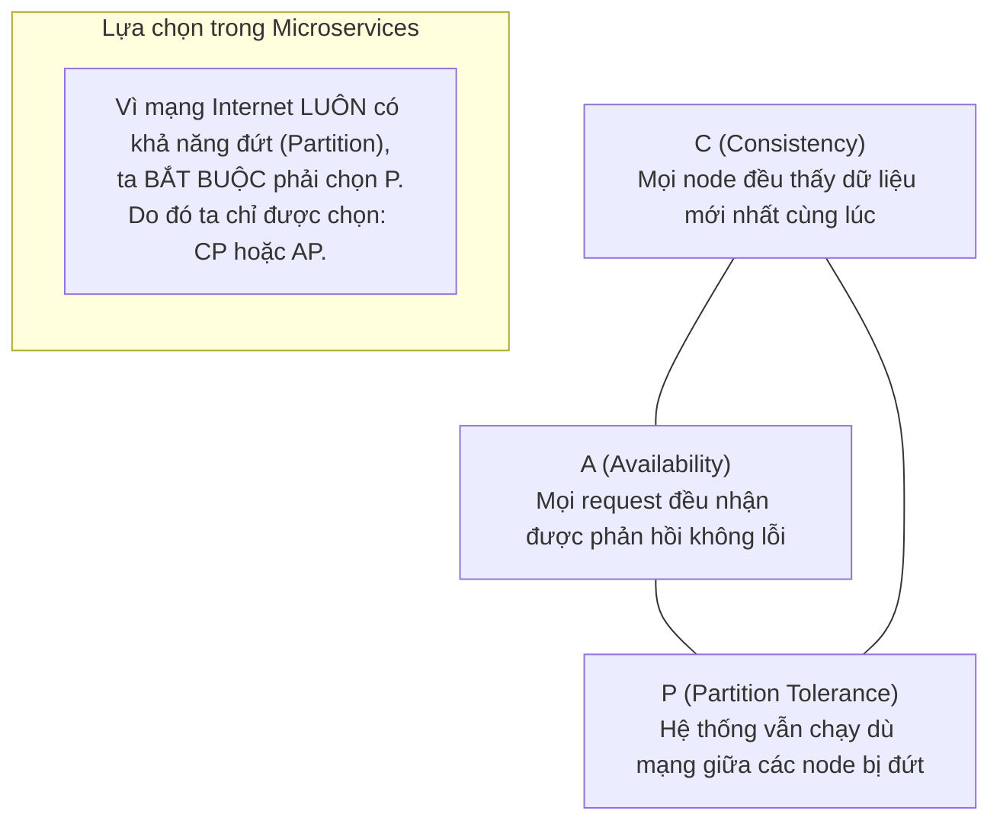
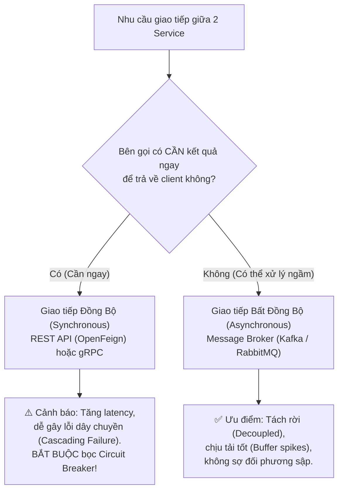
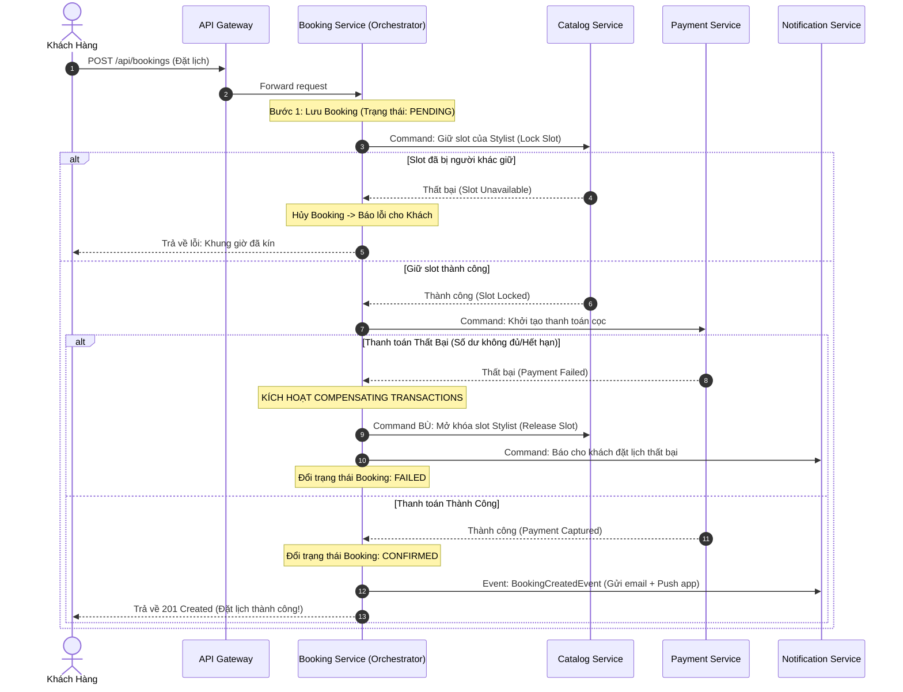
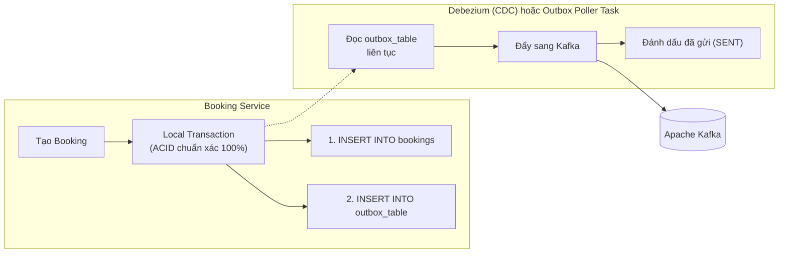
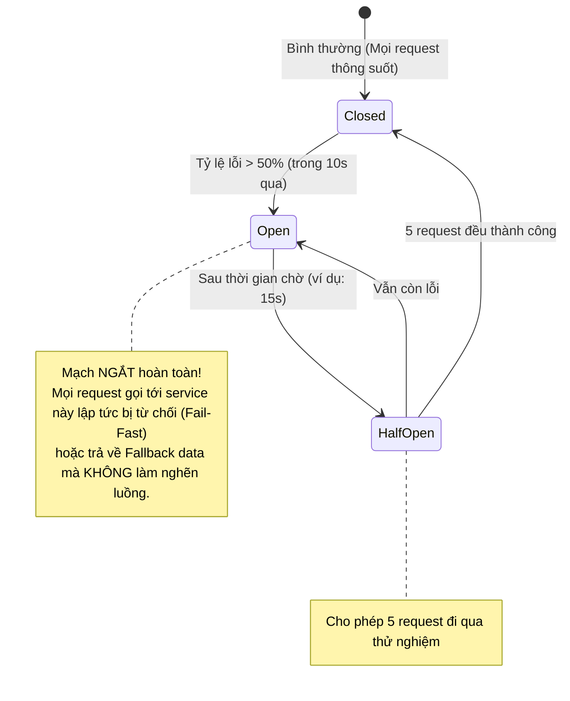
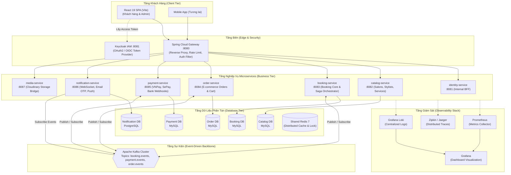
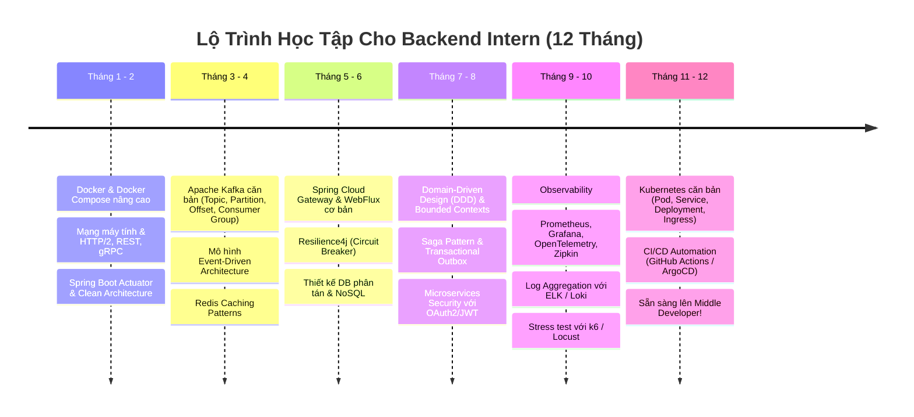

# 🚀 Kế Hoạch Toàn Diện Chuyển Đổi BookingSalon Sang Kiến Trúc Microservices
> **Dành cho:** Backend Intern Developer  
> **Mentor:** Senior Backend Architect / Tech Lead  
> **Dự án gốc:** `BookingSalon` (Spring Boot 3.5.3 · React 19 · Keycloak 26 · MySQL 8 · Redis 7)  
> **Tài liệu tham chiếu:** `UPGRADE_MICROSERVICE_PLAN.md`

---

## 📑 MỤC LỤC TỔNG QUAN

1. [Bức Thư Gửi Intern: Tâm Thế & Triết Lý Đúng Đắn](#1-bức-thư-gửi-intern-tâm-thế--triết-lý-đúng-đắn)
2. [Hiện Trạng BookingSalon & Những Điểm Nghẽn (Pain Points)](#2-hiện-trạng-bookingsalon--những-điểm-nghẽn-pain-points)
3. [Nền Tảng Lý Thuyết Cốt Lõi (Microservices Foundations)](#3-nền-tảng-lý-thuyết-cốt-lõi-microservices-foundations)
   - 3.1. Domain-Driven Design (DDD) & Bounded Context
   - 3.2. Định Lý CAP & Định Lý PACELC
   - 3.3. ACID vs BASE & Tính Nhất Quán Cuối Cùng (Eventual Consistency)
   - 3.4. Database-per-Service & Thách Thức Truy Vấn Phân Tán
   - 3.5. Cơ Chế Giao Tiếp: Sync (REST/gRPC) vs Async (Event-Driven)
   - 3.6. Saga Pattern: Quản Trị Phân Tán Không Cần 2PC
   - 3.7. Transactional Outbox Pattern & Tính Idempotent (Chống Trùng Lặp)
   - 3.8. Resilience Patterns: Circuit Breaker, Retry, Bulkhead, Rate Limit
   - 3.9. API Gateway & Mô Hình Backend-for-Frontend (BFF)
   - 3.10. Distributed Tracing & Centralized Observability
4. [Kiến Trúc Mục Tiêu (Target Architecture) Của BookingSalon](#4-kiến-trúc-mục-tiêu-target-architecture-của-bookingsalon)
5. [Chiến Lược Chuyển Đổi: Strangler Fig Pattern](#5-chiến-lược-chuyển-đổi-strangler-fig-pattern)
6. [Lộ Trình Nâng Cấp Từng Bước (Chi Tiết 9 Phases)](#6-lộ-trình-nâng-cấp-từng-bước-chi-tiết-9-phases)
   - Phase 0: Chuẩn Bị Tri Thức & Môi Trường
   - Phase 1: Xây Dựng Foundation (API Gateway + Kafka + Observability)
   - Phase 2: Tách Notification Service (Khởi động với Event-Driven)
   - Phase 3: Tách Media Service (Dịch vụ phi trạng thái - Stateless)
   - Phase 4: Tách Catalog Service (Dịch vụ đọc nhiều - Read Heavy)
   - Phase 5: Tách Identity & User Service (Keycloak Resource Server & BFF)
   - Phase 6: Tách Booking Service & Triển Khai Saga Orchestration
   - Phase 7: Tách Order & Payment Service (Xử lý giao dịch tài chính an toàn)
   - Phase 8: Tách Review & Voucher Service
   - Phase 9: Kubernetes (K8s) Orchestration & CI/CD GitOps Hoàn Chỉnh
7. [Lộ Trình Học Tập & Đọc Sách Cho Intern (Study Roadmap)](#7-lộ-trình-học-tập--đọc-sách-cho-intern-study-roadmap)
8. [Những Sai Lầm Kinh Điển Cần Tránh (Gotchas)](#8-những-sai-lầm-kinh-điển-cần-tránh-gotchas)
9. [Bảng Tra Cứu Công Nghệ & Tiêu Chí Nghiệm Thu (Definition of Done)](#9-bảng-tra-cứu-công-nghệ--tiêu-chí-nghiệm-thu-definition-of-done)

---

## 1. Bức Thư Gửi Intern: Tâm Thế & Triết Lý Đúng Đắn

Chào em,

Chúc mừng em đã bước chân vào thế giới của các hệ thống phân tán (Distributed Systems)! Microservices hiện nay là một từ khóa rất "hot", nhưng với vai trò là một người đi trước, anh muốn chia sẻ với em một sự thật quan trọng:

> [!IMPORTANT]
> **"Luật số 1 của Hệ thống Phân tán: Đừng phân tán hệ thống nếu em chưa thực sự cần."**  
> *(Martin Fowler - First Law of Distributed Object Design)*

Monolith không phải là "lạc hậu" hay "kém cỏi". Monolith là kiến trúc tuyệt vời để khởi nghiệp, ra mắt tính năng nhanh, debug dễ dàng và đảm bảo tính toàn vẹn dữ liệu qua transaction nội bộ. Microservices giải quyết bài toán về **tổ chức con người (Conway's Law)** và **khả năng mở rộng độc lập (Independent Scalability)**, nhưng nó phải trả giá bằng:
- Sự phức tạp của mạng (Network latency, network partitions, packet loss).
- Mất đi tính ACID truyền thống (không thể `JOIN` hai bảng ở hai database khác nhau).
- Khó khăn trong việc trace bug, debug, và kiểm thử cục bộ.

Kế hoạch này được anh viết riêng cho em, bám sát từng dòng code, từng Controller, Service hiện có trong dự án `BookingSalon`. Em hãy học với tâm thế: **Hiểu lý do đằng sau mỗi quyết định kỹ thuật trước khi gõ phím.**

---

## 2. Hiện Trạng BookingSalon & Những Điểm Nghẽn (Pain Points)

Hiện tại, `BookingSalon` là một **Modular Monolith** rất gọn gàng:
- 1 ứng dụng Spring Boot chạy trên port 8080.
- Kết nối tới 1 Database MySQL duy nhất (gần 28 bảng).
- 1 Redis Cache dùng chung.
- Tích hợp Keycloak 26 quản lý IAM.

```
┌────────────────────────────────────────────────────────────────────────┐
│                   BOOKINGSALON MONOLITH (1 Process)                    │
│                                                                        │
│   ┌───────────────┐  ┌───────────────┐  ┌───────────────────────────┐  │
│   │ Auth/User     │  │ Catalog/Salon │  │ Booking (Core Domain)     │  │
│   └───────────────┘  └───────────────┘  └───────────────────────────┘  │
│   ┌───────────────┐  ┌───────────────┐  ┌───────────────────────────┐  │
│   │ Order/Cart    │  │ Payment       │  │ Notification / WebSocket  │  │
│   └───────────────┘  └───────────────┘  └───────────────────────────┘  │
│                                                                        │
│          Shared Memory · In-Process Calls · Local DB Transactions      │
└────────────────────────────────────┬───────────────────────────────────┘
                                     │
                    ┌────────────────┴───────────────┐
                    │      MySQL 8 (Single Schema)   │
                    └────────────────────────────────┘
```

### Điểm nghẽn thực tế khi ứng dụng scale lên 100.000 users:
1. **Coupling trong Database (Liên kết bảng chéo):**  
   Bảng `bookings` khóa ngoại trực tiếp tới `users`, `salons`, `stylists`, `service_offerings`. Khi muốn tối ưu bảng `bookings`, em có thể vô tình làm ảnh hưởng tới truy vấn của `users`.
2. **Coupling trong Code:**  
   Ví dụ trong code hiện tại: `BookingService` gọi thẳng `NotificationService` và `NotificationWebSocketHandler`. Nếu mạng WebSocket bị nghẽn hoặc gửi email SMTP chậm, luồng tạo Booking có thể bị block hoặc timeout!
3. **Thắt cổ chai tài nguyên:**  
   Vào các khung giờ vàng (17h - 20h), lưu lượng đặt lịch (Booking) tăng vọt 500%, trong khi quản lý sản phẩm (Product/Catalog) hầu như không ai đụng đến. Với monolith, ta phải scale toàn bộ con server nặng nề thay vì chỉ scale module Booking.
4. **Rủi ro triển khai (Single Point of Failure):**  
   Một lỗi NullPointerException rò rỉ bộ nhớ (OOM) trong module `MediaController` (khi upload ảnh lớn) có thể làm sập luôn toàn bộ hệ thống thanh toán `PaymentController`.

---

## 3. Nền Tảng Lý Thuyết Cốt Lõi (Microservices Foundations)

### 3.1. Domain-Driven Design (DDD) & Bounded Context

Khái niệm sống còn khi làm Microservices: **Làm sao để biết chia một ứng dụng thành bao nhiêu service?**  
Câu trả lời nằm ở **DDD: Bounded Context**.

> **Bounded Context** là một ranh giới rõ ràng trong đó một mô hình nghiệp vụ (Domain Model) có ý nghĩa và hành vi nhất quán.

#### Ví dụ thực tế từ BookingSalon: Thực thể "User"
Trong Monolith hiện tại, em có class `User.java` chứa tất cả: `id`, `name`, `email`, `phone`, `avatar`, `bookings`, `orders`, `vouchers`.

Khi chia theo Bounded Context:
```
           ┌──────────────────────────────────────────────┐
           │            THỰC THỂ USER NGOÀI ĐỜI           │
           └──────────────────────┬───────────────────────┘
                                  │
         ┌────────────────────────┼────────────────────────┐
         ▼                        ▼                        ▼
┌──────────────────┐    ┌──────────────────┐    ┌──────────────────┐
│ Identity Context │    │ Booking Context  │    │  Order Context   │
├──────────────────┤    ├──────────────────┤    ├──────────────────┤
│ - userId         │    │ - customerId     │    │ - buyerId        │
│ - username       │    │ - customerName   │    │ - shippingAddress│
│ - passwordHash   │    │ - customerPhone  │    │ - recipientPhone │
│ - roles / tokens │    │ - notesForStylist│    │ - invoiceTaxCode │
└──────────────────┘    └──────────────────┘    └──────────────────┘
```
- **Identity Context:** Chỉ quan tâm đến tài khoản, mật khẩu, JWT token, quyền hạn.
- **Booking Context:** Chỉ quan tâm đến tên và số điện thoại để thợ làm tóc liên hệ. Không bao giờ cần biết password hay địa chỉ nhà.
- **Order Context:** Quan tâm đến địa chỉ giao hàng và mã số thuế.

---

### 3.2. Định Lý CAP & Định Lý PACELC

Khi một hệ thống phân tán qua mạng, định lý CAP phát biểu rằng em chỉ có thể chọn **tối đa 2 trong 3 yếu tố**:



- **CP (Consistency + Partition Tolerance):** Ưu tiên dữ liệu chính xác tuyệt đối. Nếu mạng chập chờn, thà từ chối phục vụ (Fail) chứ không trả dữ liệu cũ.  
  *Ví dụ:* Module **Payment** (Tiền bạc phải chuẩn xác từng xu).
- **AP (Availability + Partition Tolerance):** Ưu tiên luôn luôn trả lời người dùng. Chấp nhận dữ liệu có thể trễ vài giây (Eventual Consistency).  
  *Ví dụ:* Module **Review** hoặc **Catalog** (Khách xem danh sách salon chậm cập nhật 2 giây cũng không chết ai).

> [!NOTE]
> **Định lý PACELC mở rộng CAP:** Nếu có Partition (**P**), chọn giữa **A** và **C**. **E**lse (khi hệ thống bình thường), chọn giữa **L**atency (tốc độ) và **C**onsistency (nhất quán).

---

### 3.3. ACID vs BASE & Tính Nhất Quán Cuối Cùng (Eventual Consistency)

| Tiêu chí | ACID (Monolith) | BASE (Microservices) |
| :--- | :--- | :--- |
| **A** | **Atomicity:** Tất cả hoặc không có gì | **Basically Available:** Hệ thống cơ bản luôn sẵn sàng |
| **C** | **Consistency:** Dữ liệu luôn đúng quy tắc ngay lập tức | **Soft State:** Trạng thái có thể thay đổi dần theo thời gian |
| **I** | **Isolation:** Các transaction không can thiệp nhau | |
| **D** | **Durability:** Đã commit là lưu vĩnh viễn | **Eventual Consistency:** Dữ liệu cuối cùng sẽ nhất quán |

**Ví dụ trực quan:**  
Khi khách hàng bấm thanh toán đặt lịch:
- **ACID:** Database trừ tiền khách, đổi trạng thái booking sang CONFIRMED, trừ slot của stylist — tất cả trong **1 transaction duy nhất (10ms)**.
- **BASE:** Trừ tiền thành công ở Payment Service $\to$ bắn message sang Kafka $\to$ Booking Service đọc được message sau 200ms $\to$ cập nhật trạng thái. Trong 200ms đó, trạng thái là `PENDING_CONFIRMATION` (Soft state), nhưng cuối cùng nó sẽ chuyển sang `CONFIRMED` (Eventual Consistency).

---

### 3.4. Database-per-Service & Thách Thức Truy Vấn Phân Tán

Mỗi service phải sở hữu riêng Database của mình. **Không có bất kỳ service nào được phép chọc trực tiếp vào DB của service khác.**

```
❌ SAI (Anti-pattern: Shared Database):
   [Booking Service] ───┐
                        ├───► [ MySQL chung ] ◄─── [ Order Service ]
   [ User Service ]  ───┘

✅ ĐÚNG (Database per Service):
   [Booking Service] ──► [ Booking DB (MySQL) ]
   [Catalog Service] ──► [ Catalog DB (MySQL + Redis) ]
   [Notification]   ──► [ Notification DB (MongoDB / PostgreSQL) ]
```

#### Vậy giải quyết bài toán "JOIN dữ liệu" như thế nào?
Giả sử màn hình chi tiết đặt lịch cần: `Mã đặt lịch`, `Tên khách hàng`, `Tên Salon`, `Số tiền thanh toán`.
Trước đây: `SELECT * FROM bookings b JOIN users u ... JOIN salons s ...`

Trong Microservices có 2 cách chuẩn:
1. **API Composition (Gateway Aggregation):** API Gateway gọi song song 3 service qua HTTP/gRPC rồi gộp kết quả trả về cho Frontend. (Phù hợp cho màn hình chi tiết, ít dữ liệu).
2. **CQRS (Command Query Responsibility Segregation):** Sử dụng Kafka để đồng bộ một "bản sao dữ liệu đọc" (Read-optimized view) về một service chuyên đọc (hoặc Elasticsearch).

---

### 3.5. Cơ Chế Giao Tiếp: Sync vs Async



---

### 3.6. Saga Pattern: Quản Trị Phân Tán Không Cần 2PC

Khi một nghiệp vụ kéo dài qua nhiều service (ví dụ: Đặt lịch salon có thanh toán cọc), ta không thể dùng `@Transactional` của Spring được nữa. Giải pháp là **Saga Pattern**.

> **Saga** là một chuỗi các transaction cục bộ (local transactions). Mỗi transaction cập nhật DB của 1 service. Nếu một bước bị lỗi, Saga sẽ kích hoạt các **Compensating Transactions (Transaction bù trừ)** để hoàn tác lại những gì các bước trước đã làm.

Có 2 kiểu Saga:
1. **Choreography (Vũ đạo):** Các service tự lắng nghe event của nhau và tự hành động. (Phù hợp quy trình ngắn, 2-3 service).
2. **Orchestration (Nhạc trưởng):** Một service đứng ra làm "nhạc trưởng" điều phối, ra lệnh cho từng bên. (Phù hợp quy trình phức tạp như BookingSalon).

#### Workflow Saga Đặt Lịch (Booking Creation Flow):



---

### 3.7. Transactional Outbox Pattern & Tính Idempotent

Đây là kiến thức mà **90% ứng viên phỏng vấn junior/intern đều ngơ ngác khi được hỏi!**

#### Vấn đề: "Dual-Write Problem"
Xem đoạn code này trong monolith hiện tại:
```java
bookingRepository.save(booking); // Ghi vào MySQL
kafkaTemplate.send("booking-events", event); // Gửi vào Kafka
```
Chuyện gì xảy ra nếu `save()` xong, server sập điện trước khi kịp `send()`? Hoặc `send()` thành công nhưng DB bị rollback do timeout? Dữ liệu sẽ bị mất đồng bộ vĩnh viễn!

#### Giải pháp: Transactional Outbox Pattern
Ta lưu event vào **ngay trong cùng một database transaction** với bảng nghiệp vụ, sử dụng một bảng phụ tên là `outbox_table`.



#### Khái niệm Idempotent (Bảo vệ phía Consumer)
Vì Kafka đảm bảo chế độ giao hàng **At-least-once (Ít nhất một lần)**, mạng chập chờn có thể khiến 1 message bị gửi 2 lần.  
Consumer (bên nhận) **bắt buộc phải idempotent**: Nhận 10 lần cùng một event thì kết quả trong hệ thống chỉ được thực hiện 1 lần duy nhất (kiểm tra `message_id` trong Redis/DB trước khi trừ tiền hoặc gửi email).

---

### 3.8. Resilience Patterns: Tự Phục Hồi Khi Có Sự Cố

Trong hệ thống phân tán, sự cố mạng chắc chắn sẽ xảy ra. Ta dùng thư viện **Resilience4j**:



- **Circuit Breaker:** Ngăn chặn lỗi dây chuyền (Cascading Failure).
- **Retry:** Tự động thử lại khi gặp lỗi tạm thời (Transient error như chập chờn mạng 100ms) kèm **Exponential Backoff** (chờ 1s, 2s, 4s...).
- **Bulkhead:** Cô lập tài nguyên. Giới hạn Service A chỉ được dùng tối đa 20 thread trong pool để nếu Service A bị đơ, các Service B, C vẫn có thread để chạy.

---

### 3.9. API Gateway & Mô Hình Backend-for-Frontend (BFF)

Client (React SPA, Mobile App) không nên gọi trực tiếp đến từng microservice. Chúng giao tiếp qua **API Gateway**:

```
                             ┌────────────────────────────────────────┐
                             │       SPRING CLOUD API GATEWAY         │
                             │  - Port 8080 (Single Entry Point)      │
                             │  - JWT Token Authentication Filter     │
                             │  - Redis Rate Limiter (Chống Spam API) │
                             │  - Load Balancing                      │
                             └───────────────────┬────────────────────┘
                                                 │
         ┌───────────────────┬───────────────────┼───────────────────┐
         ▼                   ▼                   ▼                   ▼
┌─────────────────┐ ┌─────────────────┐ ┌─────────────────┐ ┌─────────────────┐
│ booking-service │ │ catalog-service │ │ payment-service │ │ notification-svc│
│   (Port 8082)   │ │   (Port 8083)   │ │   (Port 8084)   │ │   (Port 8085)   │
└─────────────────┘ └─────────────────┘ └─────────────────┘ └─────────────────┘
```

---

### 3.10. Distributed Tracing & Centralized Observability

Làm sao em biết được một request từ khách hàng chạy qua Gateway $\to$ Booking $\to$ Payment $\to$ Notification bị lỗi ở đâu và chậm ở bước nào?

```
Trace ID: a7f8d9c2e1 (Duy nhất cho toàn bộ vòng đời của 1 request từ Client)
├─ Span 1: API Gateway (45ms)
│  └─ Span 2: Booking Service (120ms)
│     ├─ Span 3: Catalog Service - Check Availability (30ms)
│     └─ Span 4: Payment Service - Charge Card (80ms)
│        └─ Span 5: MySQL Query - Insert transaction (5ms)
```

Công cụ: **Micrometer Tracing + Zipkin / Jaeger** giúp vẽ biểu đồ trực quan như trên.

---

## 4. Kiến Trúc Mục Tiêu (Target Architecture) Của BookingSalon

Dưới đây là sơ đồ kiến trúc hoàn chỉnh khi hệ thống đã chuyển đổi thành công:



---

## 5. Chiến Lược Chuyển Đổi: Strangler Fig Pattern

> [!CAUTION]
> **Tuyệt đối KHÔNG sử dụng chiến lược "Big Bang Rewrite" (Đập đi viết lại từ đầu).**  
> Dự án viết lại từ đầu thường mất từ 1 - 2 năm, thị trường thay đổi, bug cũ tái xuất hiện và 80% dự án dạng này thất bại!

Chúng ta áp dụng **Strangler Fig Pattern (Mô hình Cây Si Siết Cổ)**:
Lấy cảm hứng từ loài cây si trong rừng nhiệt đới: nó nảy mầm trên tán cây gỗ lớn cổ thụ, rễ của nó mọc dần xuống đất, bao bọc thân cây cũ từng chút một qua nhiều năm, cho đến khi cây cũ mục rỗng và chỉ còn lại cây si khỏe mạnh.

```
Giai đoạn 0:                  Giai đoạn giữa:               Giai đoạn đích:
┌─────────────────────┐       ┌───────────┬─────────┐       ┌─────────────────────┐
│                     │       │           │ Service │       │                     │
│  MONOLITH NGUYÊN BẢN│  ──►  │ MONOLITH  │ Mới 1,2 │  ──►  │ CÁC MICROSERVICES   │
│   (100% Request)    │       │  (60%)    │ (40%)   │       │   (100% Request)    │
│                     │       └───────────┴─────────┘       │                     │
└─────────────────────┘            ▲           ▲            └─────────────────────┘
                                   │           │
                              [ API Gateway điều phối ]
```

---

## 6. Lộ Trình Nâng Cấp Từng Bước (Chi Tiết 9 Phases)

### 📌 Phase 0: Chuẩn Bị Tri Thức & Môi Trường
*Thời gian dự kiến:* **Tháng thứ 1**  
*Mục tiêu:* Intern làm quen với Docker, công cụ dòng lệnh, và thiết lập môi trường phát triển microservice chuẩn chỉ.

#### Checklist công việc:
- [x] Đọc hiểu toàn bộ file `Microservices_Architecture_Guide.md` hiện có trong source code.
- [x] Cài đặt Docker Desktop, Docker Compose v2, Lens/k9s (nếu học K8s).
- [x] Thực hành cấu hình mạng Docker Network nội bộ (`bridge` network) để các container tự phân giải tên miền (DNS).
- [x] Tạo file `.env` chuẩn, bỏ toàn bộ hardcoded password `Bach@vt05` ra khỏi source code.

---

### 📌 Phase 1: Xây Dựng Foundation (API Gateway + Kafka + Observability)
*Thời gian dự kiến:* **Tháng thứ 2**  
*Mục tiêu:* Thiết lập hạ tầng xương sống trước khi chạm vào bất kỳ dòng code business nào. Monolith vẫn xử lý 100% logic, nhưng request từ client bắt đầu đi qua Gateway.

#### 1. Tạo project `api-gateway` (Spring Cloud Gateway)
Tạo folder mới độc lập: `services/api-gateway`.

```xml
<!-- pom.xml của api-gateway -->
<dependencies>
    <dependency>
        <groupId>org.springframework.cloud</groupId>
        <artifactId>spring-cloud-starter-gateway</artifactId>
    </dependency>
    <dependency>
        <groupId>org.springframework.boot</groupId>
        <artifactId>spring-boot-starter-data-redis-reactive</artifactId>
    </dependency>
</dependencies>
```

```yaml
# application.yml trong api-gateway
server:
  port: 8080

spring:
  cloud:
    gateway:
      routes:
        # Tạm thời route toàn bộ request về con Monolith hiện tại (đang đổi sang port 8089)
        - id: legacy-monolith
          uri: http://bookingsalon-monolith:8089
          predicates:
            - Path=/api/**, /ws/**
```

#### 2. Dựng cụm Apache Kafka với Docker Compose
Thêm Kafka (KRaft mode không cần Zookeeper) vào file `docker-compose.yml`:

```yaml
  kafka:
    image: confluentinc/cp-kafka:7.6.0
    container_name: bookingsalon_kafka
    ports:
      - "9092:9092"
    environment:
      KAFKA_NODE_ID: 1
      KAFKA_LISTENER_SECURITY_PROTOCOL_MAP: 'CONTROLLER:PLAINTEXT,PLAINTEXT:PLAINTEXT,PLAINTEXT_HOST:PLAINTEXT'
      KAFKA_ADVERTISED_LISTENERS: 'PLAINTEXT://kafka:29092,PLAINTEXT_HOST://localhost:9092'
      KAFKA_PROCESS_ROLES: 'broker,controller'
      KAFKA_CONTROLLER_QUORUM_VOTERS: '1@kafka:29093'
      KAFKA_LISTENERS: 'PLAINTEXT://0.0.0.0:29092,CONTROLLER://0.0.0.0:29093,PLAINTEXT_HOST://0.0.0.0:9092'
      KAFKA_INTER_BROKER_LISTENER_NAME: 'PLAINTEXT'
      KAFKA_CONTROLLER_LISTENER_NAMES: 'CONTROLLER'
      CLUSTER_ID: '4L622nShTWWkrFuMmupMeg'
```

#### 3. Bổ sung Distributed Tracing vào Monolith
Thêm dependency vào `backend/pom.xml`:
```xml
<dependency>
    <groupId>io.micrometer</groupId>
    <artifactId>micrometer-tracing-bridge-brave</artifactId>
</dependency>
<dependency>
    <groupId>io.zipkin.reporter2</groupId>
    <artifactId>zipkin-reporter-brave</artifactId>
</dependency>
```

**Definition of Done (DoD) Phase 1:**
- [x] Client gọi qua `http://localhost:8080/api/...` (Gateway) thì Monolith vẫn phản hồi bình thường.
- [x] Kafka Web UI (Kafdrop) truy cập được tại `http://localhost:9000`.
- [x] Log trên terminal của Monolith xuất hiện `[traceId, spanId]` ở mỗi dòng log.

---

### 📌 Phase 2: Tách Notification Service (Khởi Động Với Event-Driven)
*Thời gian dự kiến:* **Tháng thứ 3**  
*Tại sao chọn service này đầu tiên?*  
Notification là module **dễ nhất**: nghiệp vụ thuần túy là nhận tin và gửi đi (Email/WebSocket), không có quan hệ dữ liệu phức tạp, nếu có chết tạm thời thì khách hàng vẫn đặt lịch được (hệ thống không bị sập).

#### Bước 2.1: Tận dụng Event sẵn có trong Monolith
Dự án của em hiện tại đã có `BookingEventPublisher.java` và `BookingCreatedEvent.java`!  
Hiện tại nó đang dùng Spring `ApplicationEventPublisher` (chỉ chạy trong 1 máy). Em sẽ nâng cấp nó để bắn ra **Kafka Topic**:

```java
// Trong Monolith: Cải tiến BookingEventPublisher.java
@Component
@RequiredArgsConstructor
@Slf4j
public class BookingEventPublisher {
    
    // Giữ lại event nội bộ để không phá hỏng luồng cũ
    private final ApplicationEventPublisher applicationEventPublisher;
    
    // Thêm KafkaTemplate để bắn ra ngoài thế giới
    private final KafkaTemplate<String, Object> kafkaTemplate;

    public void publishBookingCreatedEvent(Booking booking, User user, Salon salon) {
        BookingCreatedEvent event = BookingCreatedEvent.builder()
                .userId(user.getId())
                .bookingId(booking.getId())
                .email(user.getEmail())
                .startTime(booking.getStartTime())
                .endTime(booking.getEndTime())
                .salonName(salon.getSalonName())
                .salonAddress(salon.getAddress())
                .totalAmount(booking.getTotalAmount())
                .build();

        // 1. Bắn nội bộ (vẫn giữ nguyên cho monolith)
        applicationEventPublisher.publishEvent(event);

        // 2. Bắn sang Kafka cho Notification Service tương lai nhận!
        kafkaTemplate.send("booking.events", booking.getId().toString(), event)
            .whenComplete((result, ex) -> {
                if (ex != null) {
                    log.error("Lỗi bắn Kafka event bookingId: {}", booking.getId(), ex);
                } else {
                    log.info("Đã gửi event BookingCreated lên Kafka thành công: offset {}", 
                             result.getRecordMetadata().offset());
                }
            });
    }
}
```

#### Bước 2.2: Khởi tạo project `notification-service`
Tạo project Spring Boot mới:
- Cổng chạy: `8086`
- Phụ trách: WebSocket server, SMTP Mail Sender, Lưu lịch sử notification.
- Lắng nghe Kafka Topic: `booking.events`.

```java
// Trong notification-service:
@Service
@Slf4j
@RequiredArgsConstructor
public class NotificationKafkaConsumer {

    private final JavaMailSender mailSender;
    private final SimpMessagingTemplate messagingTemplate; // WebSocket

    @KafkaListener(topics = "booking.events", groupId = "notification-group")
    public void consumeBookingEvent(BookingCreatedEvent event) {
        log.info("Notification Service nhận được event booking: {}", event.getBookingId());

        // 1. Gửi Email xác nhận bất đồng bộ
        sendEmail(event);

        // 2. Bắn thông báo real-time qua WebSocket tới trình duyệt của User
        messagingTemplate.convertAndSendToUser(
            event.getUserId().toString(), 
            "/topic/notifications", 
            "Lịch hẹn tại " + event.getSalonName() + " của bạn đã được xác nhận!"
        );
    }
}
```

#### Bước 2.3: Chuyển hướng Route trên API Gateway
Sửa `application.yml` của Gateway:
```yaml
        # Tách riêng traffic WebSocket và API Notification sang service mới
        - id: notification-service
          uri: http://notification-service:8086
          predicates:
            - Path=/api/v1/notifications/**, /ws/**
            
        # Các API còn lại vẫn về Monolith
        - id: legacy-monolith
          uri: http://bookingsalon-monolith:8089
          predicates:
            - Path=/api/**
```

**Definition of Done (DoD) Phase 2:**
- [x] Tạo booking trên Monolith $\to$ Notification Service nhận message từ Kafka $\to$ Email vẫn gửi về Gmail $\to$ Frontend nhận thông báo chuông qua WebSocket.
- [x] Xóa bỏ class `EmailListener.java` và thư viện gửi mail trong Monolith.

---

### 📌 Phase 3: Tách Media Service (Dịch Vụ Phi Trạng Thái - Stateless)
*Thời gian dự kiến:* **Tháng thứ 4**  
*Mục tiêu:* Tách module upload ảnh/video Cloudinary ra khỏi Monolith.

Media là dịch vụ **stateless** (không lưu trữ state phức tạp, chỉ nhận file multipart, gọi Cloudinary API, lưu URL và trả về). Khi người dùng upload ảnh hàng chục MB, CPU/RAM xử lý ảnh sẽ nằm ở `media-service`, hoàn toàn không gây chậm hệ thống chính.

**Checklist:**
- [ ] Bóc tách `MediaController.java` và `CloudinaryStorageService.java` sang service mới `media-service` (Port: 8087).
- [ ] Thiết lập bảng `media` riêng trong Database `media_db`.
- [ ] Định tuyến `/api/v1/media/**` tại Gateway về `media-service`.

---

### 📌 Phase 4: Tách Catalog Service (Dịch Vụ Đọc Nhiều - Read Heavy)
*Thời gian dự kiến:* **Tháng thứ 5 - 6**  
*Mục tiêu:* Tách các thực thể danh mục: Salon, Stylist, ServiceOffering, Category, Product.

#### Đặc thù nghiệp vụ:
- 90% lượng request vào Catalog là **READ (Xem danh sách salon, tìm thợ, xem bảng giá)**.
- Chỉ 10% là **WRITE** (Admin sửa giá, thêm salon mới).
- Áp dụng chiến lược: **Multi-Level Cache (Redis + In-Memory Caffeine Cache)**.

```
Client ──► Gateway ──► Catalog Service ──► Kiểm tra Redis (TTL: 10 phút)
                              │
                    (Nếu Cache Miss)
                              ▼
                      Catalog MySQL DB
```

#### Xử lý khóa ngoại (Foreign Key) khi tách:
Trong DB Monolith: Bảng `stylists` có `salon_id` trỏ thẳng tới bảng `salons`.  
*Khi tách DB:* Bảng `stylists` vẫn lưu cột `salon_id` (kiểu UUID/Long), nhưng **xóa bỏ Foreign Key Constraint vật lý**. Mối quan hệ được duy trì ở mức logic ứng dụng.

---

### 📌 Phase 5: Tách Identity & User Service (Keycloak Resource Server & BFF)
*Thời gian dự kiến:* **Tháng thứ 7**  
*Mục tiêu:* Quản lý thông tin profile người dùng, phân quyền và xác thực JWT tập trung.

Hiện tại `BookingSalon` đã dùng Keycloak 26, đây là lợi thế cực kỳ lớn!
- API Gateway sẽ đóng vai trò **OAuth2 Resource Server**: Giải mã JWT token, kiểm tra chữ ký (Signature Verification), trích xuất `userId` và `roles`.
- Gateway inject thông tin người dùng vào HTTP Request Headers trước khi chuyển tiếp vào các microservice nội bộ:

```yaml
# Cấu hình Gateway tự động đẩy Header vào service bên trong:
filters:
  - AddRequestHeader=X-User-Id, #{token.claims['sub']}
  - AddRequestHeader=X-User-Roles, #{token.claims['realm_access']['roles']}
```
Các service phía sau chỉ cần đọc `@RequestHeader("X-User-Id") UUID userId` mà không cần phải kết nối tới Keycloak nữa!

---

### 📌 Phase 6: Tách Booking Service & Triển Khai Saga Orchestration
*Thời gian dự kiến:* **Tháng thứ 8 - 9**  
*Độ khó:* ⭐⭐⭐⭐⭐ (Khó nhất - Trọng tâm của hệ thống)

#### Bản chất kỹ thuật:
Booking Service là hạt nhân của tiệm tóc. Nó cần phối hợp:
1. Kiểm tra thợ (Stylist) có rảnh không $\to$ Gọi `catalog-service`.
2. Khởi tạo đặt lịch $\to$ Lưu vào `booking_db`.
3. Yêu cầu thanh toán cọc $\to$ Gọi `payment-service`.
4. Nếu thanh toán thành công $\to$ Bắn event sang `notification-service`.

#### Code thực tế: Saga Orchestrator với Spring State Machine / Event Coordinator
Tại `booking-service`, em tạo một bảng trạng thái `booking_saga_state`:

| saga_id | booking_id | current_step | status | payload |
| :--- | :--- | :--- | :--- | :--- |
| `uuid-1` | `bk-999` | `LOCK_STYLIST_SLOT` | `SUCCESS` | `{...}` |
| `uuid-1` | `bk-999` | `PROCESS_PAYMENT` | `FAILED` | `Reason: Timeout` |
| `uuid-1` | `bk-999` | `COMPENSATE_SLOT` | `EXECUTING` | `{...}` |

```java
// Minh họa mã nguồn xử lý Compensating Transaction trong BookingSagaCoordinator:
@Component
@Slf4j
@RequiredArgsConstructor
public class BookingSagaCoordinator {

    private final KafkaTemplate<String, Object> kafkaTemplate;
    private final BookingRepository bookingRepository;

    // Khi nhận được event thanh toán thất bại từ Kafka:
    @KafkaListener(topics = "payment.events", groupId = "booking-saga-group")
    public void handlePaymentFailed(PaymentFailedEvent event) {
        log.warn("Saga: Nhận tin thanh toán thất bại cho bookingId: {}", event.getBookingId());

        Booking booking = bookingRepository.findById(event.getBookingId()).orElseThrow();
        booking.setStatus(BookingStatus.CANCELLED);
        bookingRepository.save(booking);

        // KÍCH HOẠT HÀNH ĐỘNG BÙ TRỪ (COMPENSATING):
        // Bắn message yêu cầu Catalog Service giải phóng giờ hẹn của Stylist
        ReleaseStylistSlotCommand compensateCommand = new ReleaseStylistSlotCommand(
            booking.getStylistId(), 
            booking.getStartTime()
        );
        kafkaTemplate.send("catalog.commands.release-slot", compensateCommand);
        log.info("Saga: Đã gửi lệnh bồi hoàn giải phóng slot cho Stylist {}", booking.getStylistId());
    }
}
```

---

### 📌 Phase 7: Tách Order & Payment Service
*Thời gian dự kiến:* **Tháng thứ 10 - 11**  
*Mục tiêu:* Đóng gói luồng thanh toán VNPay, SePay và Webhook ngân hàng an toàn tuyệt đối.

#### Yêu cầu sống còn cho Payment Service:
1. **Idempotency Key:** Mọi API gọi thanh toán đều phải kèm header `Idempotency-Key: <UUID>`. Lưu key này vào Redis với TTL 15 phút. Nếu khách bấm 2 lần liên tục nút "Thanh toán", request thứ 2 bị chặn lại ngay lập tức.
2. **Xử lý Webhook ngân hàng (VNPay/SePay):**  
   Webhook có thể gửi chậm, hoặc gửi lặp lại 3 lần. Payment Service phải lưu `transaction_reference_id` và kiểm tra: nếu trạng thái đơn hàng đã là `PAID`, bỏ qua webhook trùng lặp và trả về ngay `{"RspCode": "00", "Message": "Confirm Success"}`.

---

### 📌 Phase 8: Tách Review & Voucher Service
*Thời gian dự kiến:* **Tháng thứ 12**  
*Mục tiêu:* Tách hai module phụ trợ còn lại.

- `review-service`: Độc lập, lắng nghe event `BookingCompleted` và `OrderDelivered` để mở quyền cho người dùng đánh giá sao.
- `voucher-service`: Quản lý kho mã giảm giá, áp dụng Redis Rate Limiting nghiêm ngặt để chống bot săn voucher làm sập hệ sinh thái.

---

### 📌 Phase 9: Kubernetes (K8s) Orchestration & CI/CD GitOps Hoàn Chỉnh
*Thời gian dự kiến:* **Tháng thứ 13 trở đi**  
*Mục tiêu:* Đưa toàn bộ các container lên môi trường Kubernetes với khả năng Auto-scaling và tự phục hồi.

```
                         KUBERNETES CLUSTER (Production)
┌─────────────────────────────────────────────────────────────────────────┐
│                                                                         │
│   Ingress Controller (NGINX / Traefik)                                  │
│         │                                                               │
│         ▼                                                               │
│   [Pod: API Gateway] (Replicas: 2)                                      │
│         │                                                               │
│         ├──────────────► [Pod: Booking Service] (HPA: Scale 2 -> 10 Pods)│
│         ├──────────────► [Pod: Catalog Service] (HPA: Scale 2 -> 6 Pods) │
│         └──────────────► [Pod: Payment Service] (Replicas: 2)           │
│                                                                         │
│   Kubernetes Cluster IP Services · ConfigMaps · Secrets · PVC Storage   │
└─────────────────────────────────────────────────────────────────────────┘
```

#### Thiết lập K8s Deployment mẫu cho `booking-service`:
```yaml
apiVersion: apps/v1
kind: Deployment
metadata:
  name: booking-service
  labels:
    app: booking-service
spec:
  replicas: 2
  selector:
    matchLabels:
      app: booking-service
  template:
    metadata:
      labels:
        app: booking-service
    spec:
      containers:
      - name: booking-service
        image: nguyenbach/bookingsalon-booking-service:sha-a8f3b21
        ports:
        - containerPort: 8083
        resources:
          requests:
            memory: "512Mi"
            cpu: "250m"
          limits:
            memory: "1024Mi"
            cpu: "500m"
        livenessProbe:
          httpGet:
            path: /actuator/health/liveness
            port: 8083
          initialDelaySeconds: 40
          periodSeconds: 10
        readinessProbe:
          httpGet:
            path: /actuator/health/readiness
            port: 8083
          initialDelaySeconds: 20
          periodSeconds: 5
```

---

## 7. Lộ Trình Học Tập & Đọc Sách Cho Intern (Study Roadmap)

Để thực hiện thành công kế hoạch trên, em cần bổ sung kiến thức theo lộ trình sau:



### 📚 3 Cuốn Sách "Gối Đầu Giường" Bắt Buộc Phải Đọc:
1. **"Monolith to Microservices"** - *Sam Newman* (Cuốn sách hay nhất thế giới về các kỹ thuật bóc tách hệ thống từng bước).
2. **"Designing Data-Intensive Applications" (DDIA)** - *Martin Kleppmann* (Kinh thánh về hệ thống dữ liệu, giải thích cặn kẽ về CAP, Consensus, Replication, Partitioning).
3. **"Microservices Patterns: With examples in Java"** - *Chris Richardson* (Hướng dẫn cực kỳ chi tiết về Saga, CQRS, Outbox pattern viết riêng cho dân Spring Boot).

---

## 8. Những Sai Lầm Kinh Điển Cần Tránh (Gotchas)

> [!WARNING]
> Dưới đây là những "cái bẫy" mà các bạn lập trình viên mới làm Microservices thường xuyên mắc phải:

1. **Sai lầm 1: Tạo ra một "Distributed Monolith" (Monolith Phân Tán):**  
   Tách code thành 7 projects khác nhau nhưng các service gọi REST API lẫn nhau theo kiểu chuỗi domino (`Gateway` $\to$ `Booking` $\to$ `Catalog` $\to$ `User` $\to$ `Payment`). Khi `User` bị chậm, toàn bộ hệ sinh thái chết đứng!  
   *Cách khắc phục:* Chuyển sang Event-driven bất đồng bộ qua Kafka càng nhiều càng tốt.
2. **Sai lầm 2: Vẫn dùng chung 1 Database MySQL duy nhất:**  
   Code thì tách ra nhiều repo nhưng tất cả cùng cắm chung Connection String vào 1 Database MySQL. Chỉ cần 1 bên thay đổi tên cột hoặc khóa bảng (Table Lock) là các bên khác lăn ra chết.  
   *Cách khắc phục:* Kiên quyết thực hiện Database-per-Service.
3. **Sai lầm 3: Quên cấu hình Connection Timeout:**  
   Khi gọi service khác bằng REST, nếu không cấu hình `readTimeout` và `connectTimeout`, thread của ứng dụng sẽ bị treo vô thời hạn khi đối phương gặp sự cố.  
   *Quy tắc:* Mọi kết nối mạng nội bộ đều phải có timeout $\le$ 3 - 5 giây.
4. **Sai lầm 4: Bỏ qua tính Idempotent:**  
   Gửi email 2 lần khách hàng chỉ thấy phiền, nhưng trừ tiền cọc của khách 2 lần là công ty bị khiếu nại! Mọi consumer nhận message tài chính bắt buộc phải kiểm tra trùng lặp.
5. **Sai lầm 5: Đam mê công nghệ mới mà quên nghiệp vụ:**  
   Cố gắng nhồi nhét Kubernetes, Istio Service Mesh, gRPC, Kafka vào ngay ngày đầu tiên khi chưa hiểu rõ bài toán nghiệp vụ của tiệm tóc. Hãy làm từ đơn giản đến phức tạp.

---

## 9. Bảng Tra Cứu Công Nghệ & Tiêu Chí Nghiệm Thu

### 🛠️ Bảng Quyết Định Công Nghệ (Tech Stack Matrix)

| Thành Phần | Công Nghệ Lựa Chọn | Lý Do Chọn | Giải Pháp Thay Thế |
| :--- | :--- | :--- | :--- |
| **Language & Framework** | Java 21 + Spring Boot 3.5.x | Tận dụng 100% code hiện tại, Virtual Threads (Project Loom) cực mạnh | Go (Golang), Node.js |
| **API Gateway** | Spring Cloud Gateway | Nằm cùng hệ sinh thái Spring, lập trình bằng Java, hỗ trợ reactive non-blocking | Kong, Nginx, Envoy |
| **Message Broker** | Apache Kafka | Throughput cao, lưu vết event (log retention), hỗ trợ Replay event khi có sự cố | RabbitMQ, AWS SQS |
| **IAM & SSO** | Keycloak 26 | Đã có sẵn trong dự án, chuẩn OAuth2/OIDC, quản lý user chuyên nghiệp | Auth0, Ory Kratos |
| **Resilience** | Resilience4j | Nhẹ, thiết kế cho Java 17/21, tích hợp mượt mà với Spring Boot Actuator | Netflix Hystrix (Đã cũ) |
| **Observability** | Prometheus + Grafana + Zipkin | Bộ ba tiêu chuẩn công nghiệp (De-facto standard), mã nguồn mở, cộng đồng lớn | Datadog (Có phí), ELK |

### 🏁 Tiêu Chí Nghiệm Thu Toàn Diện (Definition of Done - DoD)
Một microservice chỉ được coi là hoàn thiện chuẩn Production khi thỏa mãn **8 điều kiện bắt buộc**:
- [ ] **DB độc lập:** Có database riêng biệt, không có FK liên kết với bảng ngoài.
- [ ] **Config động:** Đọc toàn bộ tham số qua Environment Variables, không chứa credentials nhạy cảm trong code.
- [ ] **Health Checks:** Cung cấp đầy đủ 2 endpoints `/actuator/health/liveness` và `/actuator/health/readiness`.
- [ ] **Metrics & Trace:** Tự động gửi metrics về Prometheus và trace headers (`traceparent`) qua Zipkin.
- [ ] **Xử lý sự cố:** Các API gọi ra ngoài đều được bọc Circuit Breaker và có cơ chế Fallback an toàn.
- [ ] **Non-root Container:** Dockerfile đóng gói dạng multi-stage và chạy dưới tài khoản không có quyền root (`appuser`).
- [ ] **Automated Tests:** Unit test đạt độ bao phủ (coverage) $\ge 75\%$, có integration test cho các luồng Kafka Consumer/Producer.
- [ ] **CI/CD Pipeline:** Tự động build, test, scan lỗ hổng bằng Trivy và build image gắn tag commit SHA khi push lên Git.

---

## 🎯 Lời Kết Dành Cho Em

Con đường chuyển đổi từ Monolith lên Microservices là một hành trình dài (thường tính bằng năm), đòi hỏi sự kiên nhẫn, kỷ luật và kiến thức nền tảng vững vàng. Em không cần phải vội vã triển khai tất cả mọi thứ cùng một lúc.

**Bước đầu tiên của em vào ngày mai:**  
Hãy bắt đầu với **Phase 0 và Phase 1** — tạo một module `api-gateway` nhỏ, cấu hình Docker Compose chạy Kafka, và thử cho một request chạy xuyên qua Gateway vào Monolith. Khi em nhìn thấy dòng log đầu tiên xuất hiện `Trace ID`, đó là lúc em đã chính thức bước chân vào thế giới của một Kỹ sư Hệ thống Phân tán thực thụ!

*Chúc em có một hành trình học tập và nâng cấp dự án thật nhiều hứng khởi và thành công!* 🚀

